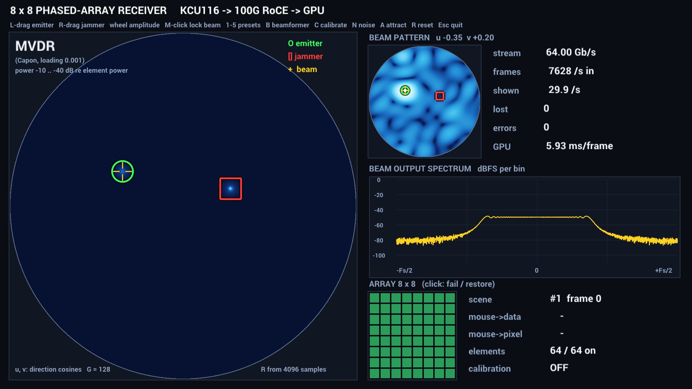
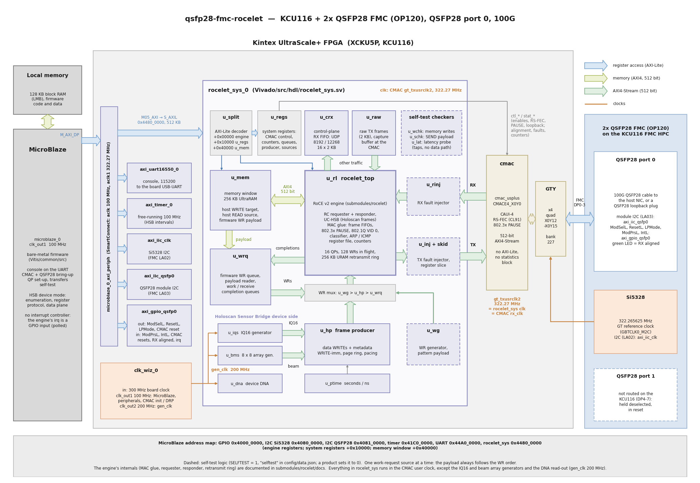

# qsfp28-fmc-rocelet

An open-source, lightweight **RoCE v2** (RDMA over Converged Ethernet) engine for AMD FPGAs,
with reference designs for the [Opsero 2x QSFP28 FMC](https://docs.opsero.com) (OP120) on AMD
development boards: **100G on the KCU116** (integrated 100G MAC) and **40G on the ZCU106**
(open-source [omac](https://omac.ethernetfmc.com) Ethernet MACs, license-free, Linux on the
Cortex-A53; 10G as a build option).

> **Status: version 0.5.0** (2026-11-05), rocelet v0.3.0, opsero-ethernet-mac v0.1.0. Validated on
> hardware against an NVIDIA ConnectX-6 Dx. **kcu116** (100G DAC, RS-FEC): RDMA at line rate in
> both directions, loss recovery, link loss including a real cable pull, the built-in self-test,
> the Holoscan Sensor Bridge device mode with NVIDIA's HSB 3.0.0 host software (RoCE into GPU
> memory up to 80 Gb/s on the test host), and the beamforming demo. **zcu106** (new in 0.5.0,
> 40G, FEC off): RDMA at 40G line rate into on-chip memory and into PS DDR, PAUSE both ways, the
> self-test, the HSB device mode and the beamforming demo at up to 40 Gb/s, controlled from
> Linux (daemon, command line, web UI, a network interface on the 40G port). See the
> [revision history](https://qsfp28-rocelet.ethernetfmc.com/en/latest/revision_history.html) in the docs
> for the measurements and the known limitations.

Important links:

* The user guide for this reference design is hosted here: [rocelet RoCE v2 reference design docs](https://qsfp28-rocelet.ethernetfmc.com "rocelet RoCE v2 reference design docs")
* The engine's own documentation (architecture, interface, register map, integration, host rules): [rocelet docs](https://rocelet.ethernetfmc.com "rocelet docs")
* The open-source Ethernet MACs of the ZCU106 target: [omac docs](https://omac.ethernetfmc.com "omac docs")
* Datasheet of the [2x QSFP28 FMC]
* The engine's source code: [rocelet on GitHub](https://github.com/fpgadeveloper/rocelet "rocelet on GitHub")
* To report a bug: [Report an issue](https://github.com/fpgadeveloper/qsfp28-fmc-rocelet/issues "Report an issue").
* For technical support: [Contact Opsero](https://opsero.com/contact-us "Contact Opsero").
* To purchase the mezzanine card: [2x QSFP28 FMC order page](https://opsero.com/product/2x-qsfp28-fmc "2x QSFP28 FMC order page").

## Beamforming demo



The KCU116 plays the digitiser of an 8 x 8 phased-array receiver: an array generator in the
FPGA streams the samples of all 64 antenna elements over rocelet (Holoscan Sensor Bridge data
plane) into GPU memory, at up to 80 Gb/s on the test host. A CuPy beamformer on the GPU draws a
"radio camera" picture of the sky (conventional and MVDR), the steered beam's pattern and its
spectrum in a Holoviz window. Dragging the emitter or the jammer writes the new scene back to
the FPGA over the HSB register protocol; the picture follows within a frame or two (mouse to
data 1.5-2.7 ms, every frame checked bit-exact at 10-80 Gb/s). The keys - / + change the stream
rate while it runs.

```
rl> hsb on                                                                      # on the board's console
RL_WIN=1 sw/beam/run.sh python3 rocelet_beam_app.py --source roce --preset 2 --rate 64 --ibv-name <rdma-dev>   # on the GPU host
```

Details, presets and measurements: [Beamforming demo](https://qsfp28-rocelet.ethernetfmc.com/en/latest/beam_demo.html);
the GPU host from a bare PC to the demo: [Host setup](https://qsfp28-rocelet.ethernetfmc.com/en/latest/host_setup.html).

## Why

AMD's ERNIC IP implements a full RoCE v2 stack, but it is large (about 42k LUTs plus the
interconnect, buffers and queues it needs on a Kintex UltraScale+) and it is paid, licensed IP.
Most FPGA RoCE applications stream data between an FPGA and a host or GPU over a point-to-point
link and need only a small part of the protocol. [rocelet](https://github.com/fpgadeveloper/rocelet), the open-source RoCE v2 engine this design is built around, implements that part:

- RC (reliable connection) transport as **requester**: RDMA WRITE, WRITE with immediate, SEND,
  SEND with immediate, multi-packet messages, go-back-N retransmission with an on-chip
  retransmit ring (zero loss, interoperable with standard NICs).
- RC **responder**: RDMA WRITE and SEND from the host into FPGA memory, RDMA READ of FPGA
  memory by the host, full duplicate and NAK handling.
- IPv4/UDP framing, TX and RX ICRC, PMTU 256-4096, 802.3x pause honoured and generated,
  out-of-band QP setup (a host helper based on libibverbs exchanges QPN, PSN, rkey and buffer
  addresses; no in-band connection manager).
- Written in SystemVerilog, a 512-bit engine at the MAC user clock: the 100G CMAC at
  322 MHz, or a 40G / 10G MAC (256 / 64 bits) at 156.25 MHz through built-in width converters.

## Description

The **kcu116** design puts the rocelet engine between the Kintex UltraScale+ integrated 100G
Ethernet MAC (CMAC, with RS-FEC) on QSFP28 port 0 of the 2x QSFP28 FMC and an on-chip memory
window (256 KB of UltraRAM), with a MicroBlaze that sets up the link and the queue pairs:



* **rocelet** (git submodule `submodules/rocelet`, MIT): RoCE v2 engine, MAC glue (frame FIFOs,
  802.3x PAUSE, 802.1Q priority tags), ARP/ICMP responder, AXI4 memory master.
* **Memory window**: the target of host RDMA WRITEs, the source of host RDMA READs and of the
  payload of the FPGA's own WRITEs/SENDs; also mapped into the MicroBlaze address space.
* **Console** (UART, 115200 baud): link status, QP setup through the same one-line parameter
  records as the host helper (`RLH`/`RLHM` in, `RLF`/`RLFM` out), transfers, counters, fault
  injection, and a built-in **self-test** (`t pma`: no plug or cable needed) that ends with
  one machine-readable `SELFTEST PASS|FAIL <passed>/<run> ...` line.
* **Self-test logic** (optional, `selftest` in `config/data.json`): line-rate work-request
  generator with a verifiable payload pattern, data checkers, TX/RX fault injectors and a
  latency probe, outside the engine. With a QSFP28 loopback plug the engine's requester talks to
  its own responder.
* **Holoscan Sensor Bridge device mode** (console `hsb on`): the board enumerates as an HSB
  device (Opsero UUID) and is configured by NVIDIA's HSB 3.0.0 host software; an RTL frame
  producer sends frames of the IQ16 test signal (four tones, a chirp and noise), a counter
  pattern or the 8 x 8 antenna array of the beamforming demo (`sw/beam/`), with an optional
  producer watchdog and a link pause. Host software in `sw/hsb/`: an
  example script, a Holoscan application (C++ or Python checker, Holoviz spectrogram demo) and
  the Opsero `hololink_module`; details in the docs, "Holoscan Sensor Bridge device mode".

The **zcu106** design keeps the same engine and system logic and builds them for the Zynq
UltraScale+ (the starting point for RFSoC boards):

* **MAC**: the open-source `omac_40g` (40GBASE-R4, MIT, git submodule
  `submodules/opsero-ethernet-mac`) on the four GTH transceivers of QSFP28 port 0; `omac_10g`
  (10GBASE-R) as a build option. No IP license of any kind.
* **Linux on the Cortex-A53** (AMD EDF Yocto image): the daemon `roceletd` runs the console code
  and owns the hardware, the command line `rl` (also over SSH: `rl t pma`), a web UI, and the
  network interface `rl0` on the 40G port (Linux owns the port's IP; RoCE v2 stays in hardware).
  A bare-metal A53 console with the same commands is the alternative.
* **Memory**: the URAM window plus a **PS DDR window** (a 256 MB reserved region, mapped to user
  space through UIO; two HP ports per direction carry 40G).
* **Clock guard and always-on block**: CPU accesses never hang on the MAC clock domain; link,
  lane and module status and the resets in one register block.

### Hardware

* [KCU116] Kintex UltraScale+ evaluation board, or [ZCU106] Zynq UltraScale+ evaluation board
* Opsero [2x QSFP28 FMC] (OP120) on the KCU116 HPC connector or the ZCU106 HPC0 connector (port 0)
* A QSFP28 cable (DAC or AOC; 40G-capable for the ZCU106) to a RoCE v2 NIC (validated with an NVIDIA ConnectX-6 Dx; for 40G the NIC must support 40GBASE-CR4), or a QSFP28 loopback plug for the self-test
* For the beamforming demo: a Linux host with that NIC, an NVIDIA GPU and a monitor (see [Host setup](docs/source/host_setup.md))

## Requirements

This project is designed for version 2025.2 of the AMD tools (Vivado and Vitis).

* Vivado 2025.2
* Vitis 2025.2
* [2x QSFP28 FMC]
* One of the target platforms listed below
* kcu116 only: the no-cost license of the [UltraScale+ Integrated 100G Ethernet (CMAC)] IP (add
  it to your account on the [AMD licensing site](https://www.xilinx.com/getlicense)); the zcu106
  needs no license
* zcu106 Linux image: a Linux build host (AMD EDF Yocto 2025.2, about 60 GB of disk)

Clone with the submodules:

```
git clone --recursive https://github.com/fpgadeveloper/qsfp28-fmc-rocelet.git
```

## Target designs

<!-- updater start -->
### FPGA designs

| Target board          | Target design      | Ports       | FEC         | FMC Slot(s) | Standalone<br> console | Linux<br> (Yocto) | Vivado<br> Edition |
|-----------------------|--------------------|-------------|-------------|-------------|-------|-------|-------|
| [KCU116]              | `kcu116`           | 1x 100G     | RS-FEC (CL91) | HPC         | :white_check_mark: | :x:   | Standard :free: |

### Zynq UltraScale+ designs

| Target board          | Target design      | Ports       | FEC         | FMC Slot(s) | Standalone<br> console | Linux<br> (Yocto) | Vivado<br> Edition |
|-----------------------|--------------------|-------------|-------------|-------------|-------|-------|-------|
| [ZCU106]              | `zcu106`           | 1x 40G (10G option) | None        | HPC0        | :white_check_mark: | :white_check_mark: | Standard :free: |

### Versal designs

| Target board          | Target design      | Ports       | FEC         | FMC Slot(s) | Standalone<br> console | Linux<br> (Yocto) | Vivado<br> Edition |
|-----------------------|--------------------|-------------|-------------|-------------|-------|-------|-------|
| [VCK190]              | `vck190_fmcp1`     | 1x 100G     | RS-FEC (CL91) | FMCP1       | :white_check_mark: | :white_check_mark: | Enterprise |

[KCU116]: https://www.xilinx.com/kcu116
[ZCU106]: https://www.xilinx.com/zcu106
[VCK190]: https://www.xilinx.com/vck190
<!-- updater end -->

## Build

```
./build.sh all --target kcu116          # Linux / git bash
build.bat all --target kcu116           # Windows command prompt
./build.sh all --target zcu106          # Linux build host (the Yocto image needs Linux)
```

`all` builds the Vivado project and the bitstream (`xsa`), the console application
(`standalone`: MicroBlaze on the kcu116, Cortex-A53 `BOOT.BIN` on the zcu106), the
configuration-flash image (`cfgmem`, kcu116: `rocelet_boot.mcs` next to `rocelet_boot.bit` in
`Vitis/boot/kcu116/`) or the Linux image (`yocto`, zcu106), and zips the boot files of each flow
into `bootimages/` (`package`). State of the build: `status`. The zcu106's 10G option:
`python3 config/update.py --mac zcu106=omac_10g`, then build as usual.

System simulation of the design's RTL with the engine (xsim, QSFP28 loopback model):

```
Vivado/src/hdl/tb/run_xsim.sh all
```

## Run

**1. Board.** KCU116: program `rocelet_boot.bit` (`Vitis/boot/kcu116/` after a build, also in
the standalone zip in `bootimages/`) over JTAG and open the console (115200 8N1). ZCU106: write the Yocto image to an
SD card, copy `BOOT.BIN` to its first partition, boot from SD and log in (UART or SSH); see
[Getting started](docs/source/getting_started.md). Run the self-test, which needs no host (a
QSFP28 loopback plug, or the cable to the host; on the ZCU106 Linux image: `rl t pma`):

```
rl> t pma
...
SELFTEST PASS 19/19 loop=pma fec=1 selftest_logic=1
```

(`fec=0` on the ZCU106: its 40G and 10G links have no FEC.)

**2. Host.** Prepare the GPU host once, following [Host setup](docs/source/host_setup.md): the
NVIDIA driver, Docker with the NVIDIA Container Toolkit and the Holoscan Sensor Bridge 3.0.0
container, the port that faces the board (KCU116: forced 100G, auto-negotiation off, RS-FEC;
ZCU106: forced 40G, auto-negotiation off, FEC off; MTU 4200, 192.168.20.1/24, point to point),
and a display session for the window. Copy or clone this
repository onto the host; `sw/beam/run.sh` runs the demo software in the container.

**3. Demo.** On the console switch the Holoscan Sensor Bridge device mode on (after every
power-up; ZCU106 Linux image: `rl hsb on`), then start the application on the host (on the
ZCU106 it runs at up to 40 Gb/s):

```
rl> hsb on
RL_WIN=1 sw/beam/run.sh python3 rocelet_beam_app.py --source roce --preset 2 --rate 64 --ibv-name <rdma-dev>
```

The window opens on the host's monitor and the tablet page at `http://<gpu-host>:8090/`; Esc
or Ctrl-C stops the stream. Keys, presets, the page and the measurements are in
[Beamforming demo](docs/source/beam_demo.md); the other HSB applications (IQ16 and counter
frames, a waterfall) in [Holoscan Sensor Bridge device mode](docs/source/hsb.md).

**4. RDMA tests.** For RDMA transfers driven from the console with the engine's host tool
(`make -C submodules/rocelet/host`), follow [Testing with a host](docs/source/hardware_test.md).

Measured against an NVIDIA ConnectX-6 Dx (3 m DAC, MTU 4200; one QP, 64 KB messages, PMTU
4096; KCU116 at 100G with RS-FEC, ZCU106 at 40G without FEC):

| Direction | KCU116 (100G) | ZCU106 (40G) |
|-----------|--------------:|-------------:|
| FPGA to host, RDMA WRITE with immediate | 98.01 Gb/s | 38.83 Gb/s |
| Host to FPGA, RDMA WRITE | 96.79 Gb/s | 38.74 Gb/s (URAM), 38.75 Gb/s (PS DDR) |
| Host READ of FPGA memory | 96.59 Gb/s | 38.73 Gb/s (URAM), 38.74 Gb/s (PS DDR) |
| FPGA WRITE-with-immediate to completion, unloaded (64 B / 4 KB) | 1.17 us / 2.03 us | |
| Host READ request to first response (FPGA responder, 4 KB) | 425 ns | |
| Real cable pull with a 40 Gb/s stream in flight (14.9 s outage) | resumed 1.9 s after the NIC's link returned, 0 lost | |

The two KCU116 latency rows come from the first ConnectX-6 Dx session (rocelet v0.1; the
completion times are averages), the other KCU116 rows from the 0.3.0 release validation (rocelet
v0.2.2), the ZCU106 column from the 0.5.0 validation (rocelet v0.3.0). See
[Testing with a host](docs/source/hardware_test.md) and
[Resources](docs/source/resources.md) for all results.

## Contribute

We strongly encourage community contribution to these projects. Please make a pull request if you
would like to share your work:
* if you've spotted and fixed any issues
* if you've added designs for other target platforms
* if you've added host software for other NICs, GPUs or frameworks

Thank you to everyone who supports us!

## About us

This project was developed by [Opsero Inc.](https://opsero.com "Opsero Inc."),
a tight-knit team of FPGA experts delivering FPGA products and design services to start-ups and tech companies.
Follow our blog, [FPGA Developer](https://www.fpgadeveloper.com "FPGA Developer"), for news, tutorials and
updates on the awesome projects we work on.

## License

The sources of this repository are released under the MIT license, see
[LICENSE](LICENSE). The rocelet engine (`submodules/rocelet`) and the omac Ethernet MACs
(`submodules/opsero-ethernet-mac`) are MIT as well.

[2x QSFP28 FMC]: https://docs.opsero.com/op120/datasheet/overview/
[UltraScale+ Integrated 100G Ethernet (CMAC)]: https://www.amd.com/en/products/adaptive-socs-and-fpgas/intellectual-property/cmac_usplus.html
