# Beamforming demo

```{note}
**Status: new in version 0.4.0** (2026-11-03). Run on hardware: KCU116 + OP120 port 0, 3 m DAC
to an NVIDIA ConnectX-6 Dx in the test host (Lenovo P520, RTX PRO 4000 Blackwell, HSB 3.0.0
container), window on a monitor attached to the GPU. Every frame compared against the
bit-exact model at 10, 40, 64 and 80 Gb/s with 0 mismatches; 20-minute soak at 64 Gb/s with 0
frames lost. Since version 0.5.0 it also runs with the ZCU106 target at up to 40 Gb/s (the
link's rate, read from the board); the VCK190 target streams at 100G like the KCU116. Measurements and limits: [Measured](#measured) and
[Known limits](#known-limits).
```

The KCU116 plays the digitiser front end of a phased-array receiver. An **8 x 8 antenna array**
generator in the FPGA produces every element's complex baseband samples, and the
[Holoscan Sensor Bridge data plane](hsb.md) of rocelet writes them, element-interleaved, over
100G RoCE v2 straight into GPU memory at up to 80 Gb/s. The GPU is the array's signal
processor: every frame it forms beams over the whole field of view and draws a "radio camera"
picture of the sky, the beam pattern of the steered beam with its nulls, and the spectrum of
whatever that beam points at. The person at the monitor drags the emitter and the jammer
across the sky; the application writes the new scene back to the FPGA over the same 100G link
(the HSB register protocol), the FPGA re-steers the element phases at the next frame, and the
GPU picture follows within a frame or two. The round trip from mouse to data and to pixel is
measured and shown. This is the architecture of real digital arrays (radar, 5G massive MIMO,
radio astronomy, sonar, ultrasound: element data over 100/400GbE into GPU beamformers), with an
FPGA front end and NVIDIA's unmodified HSB host stack.

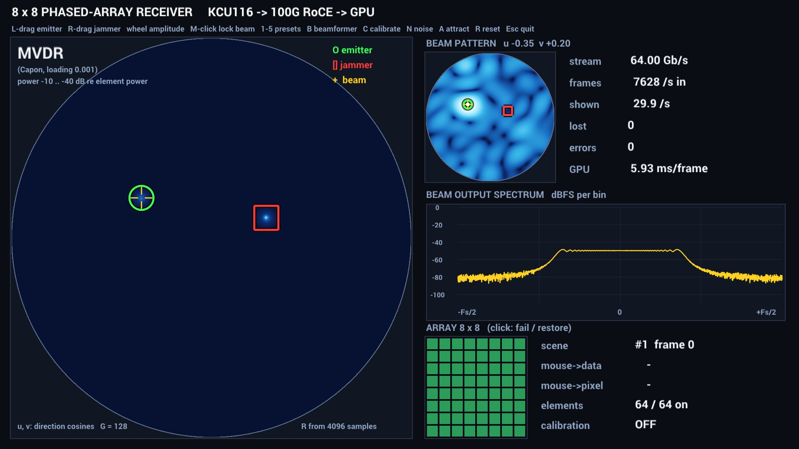

## Signal chain

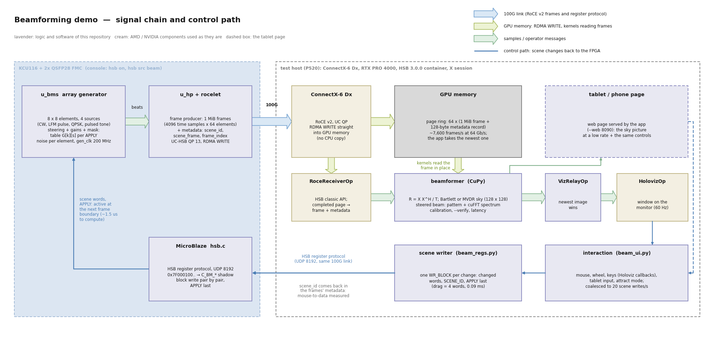

How to read the diagram:

* **Board** (left). The array generator `u_bms` (Opsero register SOURCE = 2, RTL
  `rsys_beam_src`, 200 MHz generator clock) computes 64 elements x up to 4 sources per time
  sample, adds per-element noise and delivers 16 samples per 64-byte beat to the HSB frame
  producer `u_hp`. The producer sends 1 MiB frames (4,096 time samples x 64 elements) with the
  128-byte metadata record through the rocelet engine as RDMA WRITEs on the UC-HSB queue pair,
  as for the other HSB sources; for SOURCE 2 the metadata also carries the scene id of the
  frame, the frame at which that scene became active and a 32-bit frame index.
* **Data path** (top). The ConnectX-6 Dx writes the frames into a page ring in GPU memory
  (green); no CPU copies the data. HSB's `RoceReceiverOp` hands each completed page to the
  beamformer, whose CuPy kernels read the frame where it is.
* **GPU** (middle). The beamformer computes the covariance matrix, the sky map (Bartlett or
  MVDR), the steered beam's pattern and its output spectrum, and draws the window; `VizRelayOp`
  passes only the newest image to Holoviz, so the beamformer never waits for the display.
* **Control path** (blue, bottom). Mouse, wheel and keys in the Holoviz window (and the
  tablet page) change the scene; the scene writer sends the changed registers, the scene id
  and APPLY in one block-write request of the HSB register protocol (UDP 8192) over the same
  100G link. The MicroBlaze firmware only maps the addresses onto the generator's shadow
  registers; APPLY makes the new scene active at the next frame boundary, and the frames'
  metadata tells the application which frame was the first of the new scene.
* The diagram is generated by `docs/source/images/gen_block_diagram.py`.

The design side of the generator (block, resources, timing) is in
[](description.md#beam-array-generator); its registers are in the HSB page,
[Beam array generator registers](hsb.md#beam-array-generator-registers).

## Array and scene model

The exact definitions (fixed-point arithmetic, sample packing, metadata fields, register map,
APPLY semantics, beamformer and calibration formulas) are in
[](beam_contract.md); the FPGA and the GPU application are both bit-exact or float-exact with
the reference model `sw/beam/beam_model.py` / `beam_scene.py`. In short:

* **Array**: fixed 8 x 8 planar array, 64 elements at half-wavelength spacing, centred on
  the origin. Directions are direction cosines (*u*, *v*); the visible sky is the unit disc,
  boresight at (0, 0). The half-power beamwidth is about 0.22 in *u* or *v* at boresight.
* **Sources**: up to four. Sources 0 and 1 are the emitters (green circles on the screen),
  2 and 3 the jammers (red squares). Each has a direction (two 32-bit words, Q2.30), an
  amplitude and a waveform: **CW tone**, **LFM pulse** ("radar": a chirp within a pulse of
  programmable width and a power-of-two repetition interval), **QPSK** ("comms": hash-random
  symbols on a carrier, noise-like and band-limited) or a **pulsed tone**. The FPGA computes
  every element's steering phase from the two direction words, so moving a source is two
  register writes.
* **Noise**: white Gaussian-like noise per element (the IQ16 generator's noise, at the
  element-sample index), one amplitude for all elements.
* **Gain errors**: a complex gain per element (Q2.14), applied to the signals, not to the
  noise; preset 5 writes random errors (+-30 degrees, +-1.5 dB) for the calibration demo.
* **Element mask**: a 64-bit enable mask; a disabled element outputs noise only (a failed
  channel whose ADC still digitises receiver noise).
* **Scene changes are atomic**: the host writes shadow registers, APPLY stages them, and the
  generator computes the per-scene steering table (about 1.5 us) and switches at the next frame
  boundary. Every frame comes from exactly one scene, and its metadata names it.

On the GPU, per frame: X = the 64 x 4096 complex sample matrix (int16 / 32768), corrected by
the calibration once it has been run; R = X X^H / T (accumulated in complex128); the sky on a
128 x 128 grid of the unit disc as conventional (Bartlett) power a^H R a / N^2 or MVDR (Capon)
power 1 / a^H (R + d I)^-1 a with diagonal loading d = 1e-3 tr(R) / N. The conventional map is
shown as 10 log10(P / max P), 0 to -40 dB of its own peak; the MVDR map on an absolute scale,
-10 to -40 dB relative to the frame's mean element power tr(R) / N (which is within 0.6 dB of
the conventional peak in presets 1, 2, 4 and 5; `--mvdr-top-db` moves the top). The top sits
10 dB below the element power because MVDR peaks are narrower than a grid cell: the peak cell of
a calibrated source is 8-14 dB below it. The absolute scale keeps a map that nulls its own
source dark instead of stretching its floor to full brightness. Then the steered beam's weights (conventional or MVDR), its pattern
|w^H a|^2 over the sky, and the 4096-point cuFFT spectrum of the beam output y = w^H X. The
maps use one frame (no averaging); the spectrum display is smoothed (`--spec-avg 0.6`).

## The window

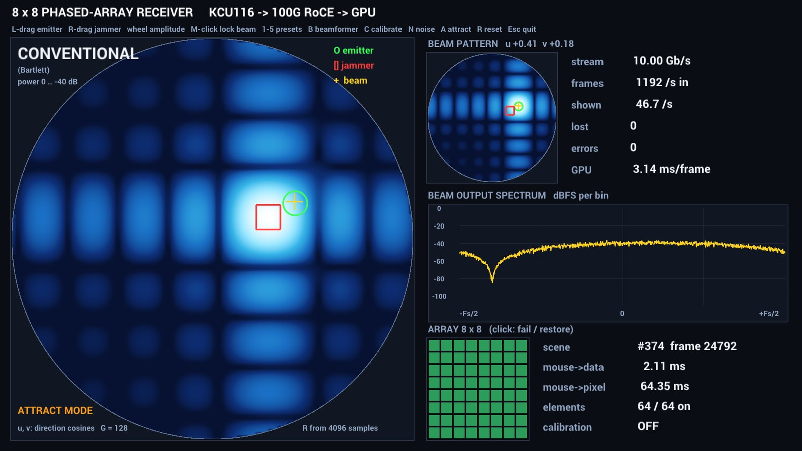

The application opens one 1920 x 1080 window, fullscreen (`--windowed` for a window). Its header
(and the page's) names the source: `ZCU106 -> 40G RoCE -> GPU` or `KCU116 -> 100G RoCE -> GPU`,
from the board's HSB register `LINK_GBPS` (`--board` names a ported board, and the VCK190:
`LINK_GBPS` 100 names the KCU116 by default, so start the demo with `--board VCK190` for a
`VCK190 -> 100G RoCE -> GPU` header; `FPGA -> RoCE -> GPU` when the register cannot be read):

* **Sky map** (left, large): the power map over the unit disc, title CONVENTIONAL (Bartlett,
  "power 0 .. -40 dB re peak") or MVDR ("power -10 .. -40 dB re element power"). Markers sit at the true source positions of the frame's
  scene: green circles = emitters, red squares = jammers; a white ring follows a source while it
  is dragged; the yellow crosshair is the steered beam. ATTRACT MODE is shown while the
  application moves the sources itself. What the markers, the two beamformer modes and the
  buttons mean: [What you are looking at](#what-you-are-looking-at).
* **Beam pattern** (top right): the pattern of the steered beam's weights over the sky, with
  the steering direction (*u*, *v*) in the title. With MVDR the nulls on the jammers are
  visible.
* **Beam output spectrum** (middle right): what the steered beam hears, dBFS per bin, from
  -Fs/2 to +Fs/2: a tone is a line, the LFM pulse a flat band, the QPSK jammer a hump.
* **Array** (bottom right): the 8 x 8 element layout; green = on, a red cross = failed.
* **Tiles**: stream Gb/s, frames received per second, frames shown per second, frames lost,
  record errors, GPU milliseconds per shown frame, the scene id and its first frame,
  mouse-to-data and mouse-to-pixel latency, elements on, calibration state (with the largest
  gain error against the gains the application wrote).

| Input | Action |
|---|---|
| left-drag on the sky | moves the nearest emitter (adds one if the scene has none) |
| right-drag on the sky | moves the nearest jammer (adds one if the scene has none) |
| wheel | amplitude of the grabbed or nearest source, 1 dB per notch (the sum of the amplitudes is kept at or below 30,000, so nothing clips) |
| middle click | locks the steered beam on the nearest source; again: back to the cursor |
| click on an element | fails / restores it (element mask) |
| 1-5 | the presets ([Presets](#presets)) |
| B | beamformer: conventional / MVDR |
| C | calibration on / off (estimates the element gains from the scene's single source) |
| N | element noise: 100, 300, 1000, 3000 |
| A | attract mode on / off |
| R | reset the current preset (also drops the calibration) |
| - / + | stream rate down / up: 1, 2, 5, 10, 20, 40, 64, 80 Gb/s, up to the board's link (1-40 on the ZCU106; board source; also the keypad - / +) |
| Esc | quit |

Mouse moves are coalesced to `--update-hz` (default 20) scene writes per second; a drag writes
4 words (U, V, scene id, APPLY), a preset all 102. After `--attract-idle` seconds without input
(default 10) attract mode moves every active source on its own circle at about 20 Hz; a drag,
click, scroll, preset or reset stops it, while B, C and N act without stopping it.

With an uncalibrated array (preset 5 before C) MVDR suppresses the source, because its steering
vector does not match the data: the MVDR map is a dark disc (~-36 dB) with a dim blob at the
source (~-26 dB), and after C a white peak. While calibration is off and the scene has element
gain errors (preset 5), the sky shows the hint "array uncalibrated: press C".

## The tablet page

With `--web PORT` (default 8090, `--web 0` = off) the application serves a page for a phone or
tablet on the same LAN, at **http://\<gpu-host\>:8090/** (the GPU host's LAN address; `--web-bind`, default
0.0.0.0; `--web-bind 127.0.0.1` keeps it local). It is a standard-library threaded HTTP server
and one plain HTML / JavaScript page with no external resources. The page shows what the monitor
shows: the 128 x 128 sky map in the same colour scale (about 10 updates per second,
`--web-hz`), the true source markers, the steered beam, the tiles and the 8 x 8 element layout.

| Page | Action |
|---|---|
| touch / drag on the sky | moves the nearest emitter, or the nearest jammer with the "jammer" toggle (adds one if the scene has none) |
| preset buttons 1-5 | presets |
| beamformer / calibrate / noise / attract / reset | the keys B / C / N / A / R |
| rate - / rate + | the keys - / + (stream rate) |
| tap an element | fails / restores it |

Every button, the sky and the array panel carry a hint (hover with a mouse, long-press on most
phones) that says what it does. Page input goes into the same interaction state as the mouse, so the monitor and the page stay
in sync and page drags are coalesced to `--update-hz` scene writes like mouse drags; a page drag
whose finger-up never arrives is released after 3 s. A jammer drag from the page measured
2.97 ms mouse to data. The rate buttons change the stream rate like the keys - / +; the "rate
set" tile shows the rate the board acknowledged.

Endpoints, for scripts and tests:

| Endpoint | What |
|---|---|
| `GET /events` | Server-Sent Events: `hello`, then about 10 `frame` events per second (JSON: the sky map as base64 uint8 128 x 128, true sources, steered beam, element mask, tiles, hint, message) |
| `GET /state` | the latest frame state as one JSON object |
| `POST /control` (JSON) or `GET /control?...` | `preset n`, `beamformer`, `calibrate`, `noise`, `attract`, `reset`, `element k` (0-63, k = 8 iy + ix), `drag phase=down\|move\|up u v cls=emitter\|jammer`, `rate gbps=<Gb/s>` (clamped to 1-80, 1-40 on the ZCU106) or `rate step=1\|-1` (the next step of the keys - / +; 409 without the board) |

```
curl -N http://<gpu-host>:8090/events
curl -X POST -d '{"cmd":"preset","n":2}' http://<gpu-host>:8090/control
curl 'http://<gpu-host>:8090/control?cmd=drag&phase=down&u=0.3&v=0.1&cls=jammer'
curl -X POST -d '{"cmd":"rate","gbps":40}' http://<gpu-host>:8090/control    # stream rate while running
```

There is no authentication: anyone who reaches the port can change the scene. The page has been
tested with curl, with its JavaScript under a DOM stub and against the board, not yet on a real
tablet.

### What you are looking at

The page (and the monitor) are read the same way; the terms below are the ones used on both.

**The circular window** is the *sky map*. It is the hemisphere in front of the array, drawn
as the unit disc of direction cosines (*u*, *v*): the centre is boresight (straight ahead,
perpendicular to the array face), the edge is the horizon (a wave arriving along the plane of
the array), *u* runs along the array's rows (left to right) and *v* along its columns (bottom to
top). Each of the 128 x 128 pixels inside the disc is the power the array measures when the
beamformer points a beam in that direction, on the colour scale printed under the title (dark
= weak, bright = strong). The map is recomputed from every frame that is shown (4,096 time
samples of all 64 elements), so whatever changes on the board is visible a frame later. The
markers are drawn where the sources *really* are (the application knows the scene it sent to
the board); the map is what the array makes of them, and the difference between the two is the
point of the demo.

| On the sky | Meaning |
|---|---|
| green circle | an **emitter**: a wanted signal, a CW tone or an LFM radar pulse, at its true direction |
| red square | a **jammer**: a strong, wideband QPSK interferer at its true direction; what MVDR is there to suppress |
| white ring | the source that is being dragged at the moment |
| yellow crosshair | the **steered beam**: the direction the receive beam is pointed at. It is not a source. On the monitor it follows the mouse pointer over the sky, a middle click locks it on the nearest source, and in attract mode it follows the first emitter; the page shows it but cannot move it. The *beam pattern* and *beam output spectrum* panels of the window are computed for this direction |
| ATTRACT MODE | the application is moving the sources itself (see below) |
| "array uncalibrated: press C" | the scene has element gain errors (preset 5) and calibration is off |

**Beamformer** (button *beamformer*, key B; the name above the sky):

* **CONVENTIONAL** (Bartlett, delay-and-sum). For each direction the 64 element signals are
  phase-aligned for that direction and summed; the map is the power of that sum, relative to
  its own peak (0 to -40 dB). This is the array's natural beam: a main lobe about 0.22 wide
  (half power) and a grid of sidelobes about 13 dB down along the array axes. Its limits are
  what presets 2 and 3 show: a strong source's sidelobes bury a weak one, and two sources
  closer than a beamwidth merge into one blob.
* **MVDR** (minimum variance distortionless response, also called Capon). Adaptive: the
  weights are computed from the covariance matrix of the frame so that the beam has unit gain
  in the look direction and the smallest possible output power from everything else, which
  places nulls on the other sources. The map is 1 / (a^H R^-1 a) on an absolute scale relative
  to the element power (-10 to -40 dB). Sources appear as narrow points, close sources are
  resolved, and a jammer is nulled (the beam pattern panel shows the notch). Its price: it
  relies on the steering vectors matching the real array, so gain and phase errors (preset 5)
  make it suppress the wanted source until the array is calibrated, and it costs about 6 ms of
  GPU time per frame against 3.5 ms for conventional.

**Calibrate** (button *calibrate*, key C). Estimates the complex gain of every element from
the covariance of a scene with one source at a known direction (preset 5: boresight) and
divides it out of every following frame. The *calibration* tile shows ON with the largest
remaining gain error against the gains the application programmed into the board. It is meant
for preset 5; *reset* drops it.

**Noise** (button *noise*, key N). Cycles the noise amplitude that the board adds to every
element sample: 100, 300, 1,000, 3,000 (int16 units; the source amplitudes sum to at most
30,000). More noise raises the floor of both maps and makes the MVDR nulls shallower.

**Attract** (button *attract*, key A). After 10 s without input the application moves every
active source along its own circle (radii 0.3 to 0.7, one lap in 20 to 41 s) and keeps the
beam steered at the first emitter, so a monitor nobody is standing at keeps showing the
beamformer adapting; ATTRACT MODE appears on the sky. A drag, click, scroll, preset or reset, on
the monitor or on the page, stops it; *beamformer*, *calibrate* and *noise* act without stopping it;
the button toggles it by hand.

**Reset** (button *reset*, key R). Reloads the current preset: source positions and
amplitudes, noise, element mask, and drops the calibration.

**emitter / jammer** (the toggle above the sky) chooses which kind of source a touch or drag
on the sky moves: the nearest emitter or the nearest jammer (one is added if the scene has
none of that kind). On the monitor the left and right mouse buttons do the same.

**Array 8 x 8**: the element layout as seen from the front; tap an element to fail it (red
cross) and tap again to restore it. Preset 4 shows what failed elements do to the sidelobes.

**Stream rate** (buttons *rate -* / *rate +*, keys - / +: 1, 2, 5, 10, 20, 40, 64, 80 Gb/s; up to 40 on the ZCU106).
The rate sets how fast the FPGA produces frames, not what is in them, so the picture does not
change: every frame is the same snapshot of 4,096 samples from all 64 elements, the covariance
has the same quality at 1 Gb/s as at 80, and the waveforms are defined as fractions of the
sample rate, so the tones and the LFM band stay where they are. What moves is in the tiles: the
measured Gb/s follows the set value within about a second, *frames /s in* scales with it (7,628
per second at 64 Gb/s, about 1,200 at 10), *shown /s* and the GPU time per frame stay put because
the display only takes the frames it can show, and *mouse->data* grows at low rates because a
scene change waits for the next frame boundary (a frame lasts 131 us at 64 Gb/s and 8.4 ms at
1 Gb/s). The physical quantity behind it is the per-element sample rate, 31.2 MS/s at 64 Gb/s
and 0.49 MS/s at 1 Gb/s. At 80 Gb/s the stream sits just under the test host's NIC-to-GPU
ceiling ([Known limits](#known-limits)); *lost* is the tile to watch there. A change takes
effect from the board's next frame start; the stream itself never stops.

**Tiles**:

| Tile | Meaning |
|---|---|
| Gb/s | the stream rate measured at the receiver |
| frames /s in | frames received per second |
| shown /s | frames the display shows per second (`--fps`); the ones in between are dropped |
| lost | frames the receiver missed since the start (plus, separately, those lost while the stream started) |
| errors | frames whose metadata or record check failed |
| GPU ms /frame | GPU time per shown frame (covariance, map, pattern, spectrum, drawing) |
| mouse->data | from the input to the moment the board generated the first frame of the new scene, read from the frame metadata |
| mouse->pixel | from the input to the display showing that frame |
| beamformer, calibration | the current mode and calibration state |
| scene | the id of the scene the shown frame was generated with (every change gets a new id) |
| rate | the stream rate the board was told to send |

## Running it

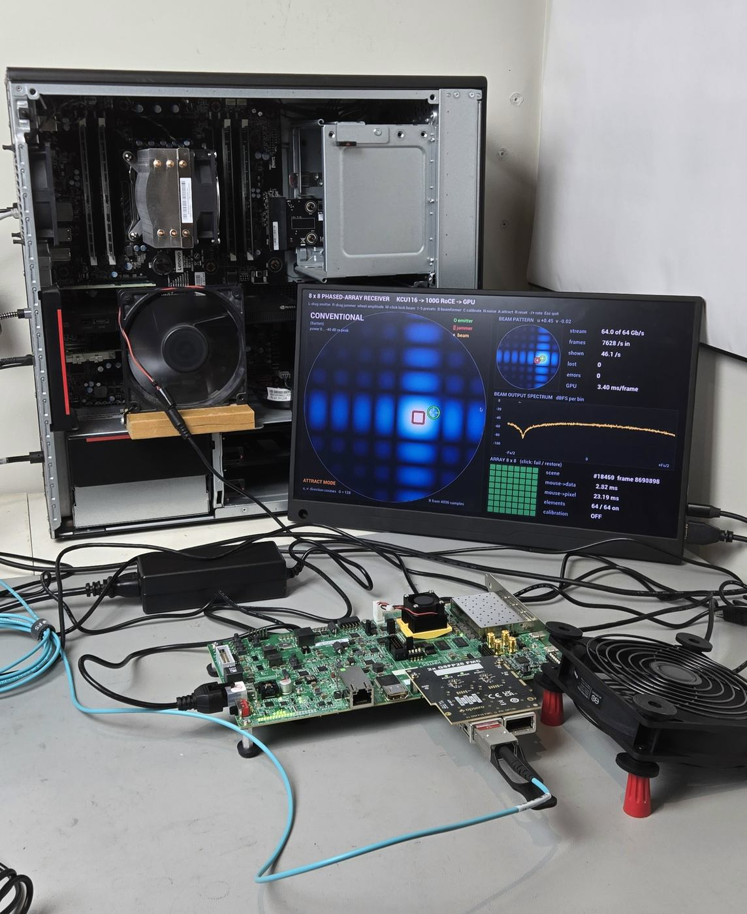

What is needed:

* The board: KCU116 + 2x QSFP28 FMC, programmed with the bitstream and firmware of version
  0.4.0 or later (the build of this repository, `bootimages/` or
  `Vitis/boot/kcu116/rocelet_boot.bit`), QSFP28 port 0 connected to the host's 100G port as in
  [](hsb.md#quick-start). Or, since version 0.5.0, the **ZCU106** + 2x QSFP28 FMC (Linux image
  or bare-metal console) with port 0 connected to the host's port at 40G: the demo then runs at
  up to 40 Gb/s (start it with `rl hsb on` on the board, over SSH). Or the **VCK190** + 2x
  QSFP28 FMC on FMCP1 (Linux image or bare-metal console) with port 0 connected to the host's
  100G port: the same rate range as the KCU116 (`rl hsb on` on the board, `--board VCK190` on
  the host).
* The host: a RoCE v2 NIC that writes into GPU memory (validated: ConnectX-6 Dx), an NVIDIA GPU,
  NVIDIA's HSB 3.0.0 container (`hololink-demo:3.0.0`: Holoscan 4.4, hololink 3.0.0, CuPy; no
  extra packages), and for the window a monitor on the GPU with the full NVIDIA display driver
  and an X session (see [Known limits](#known-limits)). [](host_setup.md) sets such a host up
  from a bare install: drivers, the container, the 100G port, the display session and the
  start order of board and host.

Board side, on the console (115200 8N1):

```
rl> hsb on          # enumeration and register protocol
rl> hsb src beam    # SOURCE = 2 (optional: the application writes it too)
rl> hsb st          # the beam generator line: active scene id, its first frame, applies
```

Host side, in the HSB container with `--net host --privileged`, the 100G interface on
192.168.20.0/24 with an MTU of at least 4200, and `sw/hsb/` next to `sw/beam/` (the
application reuses `rocelet_hsb_app.py` and `rocelet_hsb.py`):

```
docker run --rm -it --gpus all --runtime=nvidia --net host --privileged \
    -e DISPLAY=$DISPLAY -e NVIDIA_DRIVER_CAPABILITIES=all -v /tmp/.X11-unix:/tmp/.X11-unix \
    -v $PWD/sw:/sw -w /sw/beam hololink-demo:3.0.0 bash

python3 rocelet_beam_app.py --source roce --preset 2 --rate 64                # the demo
python3 rocelet_beam_app.py --source roce --preset 2 --rate 64 --verify -1    # + every frame checked
python3 rocelet_beam_app.py --source roce --headless --duration 60 --outdir out   # no monitor: PNGs
```

The wrapper `sw/beam/run.sh` starts the container with these options and the repository
mounted at `/beam` (`RL_WIN=1` adds the X display; see [](host_setup.md#6-the-demo-software)):

```
RL_WIN=1 sw/beam/run.sh python3 rocelet_beam_app.py --source roce --preset 2 --rate 64
```

The tablet page is on port 8090 by default (`--web`, 0 = off). The application's default RDMA
device is the test host's `rocep179s0f0`; on another host add `--ibv-name <rdma-dev>`.

`--source roce` finds the board at `--ip` (default 192.168.20.2), resets it (`hl.reset()`),
reads `S_BM_CAPS` and refuses to run unless it reads 0x01440808 (a bitstream with the array
generator; `--force` overrides), writes SOURCE = 2 and RATE_MBPS (`--rate`, Gb/s of frames +
records), writes the start scene (all 102 words, APPLY while the generator is idle), arms the
producer watchdog's keepalive, and lets the start gate enable the data plane once the graph is
up. At the end, Esc, Ctrl-C or SIGTERM switch the data plane off; the next run starts without
a power cycle. Every run ends with a `PASS:` / `FAIL:` line and a JSON summary (`--outdir`,
`--tag`).

The stream rate starts at `--rate` and changes while the stream runs: the keys - / + and the
page write RATE_MBPS, the firmware recomputes the frame period (`C_HP_PERIOD`) at once, and the
frame producer samples it at its next frame start, so the new rate applies from the next frame
on. Live changes stay within 1-80 Gb/s (the test host is clean to 80), and within the board's
link rate (HSB register `LINK_GBPS`): 1-40 Gb/s on the ZCU106 target, whose top key step is 40. The stream tile shows the
measured rate against the rate set; the verify page age and the latency frame period follow the
new rate.

Useful options:

| Option | Meaning |
|---|---|
| `--preset 1-5`, `--beamformer conv\|mvdr` | the start scene and beamformer |
| `--rate <Gb/s>` | stream rate at the start (default 64; the test host is clean to 80); keys - / + and the page change it while running |
| `--verify N` | compare up to N frames per second (-1 = every frame the application takes) word for word with the bit-exact CUDA generator, for the scene, frame index and activation frame in the frame's own metadata; any mismatch fails the run and saves the frame |
| `--web PORT`, `--web-bind`, `--web-hz` | the tablet page (default 8090, 0 = off), its bind address (0.0.0.0) and update rate (10 per second) |
| `--mvdr-top-db` | top of the MVDR colour scale relative to the element power (default -10 dB) |
| `--headless`, `--png-every N` | render off screen and write a PNG every N shown frames (no monitor needed) |
| `--viz none` | no rendering at all (beamformer, checks and latency only) |
| `--windowed` | a 1920 x 1080 window instead of fullscreen |
| `--fps`, `--update-hz`, `--attract-idle` | frames beamformed per second (default 60; the others are counted), scene writes per second (20), seconds before attract mode (10, 0 = never) |
| `--script "t cmd args; ..."` or `@file` | replayed input (key, move, press / release, drag, scroll, elem, quit) through the same handlers: unattended tests |
| `--board NAME` | board name in the window header and on the page (default: from `LINK_GBPS`, 100 KCU116, 40 / 10 ZCU106; `--board VCK190` for the VCK190) |
| `--reg-mode block\|single` | one block write per scene change (default) or one register write per word |
| `--source synthetic\|csynthetic` | no board: frames from the numpy model (~10 frames/s) or the same generator as a CUDA kernel (~50-60 shown/s) |

The application's README (`sw/beam/README.md`) lists the files, every option and the
latency definitions.

## Presets

Keys 1-5 (and `--preset`); the exact parameters are in [](beam_contract.md), section 7. All
frequencies are on exact FFT bins of 4,096, all gains 1 and all elements on unless noted.

| Preset | Scene | What it shows |
|---|---|---|
| 1 single emitter | one CW emitter at (0.30, 0.20), 15.7 dB SNR per element | the main lobe and the sidelobe grid of an 8 x 8 array; the tone in the beam spectrum |
| 2 emitter + jammer | an LFM radar pulse at (-0.35, 0.20) and a QPSK jammer 18 dB stronger at (0.275, 0.10) | the conventional map shows only the jammer (its sidelobes hide the emitter); MVDR shows both as points and nulls the jammer (-36 dB against conventional) |
| 3 two emitters | two CW emitters at different frequencies, one half-power beamwidth apart (du = 0.22) | resolution: conventional merges them into one blob, MVDR separates them |
| 4 failed elements | preset 1 with elements 3, 12, 21, 30, 46 and 57 disabled | the conventional sidelobes rise and lose their regular grid; the array panel marks the failed elements; MVDR uses the 58 enabled elements and keeps its peak |
| 5 uncalibrated array | one CW source at boresight, random gain errors (+-30 degrees, +-1.5 dB) | calibration: the conventional map is smeared, MVDR self-nulls the source (a dim blob on a dark disc); after C the conventional pattern is regular again and MVDR shows a white peak |

The pictures below are the application's own render buffer (the PNG sink, `--png-every`),
captured during a hardware run at 64 Gb/s with the scripted events of `--script`; they are what
the monitor shows.

### Preset 2: an emitter and a jammer

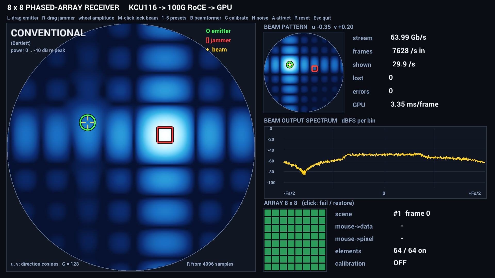

The conventional beamformer sees only the jammer (red square): its main lobe saturates the map
and its sidelobe grid covers the whole sky, 13 dB down along the array axes, which is still well
above the emitter 18 dB weaker. The emitter's green circle sits in a dark patch. The beam steered
at the emitter (yellow crosshair) does not help either: its own sidelobes let the jammer in, so
the beam output spectrum (middle right) is the jammer's QPSK hump filling the band, with the LFM
pulse buried inside it.


With MVDR the weights are computed from the frame's covariance matrix, so the beam steered at the
emitter places a null on the jammer: the beam pattern (top right) shows the notch at the red
square, and the spectrum changes completely: the jammer's hump is gone and the LFM pulse appears
as a flat band 30 dB above the noise floor. On the sky map, which is on an absolute scale here,
the jammer collapses to a single point and the emitter shows as the small bright point under the
crosshair; everything else is dark because MVDR reports the power that remains after every other
source has been suppressed, not the array's sidelobes.

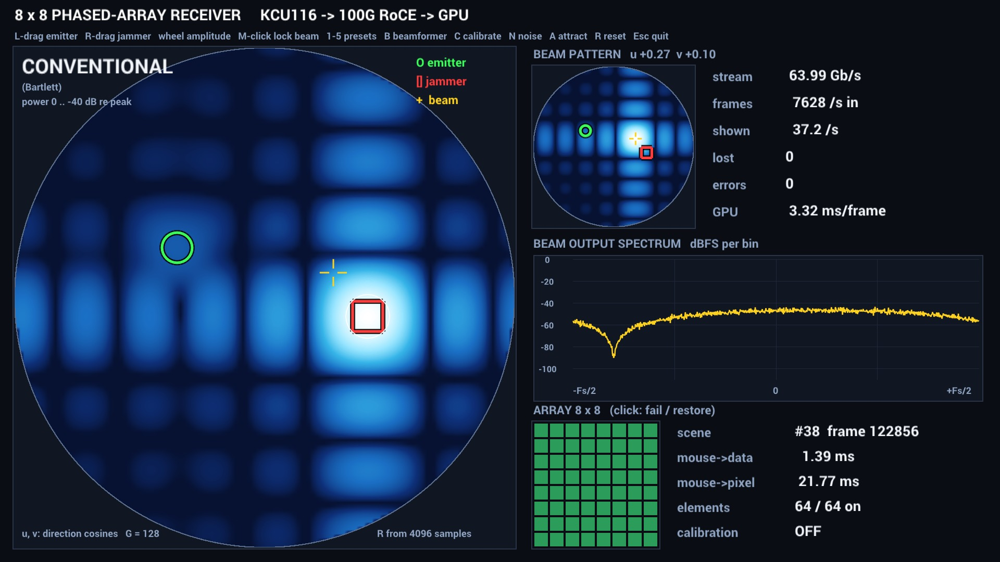

Dragging a source (here the jammer, white ring) writes four register words to the board; the
next frame the board generates already has the source at the new position. The scene tile
counts the changes (every drag step is a new scene id), and the latency tiles show the measured
time from the input to the first frame with the new scene (mouse->data, 1.4 ms) and to the
display showing it (mouse->pixel, 22 ms, most of it the 60 Hz display). The crosshair follows the
pointer, so this beam is steered beside the jammer and hears its hump.

### Preset 3: two emitters one beamwidth apart

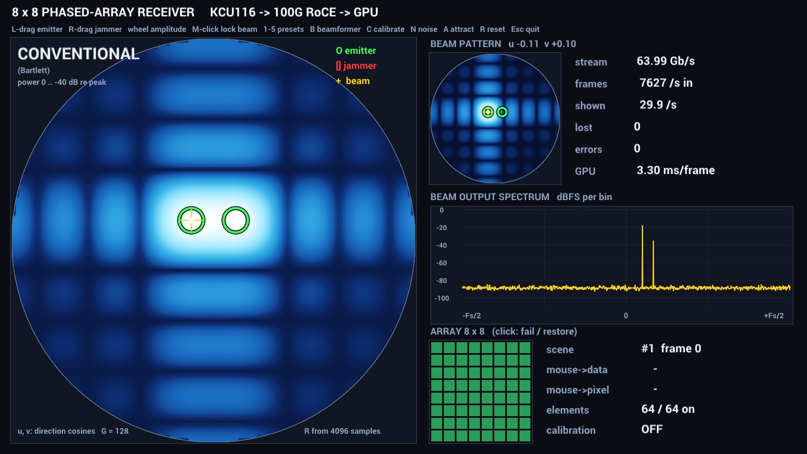

Two tones from two directions separated by one half-power beamwidth. The conventional map cannot
tell them apart: one blob covers both green circles, because the conventional beam is as wide as
their separation. The beam steered at the left emitter still hears both tones (two lines in the
spectrum), the second one through the main lobe's shoulder.

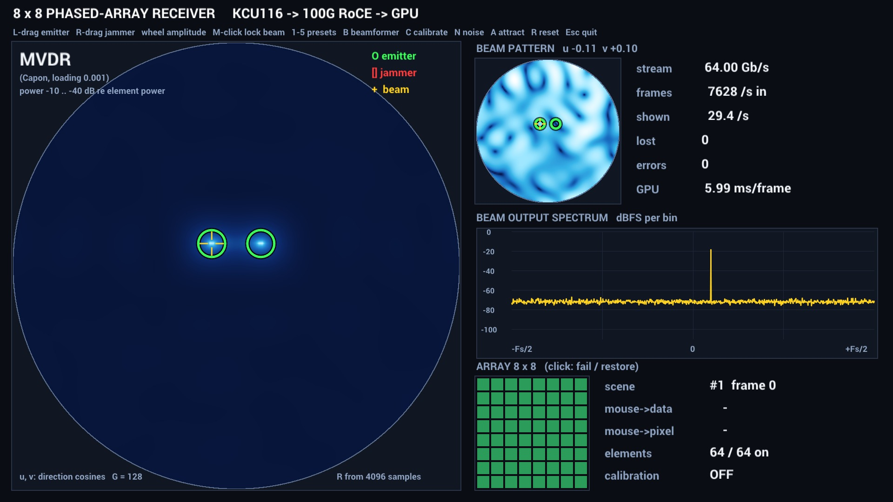

MVDR resolves them: two separate points on the sky, and the beam steered at the left emitter now
hears only its tone, the second line has dropped into the noise because the adaptive weights
nulled that direction. This is the resolution gain of an adaptive beamformer over the same
aperture.

### Preset 4: failed elements

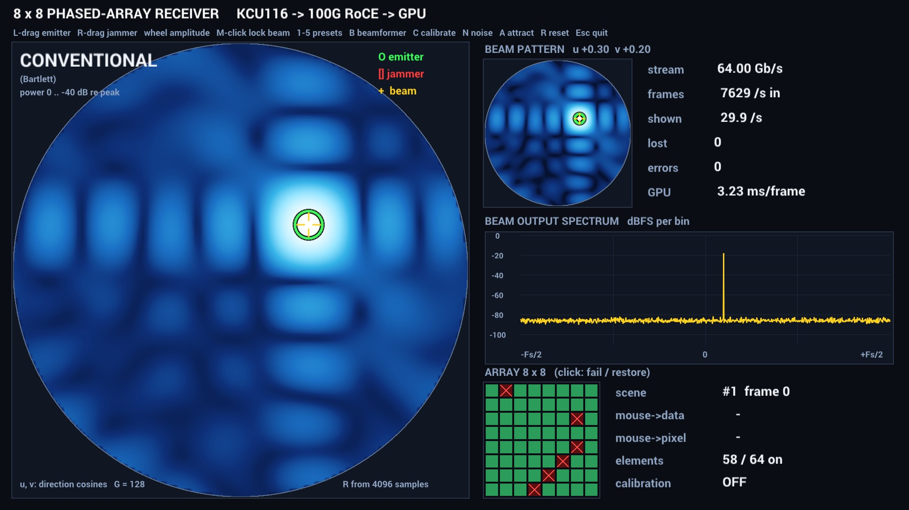

Six of the 64 elements are switched off (red crosses in the array panel, 58 / 64 on); a disabled
element delivers receiver noise only, as a failed channel would. The source is still found, but
the aperture is no longer uniform: compared with preset 1 the sidelobes rise and lose their
regular grid, and the beam pattern shows the same damage. In the demo any element can be failed
or restored with a click and the map answers one frame later.

### Preset 5: an uncalibrated array

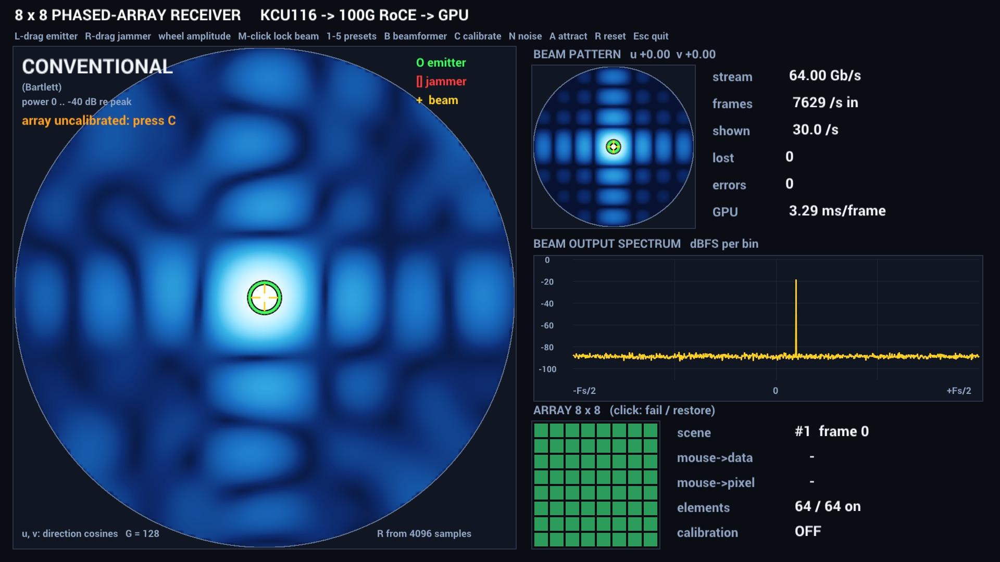

Every element has its own gain and phase error (up to 1.5 dB and 30 degrees), as the channels of
a real array do before calibration. The source is at boresight, but the conventional map is
smeared and its sidelobe pattern is irregular, because the element signals no longer add up in
phase; the hint under the title asks for calibration.

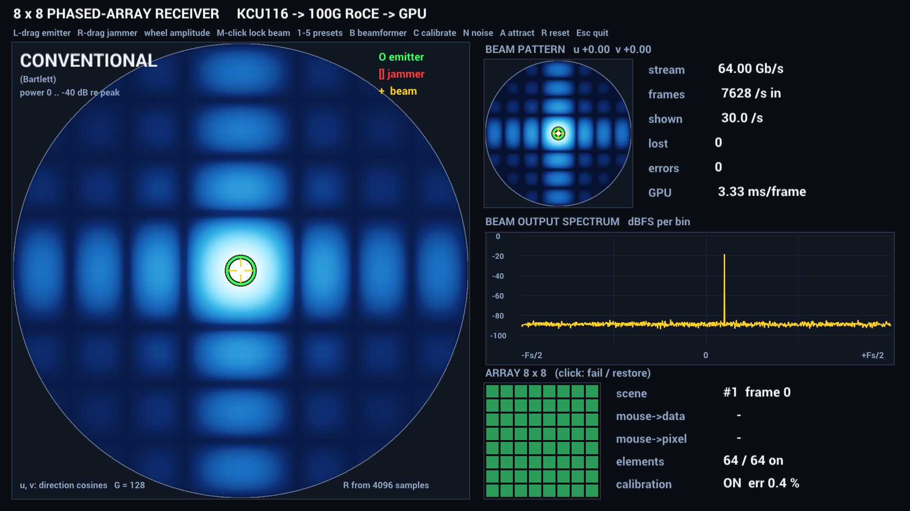

After C the GPU has estimated the 64 complex element gains from the covariance of the single
source and divides them out of every frame: the regular main lobe and sidelobe grid are back,
and the calibration tile shows the residual error against the gains the application wrote into
the board (0.4 %).

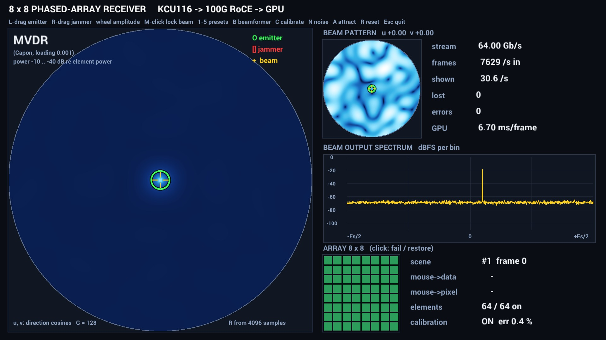

MVDR on the calibrated array: a single white peak at boresight on an otherwise dark sky, the
textbook picture.

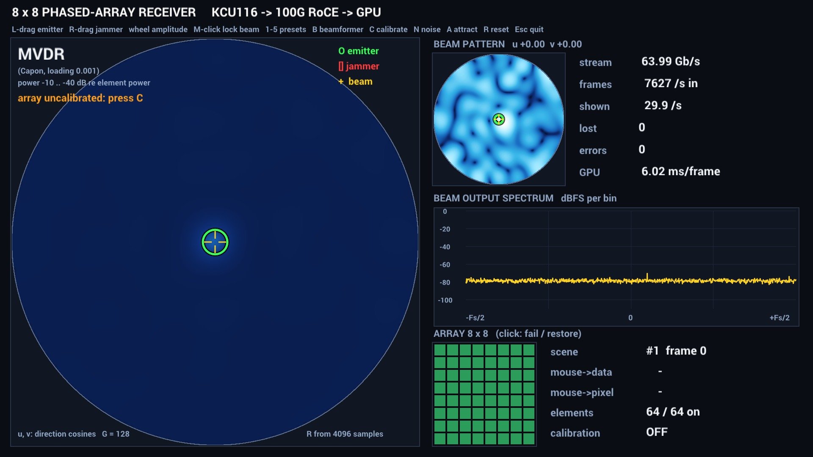

MVDR on the uncalibrated array, the picture a visitor sees if they press B before C: the source
almost disappears. MVDR trusts its steering vectors; when the real array does not match them, the
signal from the source looks like interference from a slightly different direction and the
beamformer nulls it, so the map shows a dim blob on a dark disc and the beam steered straight at
the source hears nothing at all: the tone is gone from the spectrum. That is why adaptive
beamformers need calibrated arrays, and why C comes before B in this preset.

## Measured

**ZCU106 (version 0.5.0, 40G).** ZCU106 + OP120 port 0 on the Linux image, 3 m DAC to the
ConnectX-6 Dx forced to 40000 with FEC off, the same host: the application read `LINK_GBPS` = 40
and limited the rate range to 1-40 Gb/s ("--rate 64 > the link: 40 Gb/s"); the stream ran at
about 38.8 Gb/s at the 40 Gb/s step, followed the keys 40 → 20 → 10 → 20 → 40 (the `+` key at
40 refused), and the page's `rate gbps=64` / `gbps=0.5` requests were clamped to 40 / 1; all
1,652 frames shown, 150 frames verified bit-exact, 0 lost. The rest of this section was
measured with the KCU116 at 100G.

% TODO(m3): beamforming demo on the VCK190 at 100G (rate steps, frames verified / lost), and whether the host software should name the VCK190 itself instead of --board.

Board: KCU116 + OP120 port 0, 3 m DAC, RS-FEC, MTU 4200, to a ConnectX-6 Dx (port 1, forced
100G) in a Lenovo P520 (Xeon Skylake-SP, PCIe Gen3) with an RTX PRO 4000 Blackwell; HSB 3.0.0
container; 1 MiB frames (4,096 time samples); 2026-11-03. Numbers marked **(P520)** belong to
the test host, not to the design.

**Bit-exact check.** `--verify -1`, headless, 60 s per rate, attract mode moving the sources
(about 1,100 scene changes per run): every frame the application took was compared word for word
with the CUDA generator for the scene named in its own metadata.

| Rate | Frames into GPU memory | Frames compared | Scene changes | Mismatches |
|---|---:|---:|---:|---:|
| 10 Gb/s | ~70,000 | 26,901 | 1,093 | 0 |
| 40 Gb/s | ~281,000 | 25,716 | 1,114 | 0 |
| 64 Gb/s | ~370,000 | 24,422 | 1,114 | 0 |
| 80 Gb/s | ~462,000 | 24,232 | 1,108 | 0 |

0 frames lost after the first 2 s of each run; in the first 2 s the ConnectX-6 discarded
packets of 0-6 frames at 40-80 Gb/s in this session (see [Known limits](#known-limits)). With the
pre-release bitstream (`42cf7df`) the check was repeated: 0 mismatches in 22,755 frames at 64 Gb/s
and 9,014 frames at 80 Gb/s.

**Rate changes while running** (bitstream `f75b487`, `--verify -1`, 60 s, the keys scripted to
64 -> 40 -> 20 -> 40 -> 64 -> 80 Gb/s every 10 s): 31,383 frames compared word for word, 0
mismatches, 0 lost, 0 errors; each RATE_MBPS write took 0.22-0.33 ms and the measured rate
followed within a second. The same from the page and from the console (`hsb rate 20000`: the
frame period went from 42,245 to 135,184 clocks with the stream running).

**Window on the monitor** (60 Hz vsync, 70 s per rate, attract mode, `--verify -1`):

| Rate | Shown / s | GPU ms / shown frame (p50 / p99) | Data to pixel | Mouse to data (p50) | Mouse to pixel (p50) |
|---|---:|---:|---:|---:|---:|
| 10 Gb/s | 45-47 | 3.17 / 4.15 | 20.6 ms | 2.4 ms | 44 ms |
| 40 Gb/s | 45-47 | 3.24 / 4.32 | 20.7 ms | 1.6 ms | 23.7 ms |
| 64 Gb/s | 45-47 | 3.25 / 5.27 | 20.7 ms | 1.5 ms | 23.3 ms |
| 80 Gb/s | 45-47 | 3.24 / 5.32 | 20.1 ms | 2.7 ms | 23.6 ms |

* **Mouse to data** is the GUI event to the activation frame (the first frame of the new scene)
  completed in GPU memory; **mouse to pixel** adds the application's first look at that frame
  and its data-to-pixel time (to the image handed to Holoviz, which presents it at the next
  60 Hz refresh). At 10 Gb/s the 0.84 ms frame period puts the first new-scene frame one loop
  later, hence 44 ms. The board activates a scene 0-1 frames after the reply to the APPLY
  write.
* **GPU**: 3.1-3.3 ms per shown frame with the conventional beamformer for the whole beamformer
  and the window composition (covariance 0.3 ms); MVDR costs about 6 ms per shown frame against
  about 3.5 ms conventional in the same run; `nvidia-smi` reports 4-5 %
  utilisation **(P520)**. Frames arriving faster than `--fps` are counted, not processed: at
  64 Gb/s about 7,600 frames per second reach GPU memory and about 46 per second are
  beamformed and shown.
* **Register path** (block write on its own UDP socket, HSB register protocol round trip
  73 us): the full scene (102 words) 0.6 ms, a 4-word drag write 0.09 ms; with `--reg-mode
  single` 6.6 ms and 0.31 ms.
* **Soak**: 20 minutes at 64 Gb/s with the window, attract mode and `--verify`: 9.24 M frames
  into GPU memory, 54,648 shown, **0 lost**, 0 NIC discards, 19,128 frames verified with 0
  mismatches, 20,053 scene changes (120,414 register words, 0 failed writes), GPU memory flat at
  933 MiB, mouse to data 1.6 ms p50.
* **Final run** with the pre-release bitstream (`42cf7df`): 10 minutes at 64 Gb/s with the window
  and the tablet page open: 4.56 M frames into GPU memory, 0 lost, 5,444 frames verified with 0
  mismatches, 10,934 scene changes, GPU 3.48 ms per shown frame, 42.8 shown per second, mouse to
  data 1.55 ms, mouse to pixel 28 ms.
* SIGTERM and SIGINT stop the data plane; the next run starts without a power cycle.

## Known limits

* **NIC-to-GPU path of the test host**: about 81 Gb/s **(P520)**, as for the other HSB sources
  ([](hsb.md#measured-limits-test-host)); above it the NIC drops packets of every kind,
  including the register replies. The generator itself delivers up to 102 Gb/s and the board
  sends 97.6 Gb/s unpaced.
* **Start-up loss** (occasional, host NIC-to-GPU warm-up) **(P520)**: in the B5 session a
  40-80 Gb/s data-plane start into GPU memory made the ConnectX-6 Dx discard about 1,000 packets
  (0-6 frames, `rx_discards_phy`) in the first 2 s; in the later session 12 starts and the
  10-minute final run lost 0 frames. The application reports losses in the first 2 s apart
  (`lost_start`) and judges the run on the losses after that.
* **Display latency**: mouse to pixel (~23 ms) is dominated by the display pipeline (one or
  two 60 Hz periods with vsync), not by the data path (mouse to data 1.5-2.7 ms).
* **Shown frame rate**: 43-47 frames per second with the window (the greedy scheduler, one
  thread); the beamformer itself takes about 3.5 ms per frame with the conventional beamformer
  and about 6 ms with MVDR.
* **Failed elements**: the beamformers use the enabled elements only (the steering rows of
  disabled elements are zero, the conventional map is normalised by the enabled count), so
  MVDR keeps a sharp peak on the source in preset 4 while the conventional map shows the
  larger sidelobes of the thinned array.
* **Display on the host**: the window needs a monitor on the GPU, the full NVIDIA display
  driver (GLX / Vulkan; the headless compute-only driver has no Vulkan) and a running X server
  that the container may use (`DISPLAY`, the X socket mounted, `xhost +local:`), with screen
  blanking (DPMS) off for unattended runs. The test host uses `nvidia-driver-595-open`, LightDM
  with automatic login and Openbox. Without a display use `--headless` (PNG files) or `--viz
  none`.
* **Monitor of the test host** (not a limit of the design): the monitor's EDID is not
  readable through its DisplayPort-to-HDMI adapter (the driver falls back to 640 x 480), so the X
  configuration forces 1920 x 1080 at 60 Hz. A fullscreen run lets Holoviz (GLFW) pick the
  highest-refresh 1080p mode the X server offers, which was a driver-generated 60.01 Hz DoubleScan
  mode that the monitor showed squeezed to 8:9; the X configuration now also carries
  `ModeValidation NoXServerModes, NoPredefinedModes, NoVesaModes`, so the forced mode is the
  only one and the picture fills the panel.
* **Fixed geometry**: the array is 8 x 8 (the beat packing relies on 64 elements = 4 beats of
  16 samples); `S_BM_CAPS` reports it, and the application refuses other values. Narrowband
  (phase-shift) beamforming only; no true-time-delay wideband model.
* The maps use one frame each (R from 4,096 samples, no averaging), so they flicker slightly
  with the noise.

## Data and register contract

The FPGA generator and the GPU application share one interface, written down in
[](beam_contract.md) and executable as the reference model `sw/beam/beam_model.py` (the frames
the board sends are compared with it bit for bit, see [Measured](#measured)). In short:

* **Array**: 8 x 8 elements at half-wavelength spacing, element k = 8 iy + ix; directions are
  the direction cosines (u, v) with boresight at (0, 0) and the visible region u^2 + v^2 <= 1.
* **Frames**: 1 MiB = 4,096 time samples x 64 elements x one complex int16 sample (I in the
  low half-word, Q in the high), time-major and element-interleaved, so a frame is the C array
  `int16[4096][64][2]` and, read as a 64 x 4096 complex matrix, lands in the GPU in cuBLAS
  layout without a transpose. Every HSB frame of SOURCE 2 is this.
* **Metadata**: bytes 48-63 of the 128-byte HSB record (big-endian like the rest) carry the id of
  the scene every sample of the frame was generated with, the frame at which that scene became
  active, the 32-bit frame index and the tag 0x424D0001. Bytes 0-47 are the standard HSB
  fields; HSB's parser ignores the rest.
* **Registers** (written through the HSB register protocol on the 100G link, Opsero addresses):
  four sources at 0x7F000100 + 0x20 s (type, amplitude, phase increment, LFM rate, pulse width,
  U and V in Q2.30), the array words at 0x7F000180 (noise amplitude and seed, element enable
  mask, SCENE_ID, APPLY) and 64 complex element gains at 0x7F000200; read-only status at
  0x7F000300 (pending / running / clipped and the model version, the active scene's id and first
  frame, the apply count, and CAPS = 0x01440808 for feature detection). The firmware only maps
  these addresses onto the generator's shadow registers.
* **Scene change**: all writes land in shadow registers; APPLY snapshots them into a staged
  scene, the generator computes the per-scene steering table (about 1.5 us) and makes the scene
  active at the next frame boundary, so no frame ever mixes two scenes, and the metadata of the
  first new frame names it. One block-write request (changed words, SCENE_ID, APPLY last) is
  one scene change; a drag is four words.
* **Source model**: integer-exact, every intermediate width given, so the RTL and the Python
  model agree bit for bit; the waveforms (CW, LFM pulse, QPSK, pulsed tone), the element noise
  and the exponential table are those of the IQ16 generator.
* **GPU side**: covariance, Bartlett and MVDR maps, the steered beam, calibration, the latency
  measurement and attract mode are defined in the same document so that the tests can check
  the application against the model.

```{toctree}
:hidden:

beam_contract
```
