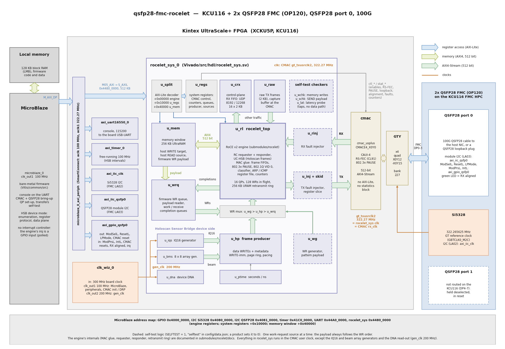

# Design description

## Block diagram



How to read the diagram:

* The MicroBlaze (left, 128 KB local memory, 100 MHz) reaches every block through one AXI
  SmartConnect (`microblaze_0_axi_periph`): the UART, the timer, the two I2C controllers
  (Si5328 on the FMC, QSFP28 module), the QSFP0 GPIO and, through `M05_AXI`, the 512 KB
  window of `rocelet_sys`, which the SmartConnect also moves from 100 MHz into the CMAC user
  clock. Inside `rocelet_sys`, `u_split` decodes that window into the engine registers, the
  system registers (`u_regs`) and the memory window (`u_mem`). The **blue arrows** are these
  register accesses.
* The **green arrows** are memory traffic: the engine's 512-bit AXI4 master into the 256 KB
  UltraRAM memory window (host RDMA WRITEs land there, host RDMA READs and the payload of the
  firmware's work requests come from there) and the payload reader of `u_wrq`.
* The **pale green arrows** are 512-bit AXI4-Streams: CMAC RX → `u_rinj` → engine → `u_inj` →
  CMAC TX, the engine's other-traffic port (frames that are not RoCE and not answered by the
  ARP / ICMP responder leave there, and `u_crx` keeps the HSB control frames; `u_raw` sends the
  firmware's frames into it), the IQ16 and beam array samples into the frame producer, the
  work requests of the three sources (`u_wg`, `u_hp`, `u_wrq`; one source at a time) and the
  completions back to `u_wrq`.
* `u_rl` is the rocelet engine as one block (MAC glue, classifier, ARP / ICMP responder,
  requester, responder, retransmit ring, registers); its internals are documented in the
  [rocelet docs](https://rocelet.ethernetfmc.com) (`submodules/rocelet/docs`).
* The dashed boxes are the optional self-test logic (`"selftest"` in `config/data.json`): the
  fault injectors `u_rinj` / `u_inj` (with the TX register slice), the WR generator `u_wg`, the
  data checkers `u_wchk` / `u_schk` and the latency probe `u_lat` (they only watch the
  streams). A product sets it to `false`.
* The bottom group is the Holoscan Sensor Bridge device side: the frame producer `u_hp` fed by
  the IQ16 generator `u_iqs` or the beam array generator `u_bms` (see
  [Beam array generator](#beam-array-generator)) and the timestamps of `u_ptime`, and the
  device DNA `u_dna` (the board's serial number); see [](hsb.md).
* The orange lines and labels are the clocks: `clk_wiz_0` makes 100 MHz (MicroBlaze,
  peripherals, CMAC init / DRP clock) and 200 MHz (`gen_clk`: the IQ16 and beam array
  generators and the DNA read-out, crossed into the CMAC clock by an asynchronous FIFO and XPM CDC macros) from the
  300 MHz board clock; the Si5328 on the FMC gives the GT reference clock (322.265625 MHz,
  GBTCLK0_M2C), and the CMAC's `gt_txusrclk2` (322.27 MHz) clocks the CMAC's RX and TX
  interfaces and everything in `rocelet_sys`.
* The thin grey line is the CMAC's static control and status (`ctl_*` from `u_regs`:
  enables, RS-FEC, PAUSE, GT loopback; `stat_*`: alignment, faults, packet counters): the
  CMAC's AXI-Lite statistics block is not built (see [CMAC](#cmac)).
* The 2x QSFP28 FMC (right) uses only QSFP28 port 0 on the KCU116 (FMC DP0-3, GTY quad
  X0Y12-X0Y15, the device's only CMAC, CMACE4_X0Y0); port 1 is not routed and is held
  deselected and in reset.

The diagrams in these docs are generated by `docs/source/images/gen_block_diagram.py`
(Python 3 with matplotlib); edit and run it after a change to the design.

## The rocelet engine

The engine is the git submodule `submodules/rocelet` (MIT). The design instantiates its top
level, `rocelet_top`; its port list is documented in the rocelet docs,
[top-level interface](https://rocelet.ethernetfmc.com/interface.html), and its register map in
[register map](https://rocelet.ethernetfmc.com/registers.html). The engine's build parameters
come from `config/data.json` (`engine`):

| Parameter | kcu116 | Meaning |
|-----------|--------|---------|
| `NUM_QP` | 16 | queue pairs |
| `NUM_MR` | 16 | memory windows (R_Key low bits select the window) |
| `READ_DEPTH` | 16 | outstanding RDMA READs per QP (responder) |
| `MAX_WR` | 128 | outstanding work requests |
| `RTX_MODE` | RING | requester retransmission from an on-chip payload ring |
| `RING_BYTES` | 262144 | retransmit ring: 256 KB of UltraRAM |
| `HSB_EN` | 1 | Holoscan Sensor Bridge packet format (QP type UC-HSB) |

## CMAC

The UltraScale+ Integrated 100G Ethernet (CMAC) runs CAUI-4 on the four lanes of QSFP28 port 0
with RS-FEC (Clause 91), without auto-negotiation or link training. Its optional AXI4-Lite
register and statistics block is **not** built (it is larger than the RoCE engine's MAC glue):
the CMAC is configured through its static `ctl_*` inputs, which come from the system register
`C_MAC_CTL` (RX/TX enable, RS-FEC, PAUSE, GT loopback), and a few fabric counters (frames, FCS
and code errors, TX underflow, link drops; RS-FEC corrections in the engine's counters) replace
the statistics. The CMAC reset is a GPIO bit, so the firmware can relink without the CMAC user
clock.

The CMAC's status also drives the engine's `link_up` input (rocelet v0.2):
`link_up = stat_rx_aligned & ~stat_rx_local_fault & ~stat_rx_remote_fault`, registered in the
engine clock. A local fault means the CMAC receives no valid signal, a remote fault means the
link partner reports that it does not receive ours; in either case the partner cannot answer,
so the requester's ACK timer holds as it does when alignment is lost. While `link_up` is low,
and for `LINK_GRACE` (default 2 s, console `grace`) after it rises, the requester holds its ACK
timeouts, so a cable pull or a link-partner reset does not exhaust the retry budget of a QP with
data in flight. Fault bits that toggle while the link comes up only restart the grace (and may
add to the engine's link-drop count). Because the remote fault clears only when the partner
receives the FPGA's signal, the grace starts at the partner's own link-up, which is why 2 s
is enough. In this design the CMAC's `rx_clk` is its TX user clock,
so the status is already in the engine's clock (rocelet synchronises it anyway).

## Address map (MicroBlaze)

| Address | Size | Block |
|---------|------|-------|
| 0x4000_0000 | 64 KB | QSFP0 GPIO: out [0] ModSelL [1] ResetL [2] LPMode [3] CMAC reset; in [0] ModPrsL [1] IntL [2] usr_tx_reset [3] usr_rx_reset [4] RX aligned [5] engine interrupt |
| 0x4080_0000 | 64 KB | I2C: Si5328 (GT reference clock) |
| 0x4081_0000 | 64 KB | I2C: QSFP28 module, port 0 |
| 0x41C0_0000 | 64 KB | timer (counter 0 free running at 100 MHz: the HSB enumeration interval) |
| 0x44A0_0000 | 64 KB | UART 16550 |
| 0x4480_0000 | 64 KB | rocelet engine registers (`rocelet_regs.h`) |
| 0x4481_0000 | 64 KB | system registers (`Vitis/common/src/rsys_regs.h`, generated from `rsys_pkg.sv`; +0x8000: head frame of the control-plane receive FIFO) |
| 0x4484_0000 | 256 KB | memory window (local address 0 of the engine's memory windows) |

The rocelet_sys window is in the CMAC user clock domain: it answers only while that clock
runs (GPIO bit `usr_tx_reset` low).

## Data paths

* **Host RDMA WRITE / SEND to the FPGA:** the engine writes WRITE payload through its AXI4
  master into the memory window (memory windows `MR1`, read/write, and `MR2`, read-only, both
  at VA 0); SEND payload leaves on the engine's SEND stream (checked by the self-test logic; a
  product connects its own sink there). Receive completions (SEND, WRITE with immediate) are
  queued for the firmware (`cq`).
* **Host RDMA READ:** the engine reads the memory window through its AXI4 master.
* **FPGA RDMA WRITE / SEND to the host:** work requests come from the firmware queue (`post`:
  the payload is read from the memory window) or from the self-test generator (`wg`: a
  pattern payload that the host helper verifies). Work completions are queued for the
  firmware.
* **Holoscan Sensor Bridge frames to the host:** the HSB frame producer issues the data and
  metadata work requests of each frame (IQ16, beam array or counter payload) once a host has configured
  the data plane through the HSB register protocol; see [](hsb.md).
* **DDR4:** the KCU116's DDR4 (soldered components, 1 GB / 32 bit, not a socket) can replace or extend the
  on-chip window: connect the engine's AXI4 master to a MIG DDR4 controller through an AXI
  SmartConnect (a clock converter from the CMAC user clock to the MIG user clock) instead of
  `u_mem`. This is not built in this version.

## Beam array generator

`rsys_beam_src` (instance `u_bms`, new in version 0.4.0) is the 8 x 8 phased-array generator of
the [beamforming demo](beam_demo.md): **SOURCE 2** of the HSB frame producer, next to the IQ16
test signal (0) and the counter pattern (1). It produces the complex baseband samples of 64
antenna elements receiving up to four sources (CW tone, LFM pulse, QPSK, pulsed tone) from
directions (*u*, *v*), with per-element complex gains, an element enable mask and element
noise, bit-exact with the integer model `sw/beam/beam_model.py`. Its specification is
[](beam_contract.md); its registers are listed in
[Beam array generator registers](hsb.md#beam-array-generator-registers).

* **Interface**: the same as the IQ16 source's: the generator runs in the 200 MHz `gen_clk`,
  delivers at most one 64-byte beat of 16 complex int16 samples per clock (102 Gb/s), and
  crosses into the CMAC user clock through an asynchronous FIFO. Beat *b* carries time sample
  *b* / 4 and, in lane *L*, element 16 (*b* mod 4) + *L* (time-major, element-interleaved).
  Every beat carries the scene id and activation frame of the scene that generated it as
  side-band; the producer writes them into bytes 48-63 of the frame's metadata record.
* **Scene engine**: the host writes shadow registers (system registers `C_BM_*`, cfg 128-255);
  APPLY snapshots them in the CMAC clock, and one shared complex-exponential unit computes the
  per-scene steering table G[*k*][*s*] (steering phase x element gain x enable, 256 entries)
  into the inactive bank of the per-lane LUTRAM tables in about 1.45 us. The bank becomes
  active at the next frame boundary, so a frame never mixes two scenes. Moving a source is two
  words (U, V): the steering phases are computed in the FPGA.
* **Sample pipeline** (28 clocks): the four source waveforms per time sample (phase
  accumulators, the IQ16 generator's E() unit, QPSK symbols from a hash), then per lane two
  8-deep systolic DSP48E2 cascades for the four complex products w_s G[*k*, *s*], plus the IQ16
  generator's element noise path reused at the element-sample index, a rounding and a
  saturation.
* **Resources** (routed design, 0.4.0): the generator is **12.1k LUT, 535 DSP and 2.5 BRAM36**.
  The whole design is 68.6k LUT (31.6 %), 1,118 DSP (61 %), 98 BRAM36 and 16 URAM; timing is
  met at the CMAC user clock (322 MHz, WNS +0.002 ns) and at the generator clock (200 MHz,
  +0.371 ns). See [](resources.md).
* **Simulation**: `Vivado/src/hdl/tb/run_xsim_beam.sh` runs `tb_beam_src` against vectors
  from the model (`beam_vectors.py`, python3 + numpy): 114,688 beats bit-exact, presets 1, 2
  and 5, an APPLY during a run and while idle, the noise index across m[63:32] = 0 to 1, and
  back-to-back beats at 102.4 Gb/s. In the system testbench, `run_xsim.sh hsbbm` runs the
  producer with the beam generator.

## Self-test logic

The self-test logic (`"selftest": true` in `config/data.json`) is outside the engine and
makes the loopback benchmarks and the console's self-test possible:

* a **pattern region** of the memory window (local address bit 40): reads return
  pattern(address), writes are checked and discarded, so a line-rate stream of any length can
  be verified;
* a **WR generator** issuing WRITE / WRITE-imm / SEND / SEND-imm work requests of a fixed length
  at line rate, with a self-describing payload pattern;
* **data checkers** for memory writes and SEND payload, and an immediate-sequence check;
* **fault injectors** on the engine's TX and RX streams (drop or corrupt frames of selected
  classes, once / periodic / random; 802.1Q-tagged frames are classified too), usable with a
  host as well (`injset`);
* a **latency probe** (WR to completion, split by the CMAC interface timestamps).

A product built from this design sets `"selftest": false`.

## Simulation

`Vivado/src/hdl/tb/tb_rocelet_sys.sv` simulates `rocelet_sys` with the engine from the
submodule through a model of a QSFP28 loopback (TX back to RX after 120 clocks, TX throttled to
about 100 Gb/s, or random back-pressure with `+rndready`). It configures the engine and the
system registers over AXI-Lite exactly as the console does and checks the counters:

```
Vivado/src/hdl/tb/run_xsim.sh [all|arp|wrq|write|send|inject|vinject|read|icrc|access|crx|hsb|hsbiq|hsbbm] [+rndready]
```

`crx` sends HSB register-protocol and BOOTP-reply frames (and frames the filter must reject)
through the loopback into the control-plane receive FIFO and checks the queue, the contents,
the counters and the overflow; `hsb` runs the frame producer with the counter pattern
(several frame / work-request / path-MTU sizes) and with the IQ16 source, decodes every
packet at the CMAC TX interface (opcode, PSN, VA per page, R_Key, length, immediate,
metadata record) and compares the payload with the counter model or with a second IQ16
generator in the testbench, and checks the device DNA read-out. The firmware's HSB protocol
code has a host-side test with the hardware mocked: `Vitis/test/hsb/run.sh`.

`Vivado/src/hdl/tb/run_xsim_prod.sh` runs the frame producer alone (`tb_hsb_prod`, counter
source) for its live frame period: the period written while the stream runs (ten changes at
random clocks, back to back, with and without back-pressure) must set exactly the interval
that begins at the next frame start, and frame size and page stride written during a run must
not reach it.

The engine's own regression (unit and top-level tests against Python models) is in the
rocelet repository (`submodules/rocelet/sim`).
