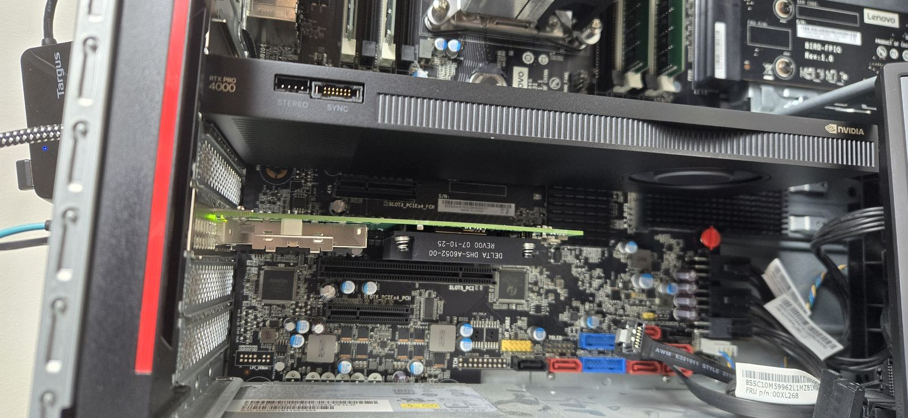
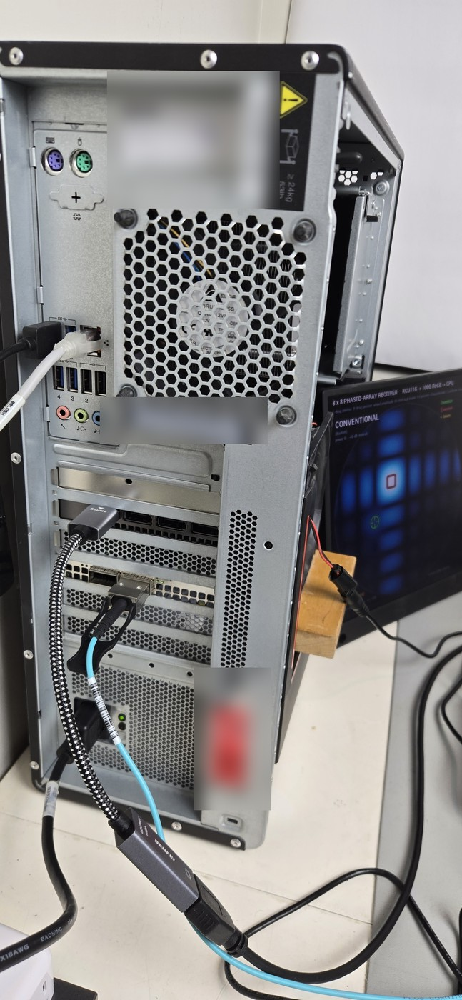

# Host setup

This page takes a PC from a bare install to the [beamforming demo](beam_demo.md) running on a
monitor: the hardware the host needs, the operating system and drivers, Docker and NVIDIA's
Holoscan Sensor Bridge (HSB) container, the 100G port that faces the board, the display session
for the window, and the order in which board and host are started. The board side (build,
programming, console) is in [](getting_started.md).

```{note}
Every step below was done on the test host of this design: a Lenovo ThinkStation P520 with an
NVIDIA ConnectX-6 Dx and an NVIDIA RTX PRO 4000 Blackwell, running Ubuntu 24.04. Values marked
**(test host)** are observations on that machine, not requirements of the design; replace them
with yours. In the commands, `<if>` is the host's 100G network interface (for example
`enp179s0f0np0`), `<rdma-dev>` its RDMA device (for example `rocep179s0f0`, from
`ibv_devices`), `<user>` the account that runs the demo and `<gpu-host>` the host's LAN address.
```

## 1. Hardware



| Part | Requirement | Test host |
|---|---|---|
| 100G NIC | a RoCE v2 NIC whose driver supports UC queue pairs (the HSB data plane is UC) and writes into GPU memory (GPUDirect RDMA); validated: NVIDIA ConnectX-6 Dx | ConnectX-6 Dx MCX623106AN-CDA (dual-port 100GbE, port 1 used), firmware 22.43.2566, Gen3 x16 slot |
| GPU | a workstation or data-centre NVIDIA GPU with CUDA and GPUDirect RDMA (dma-buf) | RTX PRO 4000 Blackwell, 24 GB, compute capability 12.0, Gen3 x16 slot |
| Cable | a QSFP28 100G DAC or AOC from QSFP28 port 0 of the FMC to the NIC port, point to point (no switch) | 3 m passive DAC; a 3 m AOC was also checked |
| Monitor | for the window: a monitor on one of the GPU's display outputs. Without one the demo runs headless and writes PNG files | DisplayPort output through a DisplayPort-to-HDMI adapter; the monitor's EDID is not readable through it (see [section 5](#5-the-display-session)) |
| Disk | about 30 GB free for the container images and the Docker build cache | +29 GB after the HSB build |
| LAN port | for the installs and the tablet page; keep it separate from the 100G link | on-board 1 GbE |

Notes on the PCIe topology, all **(test host)**:

* **NIC slot.** 100 Gb/s needs at least a Gen3 x16 (or Gen4 x8) link; the ConnectX-6 Dx linked
  at Gen3 x16 (`sudo lspci -vv -s <bdf> | grep LnkSta`).
* **NIC-to-GPU path, about 81 Gb/s.** The NIC writes into GPU memory with PCIe peer writes. On
  the test host NIC and GPU sit under different root ports of the CPU (`nvidia-smi topo -m`
  shows `NODE`), the peer writes cross the CPU's root complex, and the stream into GPU memory
  ends at about 81 Gb/s while the same link fills host memory at 97.7 Gb/s. The demo is
  therefore run at up to 80 Gb/s. A host with NIC and GPU behind one PCIe switch (`PIX` or
  `PXB`) or Gen4/Gen5 slots is expected to lift this limit; such a host has not been tested.
* **BAR1, 256 MiB.** The NIC reaches GPU memory through the GPU's BAR1 aperture, so all GPU
  memory registered for RDMA at the same time, across every process, must fit into it. The test
  host's BIOS has no Resizable BAR option, which leaves BAR1 at 256 MiB. The demo's receive ring
  is 64 pages of 1 MiB + 128 bytes (`--pages`, default 64), and BAR1 showed 71 of 256 MiB in
  use with the demo and the X server running. Check it with
  `nvidia-smi -q -d MEMORY | grep -A3 BAR1`. A GPU with Resizable BAR enabled has a BAR1 as
  large as its memory.
* **IOMMU.** The test host boots with `iommu=pt` (`GRUB_CMDLINE_LINUX_DEFAULT` in
  `/etc/default/grub`, `sudo update-grub`, reboot). The NIC-to-GPU rate was the same with and
  without it, so it is not a requirement.
* **Cooling.** The ConnectX-6 Dx has a passive heatsink and ran at 80-82 °C near idle in the
  test host; give it directed airflow (`sensors` shows its temperature).

## 2. Operating system and drivers

The test host runs **Ubuntu 24.04** (24.04.4, the GA kernel 6.8) with Secure Boot disabled.
With Secure Boot on, Ubuntu asks to enrol a key for the NVIDIA kernel module during the install
(not tried on the test host).

**RDMA.** The inbox `mlx5` driver and Ubuntu's rdma-core (version 50) are all the ConnectX-6 Dx
needs; DOCA-OFED / MLNX_OFED and `nvidia-peermem` are not used:

```
sudo apt install rdma-core ibverbs-utils infiniband-diags
ibv_devices                     # the RDMA devices, e.g. rocep179s0f0 / rocep179s0f1
rdma link show                  # each port with its netdev
```

rdma-core installs a udev rule that renames the RDMA devices after the netdev at the next
reboot (`mlx5_0` becomes `rocep179s0f0` on the test host); reboot once before you note the
`<rdma-dev>` name.

**NVIDIA driver.** For the window the host needs the full NVIDIA display driver (OpenGL, Vulkan,
the X driver), not the headless (compute-only) variant, which has no Vulkan. The test host uses
the open kernel module variant of the 595 branch, the branch `ubuntu-drivers devices`
recommended; Blackwell GPUs need the open kernel module:

```
sudo apt install --no-install-recommends nvidia-driver-595-open
sudo reboot
nvidia-smi                      # driver 595.99.02, CUDA 13.2 on the test host; the GPU is listed
```

The test host first had the headless variant (`nvidia-headless-595-open`) and added
`nvidia-driver-595-open` later with the same kernel module. For a host without a monitor the
headless driver is enough (run the demo with `--headless`); the HSB application README
(`sw/hsb/README.md`) describes how to give a container Vulkan on a headless driver.

**CUDA toolkit (recommended).** HSB's container build detects the GPU architecture with the
host's `/usr/local/cuda/bin/nvcc` and falls back to an older architecture (8.0) when it is
missing (the fallback was not tried here). The test host has `cuda-toolkit-13-2` from NVIDIA's
CUDA apt repository, with an apt pin (`/etc/apt/preferences.d/`, priority 100 for that
repository) so that the driver keeps coming from the Ubuntu archive.

## 3. Docker and the HSB container

**Docker and the NVIDIA Container Toolkit.** On the test host Docker comes from the Ubuntu
archive and the toolkit from NVIDIA's CUDA apt repository (NVIDIA's own container-toolkit
repository works as well):

```
sudo apt install --no-install-recommends docker.io docker-buildx pigz nvidia-container-toolkit
sudo nvidia-ctk runtime configure --runtime=docker      # adds the "nvidia" runtime
sudo systemctl restart docker
sudo usermod -aG docker <user>                         # log in again afterwards
docker run --rm --gpus all nvidia/cuda:13.2.0-base-ubuntu22.04 nvidia-smi    # the GPU, from a container
```

On the test host Docker 29.1.3 and toolkit 1.20.1 are installed. Its `/etc/docker/daemon.json`
was written before the install with `"bip": "172.17.0.1/16"` and `default-address-pools` of
172.18.0.0/16 and 172.19.0.0/16, so that no Docker network can take a 192.168.x range such as
the 100G link's. Starting Docker sets the iptables FORWARD policy to DROP and enables IP
forwarding; that does not touch INPUT, so the board's packets reach the host as before.

**The HSB 3.0.0 container.** Build NVIDIA's container from the holoscan-sensor-bridge repository
at tag 3.0.0, on the host itself and **after** the NIC and rdma-core are installed: the build
script looks for RDMA devices (`/sys/class/infiniband`) and leaves the RoCE support out of the
image when it finds none.

```
git clone https://github.com/nvidia-holoscan/holoscan-sensor-bridge.git
cd holoscan-sensor-bridge
git checkout 3.0.0
sh docker/build.sh --dgpu
```

`docker/build.sh --dgpu` (discrete GPU) builds two images from `docker/Dockerfile` and
`docker/Dockerfile.demo`: `hololink-prototype:3.0.0` (the base) and **`hololink-demo:3.0.0`**,
the image the demo runs in. On the test host the build took about 20 minutes including the
downloads; the images are 17.1 and 11.6 GB (shared layers) plus about 22 GB of build cache.
The image provides Holoscan SDK 4.4.0, hololink 3.0.0, CuPy (`cupy-cuda13x` 14.2.0), Python 3.12
on a CUDA 13.0 runtime base, and its own RDMA user-space libraries (inside the image only).
The beamforming demo needs no packages beyond the image.

```
docker images hololink-demo                                              # 3.0.0
docker run --rm --gpus all --runtime=nvidia hololink-demo:3.0.0 nvidia-smi
docker run --rm hololink-demo:3.0.0 pip3 show holoscan-cu13 hololink cupy-cuda13x | grep -E '^(Name|Version)'
```

## 4. The 100G port



The FPGA's 100G MAC does not auto-negotiate, so the host port runs with fixed settings. Use an
isolated point-to-point link: never put the 100G port on a LAN or behind a router.

| Setting | Value | Command (runtime) |
|---|---|---|
| Speed | 100G, full duplex, auto-negotiation off (a ConnectX-6 Dx starts with auto-negotiation on and reports "No partner detected" until it is off) | `sudo ethtool -s <if> speed 100000 duplex full autoneg off` |
| FEC | RS-FEC, the same as the FPGA (its default) | nothing to do on a ConnectX-6 Dx: its FEC setting `Auto` resolves to RS against the FPGA |
| MTU | 4200, for an RDMA path MTU of 4096 | `sudo ip link set dev <if> mtu 4200` |
| Address | 192.168.20.1/24 (the FPGA is 192.168.20.2 by default) | `sudo ip addr add 192.168.20.1/24 dev <if>` |
| Neighbour entry, link pause | leave them alone: no static neighbour entry is needed, link pause stays at the NIC's default | |

**Persistent configuration.** The test host (Ubuntu with systemd-networkd) uses a netplan file
for the address and the MTU, and a systemd `.link` drop-in for the speed. The netplan file,
`/etc/netplan/70-rocelet-100g.yaml` (mode 600; `<mac>` is the port's MAC address from
`ip link show <if>`):

```
network:
  version: 2
  ethernets:
    <if>:
      match:
        macaddress: "<mac>"
      set-name: <if>
      dhcp4: false
      dhcp6: false
      accept-ra: false
      link-local: []
      addresses: [192.168.20.1/24]
      mtu: 4200
      ignore-carrier: true
      optional: true
```

`ignore-carrier` keeps the address while the board is off (so the port's RoCE v2 GID, which
carries the address, stays the same), and `optional` keeps the boot from waiting for the link. Because of
`match` and `set-name`, netplan generates a systemd link file `10-netplan-<if>.link` for the
port, and a drop-in next to it forces the speed at every boot,
`/etc/systemd/network/10-netplan-<if>.link.d/50-force-100g.conf`:

```
[Link]
AutoNegotiation=no
BitsPerSecond=100G
Duplex=full
```

Apply the netplan file with `sudo netplan apply` (or `sudo netplan generate`, `sudo networkctl
reload`, `sudo networkctl reconfigure <if>`, which leaves the other ports alone, as on the test
host). The drop-in takes effect at the next boot; until then use the `ethtool` command of the
table.

**Ubuntu Desktop variant** (not tried on the test host, which is Ubuntu Server). Desktop manages
the ports with NetworkManager, so give the 100G port a connection profile with the same values
instead of the netplan file (the `.link` drop-in for the speed is the same on both editions, as
it belongs to systemd-udev, not to the network manager):

```
sudo nmcli connection add type ethernet ifname <if> con-name rocelet-100g \
    ipv4.method manual ipv4.addresses 192.168.20.1/24 ipv4.never-default yes \
    ipv6.method disabled 802-3-ethernet.mtu 4200 connection.autoconnect yes
sudo nmcli connection up rocelet-100g
```

`ipv4.never-default` keeps the point-to-point link out of the default route and `ipv6.method
disabled` stops NetworkManager from trying IPv6 on it. If a netplan file is preferred, the same
file as above works with `renderer: NetworkManager` under `ethernets:`.

**Check the link** with the board programmed (see [](getting_started.md)):

| Where | Command | Expected |
|---|---|---|
| host | `ethtool <if>` | `Speed: 100000Mb/s`, `Duplex: Full`, `Auto-negotiation: off`, `Link detected: yes` |
| host | `ethtool --show-fec <if>` | `Active FEC encoding: RS` |
| host | `ip -br addr show <if>` | `UP` with `192.168.20.1/24` |
| host | `rdma link show`, `ibv_devinfo -d <rdma-dev>` | the port `ACTIVE`, `active_mtu: 4096 (5)` |
| host | `ping -c 3 192.168.20.2` | replies (the FPGA answers ARP and ICMP echo) |
| board console | power-up banner, `st` | `Port 0: link up, 100 Gb/s, RS-FEC on`; `st` shows the link and the engine's counters |

The ConnectX-6 Dx's carrier comes up about 2 s after the board is programmed **(test host)**.

## 5. The display session

The demo's window is drawn by Holoviz (Vulkan) inside the container, on the host's X server. The
host therefore needs a running X session on the monitor that local clients (the container) may
use. The test host has no desktop environment; it runs LightDM with automatic login into
Openbox:

```
sudo apt install --no-install-recommends lightdm lightdm-gtk-greeter openbox xinit \
    xserver-xorg-core xserver-xorg-input-libinput x11-xserver-utils x11-utils mesa-utils vulkan-tools
```

`/etc/lightdm/lightdm.conf.d/50-rocelet-autologin.conf` logs `<user>` in at boot and starts X
without a TCP listener, screen saver or DPMS blanking:

```
[Seat:*]
autologin-user=<user>
autologin-user-timeout=0
autologin-session=openbox
user-session=openbox
xserver-command=X -nolisten tcp -s 0 -dpms
```

`~<user>/.config/openbox/autostart` keeps the monitor on and lets local clients open the display:

```
xset s off -dpms
xset s noblank
xhost +local:
```

After a reboot (or `sudo systemctl restart lightdm`) the session is display `:0`; `nvidia-smi`
lists `/usr/lib/xorg/Xorg` as a GPU process. `xhost +local:` lets every local process, the
containers included, use the display, and automatic login leaves the session open on the
monitor: settings for a demo machine, not for a shared one.

**Ubuntu Desktop variant** (not tried on the test host). A Desktop install already has a session
on the monitor, so none of the packages above are needed; four things differ:

* *Wayland or X11.* Ubuntu 24.04's GNOME session runs on Wayland by default, also with the NVIDIA
  driver. The demo's window is an X11 client and then runs through XWayland, which works with a
  monitor that has a readable EDID (the compositor picks the mode, so the DoubleScan problem
  below cannot occur). The `xorg.conf.d` fix for a monitor *without* EDID applies only to an X11
  session: choose "Ubuntu on Xorg" from the gear menu of the login screen, or set
  `WaylandEnable=false` in `/etc/gdm3/custom.conf`.
* *Automatic login* is GDM's: in `/etc/gdm3/custom.conf`, under `[daemon]`,
  `AutomaticLoginEnable=true` and `AutomaticLogin=<user>`.
* *Local clients.* `xhost +local:` must run in the session: put it in a GNOME autostart entry,
  `~<user>/.config/autostart/rocelet-xhost.desktop` with `Exec=xhost +local:` (and
  `Type=Application`, `Name=rocelet xhost`). Under Wayland the same command applies to the
  XWayland server.
* *Blanking and suspend.* GNOME blanks the screen and may suspend an idle machine, which the
  Openbox session never does; switch both off for the demo user:

  ```
  gsettings set org.gnome.desktop.session idle-delay 0
  gsettings set org.gnome.desktop.screensaver lock-enabled false
  gsettings set org.gnome.settings-daemon.plugins.power sleep-inactive-ac-type 'nothing'
  ```

The run wrapper and the demo commands are the same on both editions.

`sw/beam/run.sh` (section 6) gives the container the display when it is started with `RL_WIN=1`:
it adds `-e DISPLAY=:0` (`RL_DISPLAY` overrides it) and mounts the X socket directory
`/tmp/.X11-unix`. `NVIDIA_DRIVER_CAPABILITIES=all` lets the NVIDIA Container Toolkit bring the
host driver's OpenGL and Vulkan libraries into the container. Without a display, run the
demo with `--headless` (PNG files every `--png-every` shown frames) or `--viz none`.

**A monitor without EDID.** If the driver cannot read the monitor's EDID (on the test host
because of the DisplayPort-to-HDMI adapter), it substitutes a 640 x 480-only fallback and X
comes up at 640 x 480 (`DISPLAY=:0 xrandr`). The test host forces 1920 x 1080 at 60 Hz with
`/etc/X11/xorg.conf.d/20-rocelet-monitor.conf`:

```
Section "Monitor"
    Identifier  "rocelet-mon"
    HorizSync   30.0 - 140.0
    VertRefresh 48.0 - 76.0
    Modeline    "1920x1080_60" 148.50 1920 2008 2052 2200 1080 1084 1089 1125 +hsync +vsync
    Option      "PreferredMode" "1920x1080_60"
EndSection
Section "Device"
    Identifier  "rocelet-gpu"
    Driver      "nvidia"
    BusID       "PCI:101:0:0"
    Option      "ModeValidation" "AllowNonEdidModes, NoEdidModes, NoEdidMaxPClkCheck, NoHorizSyncCheck, NoVertRefreshCheck, NoXServerModes, NoPredefinedModes, NoVesaModes"
    Option      "UseEdidFreqs" "false"
EndSection
Section "Screen"
    Identifier  "rocelet-screen"
    Device      "rocelet-gpu"
    Monitor     "rocelet-mon"
    DefaultDepth 24
    Option      "MetaModes" "DFP-0: 1920x1080_60 +0+0"
EndSection
```

`BusID` is the GPU's PCI address in decimal (`nvidia-smi` shows `00000000:65:00.0` on the test
host, which is `PCI:101:0:0`), and `DFP-0` is the NVIDIA X driver's name for the connected
output on the test host; the modeline is the standard 1920 x 1080 at 60 Hz timing.
`NoXServerModes, NoPredefinedModes, NoVesaModes` make that modeline the only mode: without them
the X server also offered driver-generated 1920 x 1080 modes, Holoviz's fullscreen window took
a 60.01 Hz DoubleScan one, and the monitor showed the picture squeezed to about half its width.
Restart the session with `sudo systemctl restart lightdm` (`sudo systemctl restart gdm3` on a
Desktop install running on Xorg) after a change. A monitor with a readable EDID needs none of this.

## 6. The demo software

The demo is the Holoscan application in `sw/beam/`; it reuses `sw/hsb/` (frame accounting, start
gate, connection, keepalive), so both directories must sit side by side. Clone this repository
on the host (the rocelet submodule is not needed for the demo) or copy its `sw/` directory to
`<dir>/sw`:

```
git clone https://github.com/fpgadeveloper/qsfp28-fmc-rocelet.git
cd qsfp28-fmc-rocelet
```

`sw/beam/run.sh` runs a command in the `hololink-demo:3.0.0` container. It mounts the directory
two levels above itself (the clone, or `ROCELET_DIR`) at `/beam`, starts in `/beam/sw/beam`, and
uses the options the demo was validated with:

| Option | Why |
|---|---|
| `--net host --privileged` | the container sees the 100G port and the RDMA device, and may enlarge its socket buffers |
| `--gpus all --runtime=nvidia -e NVIDIA_DRIVER_CAPABILITIES=all --device /dev/nvidia-modeset` | the GPU, with the graphics and display libraries for Holoviz |
| `--ulimit stack=33554432 --shm-size=1g` | as in HSB's own `docker/demo.sh` |
| `--init`, `--name rocelet-beam` (`RL_NAME`) | Ctrl-C and `docker stop rocelet-beam` (SIGTERM) reach the application, which then switches the board's data plane off |
| `RL_WIN=1` | adds `-e DISPLAY=:0 -v /tmp/.X11-unix:/tmp/.X11-unix` for the window (section 5) |
| `RL_IMAGE` | another image name (default `hololink-demo:3.0.0`) |

Check the host without the board first: the GPU tests, then the demo with the board's generator
running as a CUDA kernel on the GPU (`--source csynthetic`, about 50-60 frames shown per second):

```
sw/beam/run.sh python3 -m unittest -v tests/test_beam_gpu.py
RL_WIN=1 sw/beam/run.sh python3 rocelet_beam_app.py --source csynthetic --preset 2
sw/beam/run.sh ibv_devinfo -d <rdma-dev>               # the RDMA device, from the container
```

The application's default RDMA device is `rocep179s0f0`, the name on the test host; on any other
host add `--ibv-name <rdma-dev>` to the `--source roce` command lines.

## 7. Start the demo

1. **Board.** Program the 0.4.0 bitstream (see [](getting_started.md)) and check the link
   (section 4). On the console (115200 8N1), switch the HSB device mode on; it is off after
   every power-up:

   ```
   rl> hsb on          # BOOTP every second from 192.168.20.2, register protocol on UDP 8192
   rl> hsb src beam    # optional: the application writes SOURCE = 2 itself
   ```

2. **Host.** Start the application with the window:

   ```
   RL_WIN=1 sw/beam/run.sh python3 rocelet_beam_app.py --source roce --preset 2 --rate 64 --ibv-name <rdma-dev>
   ```

   The other command lines (every frame checked, headless) and all options are in
   [Running it](beam_demo.md#running-it); the window's controls are in
   [The window](beam_demo.md#the-window).

3. **Tablet.** The application serves the tablet page on port 8090 by default (`--web`), at
   **http://\<gpu-host\>:8090/** from any device on the host's LAN; see
   [The tablet page](beam_demo.md#the-tablet-page). The page has no authentication.

4. **Stop.** Esc in the window, Ctrl-C in the terminal, or `docker stop rocelet-beam`. The
   application switches the board's data plane off and ends with a `PASS:` / `FAIL:` line; the
   next run needs no power cycle. If the application dies without that, the board's producer
   watchdog stops the stream within the keepalive timeout (2 s, `--keepalive`).

## 8. If it does not work

| Symptom | What to check |
|---|---|
| the application stops with "is the board on with 'hsb on', the container run with --net host?" | the board does not enumerate. Run `hsb on` (again after every power-up) and `hsb st` on the console; check the link (section 4); `sw/beam/run.sh hololink-enumerate` should list the board once a second; `sudo tcpdump -ni <if> udp port 12267` on the host shows its BOOTP broadcasts. The board's packets arrive on the host's INPUT chain: Docker's FORWARD policy does not affect them, but a host firewall that filters INPUT must accept UDP from 192.168.20.0/24 on `<if>` (the test host has no INPUT filtering) |
| the application refuses to run because of `S_BM_CAPS` | the bitstream has no array generator: program the 0.4.0 bitstream |
| the receiver cannot open the RDMA device | `--ibv-name <rdma-dev>` (section 6), and a reboot after the rdma-core install renames the devices |
| a few frames lost in the first 2 s at 40-80 Gb/s | a known start-up effect of the host NIC (`rx_discards_phy`) **(test host)**; the application reports them apart (`lost_start`) and judges the run on the losses after that ([Known limits](beam_demo.md#known-limits)) |
| X runs at 640 x 480, or the fullscreen picture is squeezed to about half its width | the monitor sends no EDID: the X configuration of section 5, including the three `ModeValidation` tokens |
| the window does not open (no display, no Vulkan device) | `RL_WIN=1`, the X session on `:0` with `xhost +local:`, and the full NVIDIA driver on the host (section 2) |
| the receive ring cannot be registered in GPU memory | BAR1 is full: another process (another receiver, or a GPU ring of `rocelet_host --mem gpu`, which takes up to 240 MiB) holds GPU memory registered for RDMA. Check `nvidia-smi -q -d MEMORY \| grep -A3 BAR1` and stop the other process, or lower `--pages` |
| packets of every kind lost, register writes time out | the stream is faster than the host's NIC-to-GPU path (about 81 Gb/s on the test host): keep `--rate` at 80 or below |

[](hardware_test.md) adds the host tool `rocelet_host` for RDMA tests with the console (not
needed for the demo), and [](hsb.md) the other HSB applications (counter and IQ16 frames).
