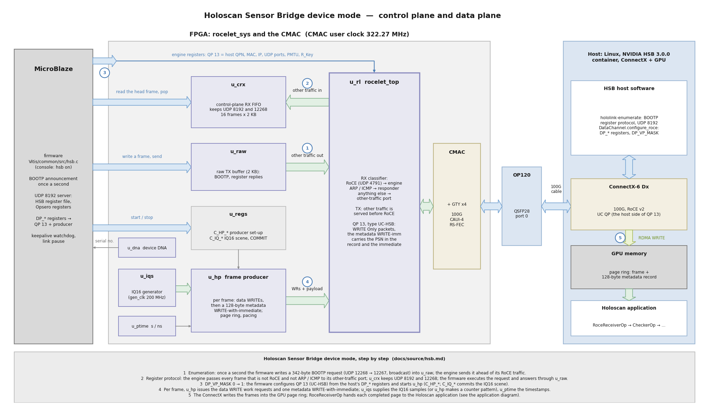
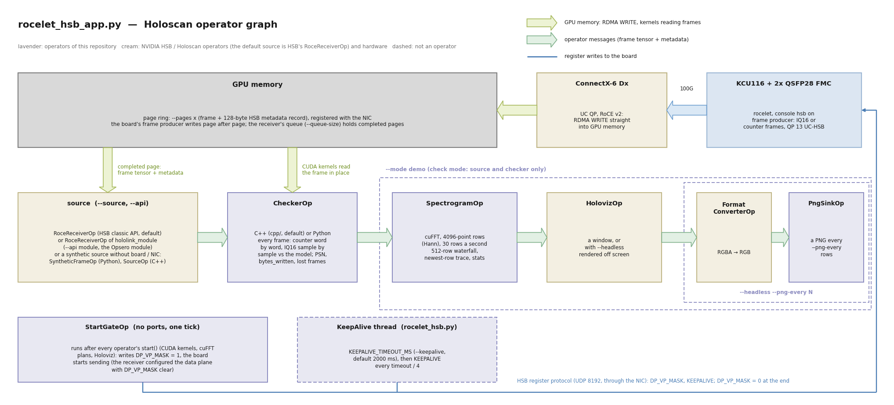

# Holoscan Sensor Bridge device mode

```{note}
**Status: released in version 0.3.0** (2026-10-31). The device mode is verified in simulation
(the design's xsim testbench: receive FIFO, frame producer against the counter model and an
IQ16 reference generator), by a host-side test of the firmware (`Vitis/test/hsb`) and on
hardware against HSB 3.0.0 on a ConnectX-6 Dx host: enumeration, register protocol, reset,
counter and IQ16 frames through the Linux-UDP receiver and through the RoCE receiver into GPU
memory (up to 80 Gb/s, the test host's NIC-to-GPU limit), the Holoscan application, the
producer watchdog, the link pause and the module API. Known limitations: see
[](revision_history.md).
```

With `hsb on` on the console, the board behaves as a Holoscan Sensor Bridge (HSB) device for
NVIDIA's HSB host software (version 3.0.0): the host finds it (enumeration), reads and writes
its registers (the HSB register protocol), configures a data plane, and receives frames in the
HSB format: through the RoCE receiver into GPU or host memory, or through the Linux-UDP
receiver into host memory with any NIC. The frames carry the IQ16 test signal (four tones, a
chirp and noise), a counter pattern or (since version 0.4.0) the samples of an 8 x 8
antenna array. The host example is in `sw/hsb/`
([README](https://github.com/fpgadeveloper/qsfp28-fmc-rocelet/tree/main/sw/hsb)).

```{tip}
The [beamforming demo](beam_demo.md) uses this device mode end to end: the FPGA's array
generator streams 64 antenna elements into GPU memory, a CuPy beamformer draws the sky in a
Holoviz window, and dragging a source in the window writes the new scene back to the FPGA over
the register protocol.
```

The rocelet engine provides the HSB data plane (QP type UC-HSB, see the rocelet documentation
`docs/hsb.md`). This design adds the device side around it:

| Part | Where | What |
|---|---|---|
| Enumeration, register protocol, register file, data-plane translation | firmware `Vitis/common/src/hsb.c` | BOOTP once a second, UDP 8192 server, DP_* registers to a rocelet QP and the producer |
| Control-plane receive FIFO | RTL `rsys_crx` | the HSB frames of the engine's other-traffic port, queued for the firmware |
| Frame producer | RTL `rsys_hsb_prod` | per frame: data WRITE work requests and one metadata WRITE-with-immediate, page ring, frame pacing |
| IQ16 source | RTL `rsys_iq_src` + `iq16_gen` | the IQ16 test-signal generator in a 200 MHz clock, asynchronous FIFO into the CMAC clock |
| Beam array source | RTL `rsys_beam_src` | the 8 x 8 phased-array generator of the [beamforming demo](beam_demo.md) (SOURCE 2), same clocking |
| Time (PTP stub), device DNA | RTL `rsys_ptime`, `rsys_dna` | metadata timestamps; the board's serial number |



How to read the diagram (the numbers are the steps in the strip at the bottom):

* The **blue arrows** are the firmware's register accesses: it reads and pops the control
  frames queued in `u_crx`, writes its own frames (the BOOTP announcement, the register
  replies) into `u_raw`, starts and stops the producer through the system registers (`C_HP_*`,
  `C_IQ_*`) and configures QP 13 in the engine registers when the host enables the data plane.
  On the host, the HSB host software talks to the board through the same NIC.
* The **pale green arrows** are AXI4-Streams in the FPGA: the engine's other-traffic port in
  (frames that are not RoCE and not answered by the engine) and out (the firmware's frames,
  sent ahead of the RoCE traffic), and the producer's work requests with their payload. On
  the host they are the frames handed from the receiver to the application.
* The **green arrow** is the RDMA WRITE of the frames into the GPU page ring by the ConnectX
  NIC; no CPU copies the data.
* The thin grey lines are sideband: the producer set-up from the system registers, the
  timestamps of `u_ptime` and the device DNA that the firmware turns into the serial number.
* The firmware handles only the control plane; the frames go from the IQ16 generator through
  the producer and the engine to the GPU without the MicroBlaze. The diagram is generated by
  `docs/source/images/gen_block_diagram.py` (see [Block diagram](description.md#block-diagram)
  for the whole design).

## Quick start

1. Program the board and connect QSFP28 port 0 to the host's 100G port (as in
   [](getting_started.md)). On the console: `hsb on`.
2. On the host, in NVIDIA's HSB 3.0.0 container with `--net host --privileged`, with the 100G interface on
   192.168.20.0/24 and an MTU of at least 4200:

   ```
   hololink-enumerate                         # the board announces itself once a second
   python3 sw/hsb/rocelet_hsb.py --read 0x80  # HSB_IP_VERSION 0x2603
   python3 sw/hsb/rocelet_hsb.py --frames 100 # 1 MiB counter frames, checked
   ```

`hsb off` stops the data plane and the enumeration. The mode is off after power-up and is not
changed by `setup`; the console tests (`t`, `write`, `tput`, ...) and `setup` re-configure
every QP, so they stop a running data plane first (the host has to configure it again).

## Host application

`sw/hsb/rocelet_hsb_app.py` is a Holoscan application for the device mode (README in
`sw/hsb/`). HSB's `RoceReceiverOp` receives the frames into GPU memory; a checker operator (C++,
`sw/hsb/cpp/`, or Python) verifies every frame it gets (the counter pattern word by word, or the IQ16 signal sample by sample
against its bit-exact model `sw/hsb/rocelet_iq.py`; the metadata record's PSN against the
immediate and against the previous frame; bytes_written; frames lost on the network apart from
frames the application skipped); in demo mode a cuFFT spectrogram (4096-point rows, 30 rows a
second) shows the IQ16 signal as a waterfall in Holoviz, in a window or rendered off screen to
PNG files. Synthetic sources write frames in the same page-ring layout into GPU memory (a Python
one with fault injection, and a C++ one that models the board's timeline and HSB's receive
queue), so the whole application, including a fault-injection self-test, runs without the board.



How to read the diagram:

* The top row is where the frames come from: the board's frame producer sends them over the
  100G link and the ConnectX NIC writes them (**green**, RDMA WRITE) into a page ring in GPU
  memory. The source operator emits each completed page as a frame tensor with its metadata;
  the operators read the frame where it is, in GPU memory.
* The middle row is the operator graph of `RoceletHsbApp.compose()`; the **pale green arrows**
  are the messages between the operators. The source is HSB's `RoceReceiverOp` (classic API,
  default), the `RoceReceiverOp` of `hololink_module` (`--api module`), or a synthetic source
  (`--source synthetic` / `csynthetic`) that needs no board and no NIC. Check mode runs the
  source and `CheckerOp` only; `--mode demo` adds the spectrogram and Holoviz, and
  `--headless --png-every N` the PNG output.
* Lavender boxes are operators of this repository, cream boxes are NVIDIA HSB / Holoscan
  operators (and hardware).
* The bottom row writes the board's registers (**blue line**, HSB register protocol):
  `StartGateOp` enables the data plane once every operator has started, the keepalive thread
  feeds the producer watchdog, and the application writes DP_VP_MASK = 0 when it ends.
* The diagram is generated by `docs/source/images/gen_block_diagram.py`.

```
sw/hsb/cpp/build.sh                                       # the C++ operators (once, in the container)
python3 sw/hsb/rocelet_hsb_app.py --mode check --data counter --rate 10 --duration 600
python3 sw/hsb/rocelet_hsb_app.py --mode demo --rate 10        # Holoviz window
```

The application controls the board through the HSB register protocol:

* **Start order.** The board's data plane starts only when the whole graph is up: the receiver
  configures the data plane with DP_VP_MASK left clear (the sensor's `vp_mask` is 0 in the
  enumeration metadata the `DataChannel` is built from), and a one-tick operator that runs after
  every operator's `start()` (CUDA kernels, cuFFT plans, Holoviz) sets DP_VP_MASK
  (`--start-gate`, `--start-delay`). Without this, HSB's `RoceReceiverOp` starts the board in its
  own `start()`, while the rest of the graph is still initialising.
* **Keepalive.** After the HSB reset the application writes KEEPALIVE_TIMEOUT_MS (`--keepalive`,
  default 2000 ms) and refreshes KEEPALIVE from a thread every timeout / 4, so a killed or hung
  application stops the board by itself ([Producer watchdog](#producer-watchdog)); the JSON
  summary lists STATUS, WATCHDOG_COUNT and LINKPAUSE_COUNT.
* **Resync.** After a link pause the producer restarts at frame number 0, the first page and
  IQ16 sample 0 while the PSN carries on; the checkers recognise this (the 16-bit frame number
  falls back and the PSN does not follow the frame-number step), count it as a resync, start a
  new accounting segment and count the frames lost across it from the PSN step, with no data
  errors.
* **Receiver scheduling.** HSB's receivers can wake the graph with an asynchronous condition per
  frame; once the stream outruns the application the delivered frame rate then decays (greedy
  scheduler always, event-based scheduler often). The application uses the classic
  `RoceReceiverOp` without that condition (`use_frame_ready_condition=False`, its `compute()`
  waits for the next frame) and the greedy scheduler (`--frame-ready`, default blocking).
* **Host APIs.** HSB's classic `hololink` API (default) or the module API (`--api module`) with
  the Opsero device module (see [Device module](#device-module-hololink_module)).

Status: run against the board (KCU116 + OP120, ConnectX-6 Dx, RTX PRO 4000 Blackwell, console
0.3.0): check mode clean at 10, 40 and 80 Gb/s for the counter pattern and the IQ16 signal
(every checked frame bit-exact against the model), with the C++ checker 99.87-99.97 % of the
1 MiB frames at 80 Gb/s on 0.9 CPU cores (default queue of 32; 99.4-99.7 % with 8); the start gate gives 0 start-up drops and 0 NIC
discards, also at the 80 Gb/s demo start; a killed application stops the board through the
keepalive watchdog within its timeout; a link drop pauses the producer, which resumes after the
link is back with no frames lost and one resync in the checker; the module API receives and
checks frames at 10-80 Gb/s; Ctrl-C / SIGTERM stops the board; the demo waterfall renders
headless at 80 Gb/s (hardware sessions F and G). See the measured limits below.

### Measured limits (test host)

Test host: Lenovo P520 (Xeon Skylake-SP, Gen3), ConnectX-6 Dx, RTX PRO 4000 Blackwell. These
numbers belong to that host, not to the design: the board sends 97.6 Gb/s unpaced.

| Path | Result |
|---|---|
| RoCE receiver into GPU memory | clean to 80 Gb/s; the host's NIC-to-GPU path ends at about 81 Gb/s (above it the NIC drops packets of every kind) |
| Linux-UDP receiver (host memory, software) | clean to 8 Gb/s, drops at 16 Gb/s |
| C++ checker, board, 1 MiB frames at 80 Gb/s | 99.87-99.97 % of the frames checked with `--queue-size 32` (default; 99.4-99.7 % with 8), ~9,500 frames/s, 0.9 CPU cores |
| Python checker, board, 1 MiB frames at 80 Gb/s | 96.4 %, 1.2 CPU cores (blocking scheduling); every frame with 4 MiB frames |
| Asynchronous receiver scheduling, board, 80 Gb/s | 88.5 % (C++ checker, 2 workers, 2 CPU cores): use the default blocking mode |
| Demo (checker, spectrogram, Holoviz), board, 80 Gb/s | 91-95 % of the frames, 1.2 CPU cores, no NIC discards with `--start-delay 0` |
| Module API (asynchronous only), board | 100 % at 40 Gb/s, 91.5 % at 80 Gb/s (C++ checker, 2 CPU cores); lost and consumer-dropped frames are not separable |
| Data-plane start after an idle GPU | a 1-3 s `--start-delay` at 80 Gb/s cost 420,000-550,000 NIC discards and damaged frames: the idle GPU had dropped to its lowest PCIe link speed (Gen1) |
| Link drop (console `link`) during 40 Gb/s | producer paused ~7 s (relink, partner link-up, 2 s grace), 0 frames lost, 1 resync |

## Device module (`hololink_module`)

HSB's module API loads a device module chosen by the board's announcement:
`hololink_<uuid>_<compat-id>.so` from `$HOLOLINK_MODULE_DIR` or the installation's
`lib/hololink/modules`. `sw/hsb/module/` builds the Opsero module
`hololink_98183d0f-18ee-4719-a3b4-ca69e9b94c97_2603.so` out of NVIDIA's tree (MIT; NVIDIA's
headers and `module_core` sources are used from a holoscan-sensor-bridge 3.0.0 checkout, not
copied): NVIDIA's canonical HSB-IP publisher with one sensor on data plane 0 and one SIF, no I2C,
clock synthesiser or MIPI D-PHY. With it, module-API applications get the board's control plane,
RoCE and Linux data channels and receivers; without it the board's metadata reaches them
unenriched and no services are available. The classic API needs no module (the application
declares the shape with `set_uuid_strategy`, as `sw/hsb/rocelet_hsb.py` does).

```
sw/hsb/module/build.sh /path/to/holoscan-sensor-bridge     # inside the HSB container
export HOLOLINK_MODULE_DIR=$PWD/sw/hsb/module/build/lib/hololink/modules
python3 sw/hsb/module/test_module.py                       # enumeration + emulator tests, no board
python3 sw/hsb/rocelet_hsb_app.py --api module --mode check --rate 10
```

The vendor identifier "NVDA" in the board's announcement is a protocol constant that every HSB
host requires (there is no other value it accepts); it does not claim that the board is an
NVIDIA product. The UUID 98183d0f-18ee-4719-a3b4-ca69e9b94c97 is Opsero's own, generated for this
design; compat-id 0x2603 names the HSB register layout the firmware implements.

## Enumeration

Once a second the firmware broadcasts a 342-byte BOOTP request from UDP port 12268 to 12267
(destination 255.255.255.255, source = the board's IP address). The host learns the board's
address from it and sends the register protocol there.

| Field | Value |
|---|---|
| BOOTP | op 1, htype 1, hlen 6, xid 0 (data plane 0), secs, ciaddr = board IP, chaddr = board MAC |
| vendor area | tag 0xE0, "NVDA" (a protocol constant the HSB host requires; not a claim of origin), data plane 0, enumeration version 2 |
| compat-id | 0x2603 (little-endian; selects the HSB register layout the host programs) |
| UUID | **98183d0f-18ee-4719-a3b4-ca69e9b94c97** (qsfp28-fmc-rocelet, KCU116 + OP120) |
| serial number | 7 bytes, unique per board (below) |
| HSB IP version | 0x2603 (little-endian) |
| status | bit 1 = serial number from hardware (DNA), bit 0 = PTP time valid (0) |
| BOOTP sequence | +1 per announcement |

**Serial number.** The firmware folds the FPGA's 96-bit device DNA (read once after
configuration by `DNA_PORTE2`; `S_DNA0..2`) into 56 bits: serial = DNA[55:0] XOR DNA[95:56],
sent big-endian. `hsb serial` prints the DNA and the serial. The HSB host keeps one device
object per serial number, so two boards on one network must differ; the MAC address of the
design is fixed (`02:0a:35:72:6c:01`), the DNA is not.

**set-ip.** `hololink-set-ip <mac> <ip>` sends a BOOTP reply to UDP 12268; the firmware adopts
the new address (`yiaddr`, when `chaddr` is its MAC) for the engine and the enumeration. The
console's `ip` command does the same by hand.

## Register protocol

UDP port 8192, requests to the board's IP address. The firmware answers on the same port to
the request's source address and port.

| Byte | Request | Reply |
|---|---|---|
| 0 | command: 0x04 write, 0x09 block write, 0x14 read, 0x19 block read | command \| 0x80 |
| 1 | flags: [0] reply requested, [1] sequence check | as received |
| 2-3 | sequence (big-endian) | as received |
| 4 | 0 | status |
| 5 | 0 | 0 |
| 6.. | address (+ value) pairs, big-endian; block commands up to 183 pairs | the pairs, read values filled in |
| end | | the latched sequence (big-endian) and two zero bytes |

Sequence check: when flag [1] is set and the sequence is not the latched one + 1, the request
is not executed and the status is 0x0B; otherwise it is executed and its sequence is latched.
Status codes: 0x00 success, 0x03 address not mapped (also for unaligned addresses), 0x04
unknown command, 0x05 bad length, 0x0B sequence check. A request without flag [0] is executed
without a reply.

### Registers

Every register a stock HSB 3.0.0 host writes while it starts a device and configures a data
plane is accepted with status 0. Most are only stored (the host can read them back); the
ones in bold act.

| Address | Name | Behaviour |
|---|---|---|
| 0x0004, 0x0008 | reset control | stored; **0x0004 bit 3 = HSB reset**: the data plane stops, every register below is cleared, the sequence latch returns to 0; the IP address, the Opsero registers and the enumeration stay |
| 0x0080 | HSB_IP_VERSION | **0x2603** (read only) |
| 0x0084 | FPGA_DATE | the firmware build date, 0xYYYYMMDD (read only) |
| 0x0100-0x011C | PTP control, profile, delay asymmetry, DPLL, averaging, domain | stored |
| 0x0180-0x0184 | PTP sync timestamp | stored |
| 0x0188, 0x018C | PTP SYNC_STAT, OFM | 0: not synchronised (no PTP) |
| 0x0200-0x0230 | event registers (host MAC / IP / UDP ports, enables, TSN VLAN) | stored; the board sends no events |
| 0x0280 | CTRL_EVT_STAT | 0 |
| 0x1000-0x10FF | sensor (VP) slices 0-3, 16 words each | stored; **slice 0 = the data plane's DP_QP ... DP_VLAN** |
| 0x2000-0x2FFF | APB RAM (sequencer, 4 KB) | stored |
| 0x02000300 + 0x10000 *d* + 0x0-0xC, *d* = 0, 1 | data-plane (HIF) slices | stored; **slice 0 DP_PACKET_SIZE, DP_PACKET_UDP_PORT, DP_VP_MASK** (bit 0: 0 to 1 starts, 1 to 0 stops the data plane) |
| 0x01000000 + 0x10000 *s* + 0x0-0xC, *s* = 0-3 | SIF packetizer | stored |
| 0x70000000-0x70000014 | VSYNC | stored |
| 0x7F000000-0x7F00002C | Opsero registers (ID, SOURCE, RATE_MBPS, SCENE, FRAMES, STATUS, the producer watchdog) | see [Opsero registers](#opsero-registers) |
| 0x7F000100-0x7F000318 | Opsero beam array generator (scene words, APPLY, status) | see [Beam array generator registers](#beam-array-generator-registers) |
| anything else (I2C, SPI, GPIO, ...) | | status 0x03: a camera application fails cleanly |

### Opsero registers

Vendor registers of this design, reached with the same register protocol (C names in
`Vitis/common/src/hsb_regs.h`). Writes to read-only registers are ignored (status 0); the
reserved words read 0.

| Address | Name | Access | Behaviour |
|---|---|---|---|
| 0x7F000000 | ID | R | "OPSR" = 0x4F505352 |
| 0x7F000004 | SOURCE | RW | 0 IQ16 test signal (default), 1 counter pattern, 2 beam array generator (3 behaves as 0); applies at the next data-plane enable |
| 0x7F000008 | RATE_MBPS | RW | frame rate limit in Mb/s (frame + 128-byte metadata), 0 = none, default 1000; live: while the data plane runs the producer follows from its next frame start |
| 0x7F00000C | SCENE | RW | IQ16 scene: 1 survey (default), 2 radar, 3 tones, 4 noise; next enable |
| 0x7F000010 | FRAMES | R | frames completed since the producer last started (an enable or a link-pause resume) |
| 0x7F000014 | STATUS | R | [0] producer running [1] data plane enabled [2] producer paused for the link [3] link pause enabled [4] keepalive watchdog armed (KEEPALIVE_TIMEOUT_MS not 0) |
| 0x7F000018, 0x7F00001C | reserved | R | 0 |
| 0x7F000020 | KEEPALIVE_TIMEOUT_MS | RW | 0 = watchdog off (default). Otherwise the data plane stops when no KEEPALIVE write has arrived for this many milliseconds while it is enabled. A write restarts the timer. Returns to 0 at an HSB reset (0x0004 bit 3), at `hsb on`, and when the watchdog fires |
| 0x7F000024 | KEEPALIVE | RW | write (any value): restart the watchdog timer. Read: milliseconds since the timer last restarted |
| 0x7F000028 | WATCHDOG_COUNT | R | data planes stopped by the watchdog since `hsb on` (kept across HSB resets) |
| 0x7F00002C | LINKPAUSE_COUNT | R | link pauses since `hsb on` (kept across HSB resets) |

SOURCE, RATE_MBPS and SCENE survive an HSB reset; the console sets them too (`hsb src`, `hsb
rate`, `hsb scene`).

### Beam array generator registers

The 8 x 8 phased-array generator of the [beamforming demo](beam_demo.md) (SOURCE 2). The full
definition (scene model, fixed-point arithmetic, packing, metadata fields, APPLY semantics) is
the [data and register contract](beam_contract.md). The firmware only maps the addresses onto
the system registers (`C_BM_*`, `S_BM_*` in `rsys_pkg.sv`); a block write (command 0x09) is
executed pair by pair, so APPLY as the last pair of a request applies everything before it.

| Address | System register | Access | Contents |
|---|---|---|---|
| 0x7F000100 + 0x20 *s* (+0x00..0x1C), *s* = 0-3 | 0x0200 + 0x20 *s*, `C_BM_S0_*` + 8 *s* | RW | source *s*: CTRL (type, PRI log2, symbol log2), AMP, INC, RATE_LO, RATE_HI, WIDTH, U, V (Q2.30) |
| 0x7F000180-0x7F00018C | 0x0280-0x028C | RW | NOISE_AMP, NOISE_SEED, EN_LO, EN_HI (element enable mask) |
| 0x7F000190 | 0x0290 `C_BM_SCENE_ID` | RW | id of the scene being written (echoed in the frames' metadata) |
| 0x7F000194 | 0x0294 `C_BM_APPLY` | RW | write (any value) = apply: all shadow words become the staged scene at once, active at the next frame boundary (~1.5 us to compute); reads back the last value written |
| 0x7F000198-0x7F0001FC | 0x0298-0x02FC | | reserved: the host writes nothing |
| 0x7F000200 + 4 *k*, *k* = 0-63 | 0x0300 + 4 *k* | RW | GAIN[*k*]: [15:0] I, [31:16] Q, Q2.14 |
| 0x7F000300 | 0x04E4 `S_BM_STATUS` | R | [0] APPLY pending [1] running with source 2 [2] clipped [15:8] model version (1) |
| 0x7F000304, 0x7F000308 | 0x04E8, 0x04EC | R | APPLIED_ID, APPLIED_FRAME (frame index of the active scene's first frame) |
| 0x7F00030C | 0x04F0 | R | APPLIES: scenes activated since the FPGA reset (the reset scene counts: 1 after configuration) |
| 0x7F000310 | 0x04F4 `S_BM_CAPS` | R | 0x01440808 (model version 1, 4 sources, 16 lanes, 8 x 8 elements); 0 = a bitstream without the generator, status 0x03 = firmware without the mapping |
| 0x7F000314, 0x7F000318 | 0x04F8, 0x04FC | R | reserved, 0 |

Writes change shadow registers only; reads return them. The shadow words, the staged and the
active scene survive an HSB reset; a system reset restores the reset scene (one CW emitter at
boresight). For SOURCE 2 the metadata record carries scene_id, scene_frame, the 32-bit frame
index and the tag 0x424D0001 in bytes 48-63 (big-endian); HSB itself reads bytes 0-47 only.

## Producer watchdog

A stock HSB 3.0.0 host sends nothing to the device while a data plane runs: the receivers
(`RoceReceiverOp`, `LinuxReceiverOp`) only receive, and the host's register traffic ends with
the DP_VP_MASK write. When the host application dies without clearing DP_VP_MASK (`kill -9`, a
crash, a host reboot), the board keeps writing frames into a queue pair that no longer exists
until someone writes DP_VP_MASK = 0 (`hololink-write -H <board> 0x0200030C 0`). NVIDIA's own
devices behave the same. The firmware offers two optional mechanisms.

**Keepalive timeout (off by default).** An application that wants the board to stop on its
own writes KEEPALIVE_TIMEOUT_MS (for example 2000) after it has connected (after the HSB
reset, before it enables the data plane), and then writes KEEPALIVE periodically, well inside
the timeout (for example every timeout / 4). The timer:

* runs only while the data plane is enabled and the producer is not paused for the link;
* restarts at every KEEPALIVE write, at a KEEPALIVE_TIMEOUT_MS write, when the data plane is
  enabled and when a link pause ends;
* on expiry stops the producer at the next frame boundary, clears DP_VP_MASK bit 0 (as the
  host's own stop), increments WATCHDOG_COUNT, sets KEEPALIVE_TIMEOUT_MS back to 0 and prints
  `hsb: no keepalive for <n> ms: data plane stopped (watchdog)` on the console.

The firmware checks the timer in its idle loop with millisecond resolution; the stop follows
within a few milliseconds of the timeout plus the frame in flight. Requests that arrive while
a console command runs wait in the receive FIFO and are served before the timer is checked.
Because the timeout returns to 0 at every HSB reset and after it fires, an application that
does not know about it (a stock HSB example) always gets the stock behaviour, also after an
application that used it. A console user can set the timeout too (`hsb wd <ms>`).

**Link pause (on by default).** When the engine reports a link drop while the data plane runs
(STATUS.LINK_UP = 0, or CNT_LINK_DOWN counted a drop since the last look, which also catches a
link that dropped and returned between two looks), the firmware pauses the producer instead of
sending frames into the down link: the producer stops at the next frame boundary, the host's
configuration (DP registers, DP_VP_MASK, the QP and its PSN) stays, LINKPAUSE_COUNT counts and
the console prints `hsb: link down: producer paused after <n> frames`. It resumes when the link
is up and the engine's ACK hold has ended (STATUS.TIMER_HOLD = 0, i.e. LINK_GRACE after the
link returned, 2 s by default, `grace`), and prints `hsb: link up: producer resumed`. The
console's own relinks (`link`, `fec`, `loop`) pause the producer before they reset the CMAC.
`hsb lpause off` turns the mechanism off (the producer then keeps sending while the link is
down, as before 0.3.0); turning it off during a pause resumes the producer.

A resumed producer starts a new run, as at a data-plane enable: frame number 0, the first page
of the ring, IQ16 sample 0 (the producer RTL has no hold input, it restarts its counters when
`C_HP_CTRL` run rises). A host checker sees a frame-number discontinuity after a link outage;
the RoCE receiver itself only follows the immediate's page and the PSN, which carries on. The
frames the board would have sent during the outage are not sent rather than lost.

## Data plane: DP registers to the rocelet engine

When the host sets DP_VP_MASK bit 0 (after writing the other registers with the bit clear,
as `DataChannel.configure_roce` does), the firmware configures rocelet QP 13 (NUM_QP - 3; the
self-test uses the last two) and starts the producer:

| HSB register | rocelet / producer |
|---|---|
| DP_QP (sensor +0x00) | QP_DQPN (the host's UC QP; a dummy for the Linux-UDP receiver) |
| DP_RKEY (+0x04) | R_Key of every WRITE (`C_HP_RKEY`) |
| DP_PAGE_LSB / MSB (+0x08 / +0x0C) | base virtual address of the page ring (IOVA 0 with the stock receivers) |
| DP_PAGE_INC (+0x10) | page stride = DP_PAGE_INC x 128 bytes (`C_HP_STRIDE`) |
| DP_MAX_BUFF (+0x14) | [27:16] first page, [11:0] last page (`C_HP_PAGES`) |
| DP_BUFFER_LENGTH (+0x18) | frame bytes (`C_HP_FRAME`) |
| DP_HOST_MAC_LOW / HIGH (+0x20 / +0x24) | QP_DMAC |
| DP_HOST_IP (+0x28) | QP_DIP0 |
| DP_HOST_UDP_PORT (+0x2C) | QP_UDP.DPORT (4791 = RoCE receiver; another port = Linux-UDP receiver) |
| DP_PACKET_SIZE (data plane +0x04) | QP_PMTU = log2(DP_PACKET_SIZE x 128) rounded down, 256 to 4096 bytes: MTU 1500 gives 1408-byte payloads on NVIDIA's devices and 1024 here; `use_mtu(4200)` gives 4096 |
| DP_PACKET_UDP_PORT (data plane +0x08) | QP_UDP.SPORT (12288) |
| fixed | QP_FLAGS type 2 (UC-HSB), QP_SQ_PSN 0 (the host QP's rq_psn), QP_COMMIT |

Clearing the bit stops the producer at the next frame boundary and waits until the engine has
no work request outstanding.

## Frame producer

`rsys_hsb_prod` is a third work-request source of the engine, next to the firmware queue and
the self-test generator (one source at a time; the payload always follows the WR order). For
each frame, on page *p* of the host's ring:

1. WRITE work requests for the frame data at page_va(*p*) + offset, each at most `C_HP_WRMAX`
   bytes (16 KB from the firmware); the engine sends every packet as a WRITE Only with its own
   RETH.
2. One 128-byte WRITE-with-immediate work request with the metadata record at page_va(*p*) +
   roundup(frame, 128), immediate [11:0] = *p*, flag `hsb_md`: the engine writes the packet's
   PSN into the record and into immediate [31:12].
3. *p* = *p* + 1, from the last page back to the first.

Metadata record (big-endian, as HSB's `frame_metadata_parser.hpp` reads it): flags 0, PSN (by
the engine), CRC 0, timestamp_s / timestamp_ns = time of the frame start, bytes_written = the
frame size, frame_number (16 bits), metadata_s / metadata_ns = time of the metadata work
request, zeros to 128 bytes.

Sources (`C_HP_CTRL[2:1]`, Opsero register SOURCE):

* **IQ16** (default): the IQ16 test signal, 16 complex int16 samples
  per 64-byte beat (I then Q, little-endian), sample 0 at the start of the data plane,
  continuous across frames. Scene from the Opsero register SCENE (1 survey: four tones, a slow
  chirp and noise; 2 radar; 3 tones; 4 noise). The samples are an exact integer function of
  their index (bit-exact model `sw/hsb/rocelet_iq.py`).
* **Counter**: 64-bit little-endian word *w* of a frame = (frame number << 48) | 8 *w*.
* **Beam array**: the 64 elements of an 8 x 8 antenna array receiving up to four sources,
  time-major and element-interleaved (time sample *t*, element *k* at byte 256 *t* + 4 *k*),
  scene from the [beam array generator registers](#beam-array-generator-registers); also one
  beat per 200 MHz clock. Bit-exact with `sw/beam/beam_model.py` ([](beam_contract.md)).

Pacing: a frame starts at most every `C_HP_PERIOD` CMAC clocks; the firmware computes it from
the Opsero register RATE_MBPS (frame + metadata bytes, default 1000 Mb/s; 0 = back to back,
limited by the engine and the IQ16 source). The producer samples `C_HP_PERIOD` at every frame
start, and the firmware rewrites it whenever RATE_MBPS is written, so the rate of a running
stream changes from the next frame on; the other producer settings (source, pages, frame size)
stay as they were when the data plane started. The IQ16 source delivers at most one beat per
200 MHz clock (102 Gb/s), more than the 100G link carries.

| System register | Meaning |
|---|---|
| `C_HP_CTRL` (0x150) | [0] run (0 to 1 latches the configuration except `C_HP_PERIOD`, which is sampled at every frame start; 1 to 0 stops at a frame boundary), [2:1] source 0 IQ16 1 counter 2 beam array |
| `C_HP_QP` .. `C_HP_COUNT` (0x154-0x178) | QP, R_Key, first-page VA, stride, pages, frame bytes, bytes per WR, period, frames per run (0 = until stopped) |
| `C_IQ_*` (0x180-0x1BC) | IQ16 configuration (tones, chirp, noise, seed) and COMMIT |
| `S_HP_STATUS` (0x4C4) | [0] running [1] IQ16 configuration pending [2] raw TX busy [3] device DNA valid |
| `S_HP_FRAMES`, `S_HP_PAGE` | frames this run; current page and next frame number |
| `E_HP_FRAMES`, `B_HP_BYTES`, `B_HP_IQ_STALL`, `B_IQ_CLIP` | frames, payload bytes, clocks waiting for IQ16 beats, saturated IQ16 beats |

## Control-plane receive FIFO

The rocelet engine forwards every frame that is not RoCE (UDP 4791) and that it does not
answer itself (ARP, ICMP echo to its address) to its other-traffic port when CTRL.OTHER_RX_EN is
set; `hsb on` sets it. `rsys_crx` keeps the frames the firmware needs:

* **Filter**: IPv4 without options, UDP, destination port 8192 or 12268 (`C_CRX_PORTS`; no MAC
  or IP check: the firmware checks the destination IP for 8192 and the MAC in the BOOTP reply
  for 12268). `C_CRX_CTRL[1]` takes every frame instead (debugging).
* **Storage**: 16 frames of up to 2 KB (a full 1514-byte frame) in 8 block RAMs. The head frame
  is readable at system-window offset 0x8000; `S_CRX_STATUS` gives the number of queued frames
  and the head frame's length, `C_CRX_POP` frees it.
* **Counters**: `E_CRX_FRAMES` queued, `E_CRX_DROP` dropped because all 16 slots were full,
  `E_CRX_LONG` dropped because longer than 2 KB, `E_CRX_FILT` other-traffic frames that did not
  match. RoCE traffic never passes here, so a burst of control frames cannot slow the data path.

The firmware answers from the raw TX buffer (2 KB, through the engine's other-traffic port,
which the engine's TX arbiter serves before the RoCE traffic).

## PTP

PTP is a stub: the PTP registers are stored, FPGA_PTP_SYNC_STAT reads 0 (never synchronised),
the BOOTP announcement says "PTP time not valid", and the metadata timestamps come from a
free-running clock (seconds and nanoseconds since the FPGA was configured, `rsys_ptime`), so
they are consistent with each other but not with the host's clock. Applications that ask for
`ptp_synchronize` wait for their timeout and continue (the stock examples ignore the failure).

## Console

| Command | Function |
|---|---|
| `hsb on` / `hsb off` | start / stop the device mode (enumeration, register protocol, receive FIFO, OTHER_RX_EN) |
| `hsb` / `hsb st` | status: identity, enumeration and register-protocol counters (requests, replies, errors, sequence errors, latched sequence), the last host, receive FIFO counters, the register file, the data-plane registers, the beam generator (active scene id, its first frame, applies, pending / running / clipped, then "APPLY pending (scene N)", "scene N staged without APPLY" or "nothing staged"), the producer and its QP, the watchdog (timeout, milliseconds since the last keepalive, stops, link pause state and count, link and ACK hold) |
| `hsb serial` | device DNA and the serial number derived from it |
| `hsb src iq\|count\|beam`, `hsb rate <Mb/s>`, `hsb scene <1-4>` | the Opsero registers by hand |
| `hsb wd <ms>` | keepalive timeout (KEEPALIVE_TIMEOUT_MS), 0 = off; see [Producer watchdog](#producer-watchdog) |
| `hsb lpause on\|off` | link pause on (default) or off |
| `hsb <n> [dport]` | (unchanged) QP *n* to type UC-HSB, see [](console.md) |

The console serves the network between typed characters: while a console command or test
runs, the enumeration pauses and requests wait in the receive FIFO (the host retries).

## Resources

In version 0.3.0 the device side added 16.2k LUT, 18 BRAM36 and 579 DSP to the kcu116 build
(the IQ16 generator 14.1k LUT / 577 DSP). Version 0.4.0 adds the beam array generator (12.1k
LUT, 535 DSP, 2.5 BRAM36): the design is 68.6k LUT and 1,118 DSP and meets timing at 322 MHz
(+0.002 ns) and 200 MHz (+0.371 ns). See [](resources.md).

## Not supported

* Sensors (I2C, SPI, GPIO, camera configuration): the stock camera examples do not run; the
  host example in `sw/hsb/` is the reference application.
* PTP synchronisation, asynchronous events, frame CRC (0 in the metadata).
* One data plane, one sensor.
