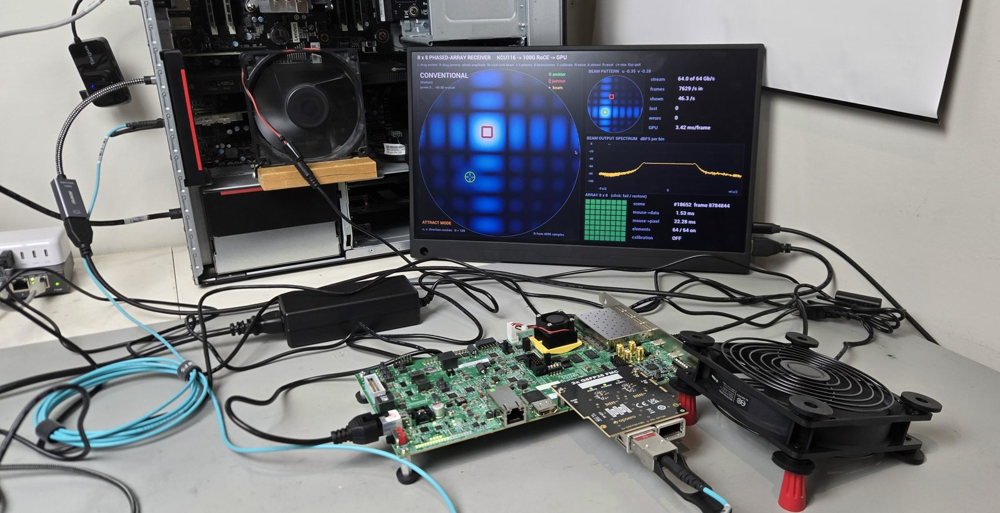

# rocelet RoCE v2 reference design for the 2x QSFP28 FMC

An open-source, lightweight **RoCE v2** (RDMA over Converged Ethernet) engine,
[rocelet](https://github.com/fpgadeveloper/rocelet), on the Opsero [2x QSFP28 FMC] (OP120):
**100 Gb/s on a KCU116** with AMD's integrated 100G MAC, **100 Gb/s on a VCK190** with the
Versal's hard multirate MAC (MRMAC), and **40 Gb/s on a ZCU106** with the open-source
[omac](https://omac.ethernetfmc.com) Ethernet MACs, entirely license-free (a 10 Gb/s build
option uses the same board). The engine has its own documentation (architecture,
interface, register map, integration and host rules) at
[rocelet.ethernetfmc.com](https://rocelet.ethernetfmc.com); this guide covers the reference
design built around it.

```{important}
**Status: version 0.6.0** (2026-11-06), rocelet v0.3.0, opsero-ethernet-mac v0.1.0. Validated
on hardware against an NVIDIA ConnectX-6 Dx. **kcu116** (100G): line-rate RDMA in both
directions, loss recovery, link loss including a real cable pull, the built-in self-test, the
[Holoscan Sensor Bridge device mode](hsb.md) with NVIDIA's HSB 3.0.0 host software and the
[beamforming demo](beam_demo.md). **zcu106** (new in 0.5.0, 40G): a Zynq UltraScale+ design in
which Linux on the Cortex-A53 runs the control plane (daemon, command line, web UI, a network
interface on the 40G port), host RDMA into on-chip memory and into PS DDR at 40G line rate,
802.3x PAUSE in both directions, the self-test, the HSB device mode and the beamforming demo at
up to 40 Gb/s. **vck190_fmcp1** (new in 0.6.0, 100G): a Versal design with the hard MRMAC with
RS-FEC, the engine on its own 300 MHz clock and the PS DDR window on the NoC, and the same
software as the ZCU106 on the Cortex-A72. Hardware-validated: bare-metal (the Cortex-A72
console: 100G RS-FEC link, the self-test, host RDMA at 91.8-97.5 Gb/s, FPGA WRITE with
immediate at 93.5 Gb/s, the PS DDR window at about 79 Gb/s each way, 802.3x PAUSE, FEC off and
on at run time); Linux image: pending.
Measurements and known limitations: [](resources.md), [](revision_history.md).
```

% TODO(m3): status box: Linux image on the VCK190 validated (daemon, rl, web UI, rl0, HSB, beamforming demo at 100G); drop "Linux image: pending".



The design connects a RoCE v2 capable host NIC (validated with an NVIDIA ConnectX-6 Dx)
point-to-point to QSFP28 port 0 of the FMC. The host and the FPGA exchange RDMA traffic in both
directions:

* **FPGA to host:** RDMA WRITE (with or without immediate) and SEND into host memory, reliable
  (RC, go-back-N retransmission from an on-chip ring) or unreliable (UC, including the
  Holoscan Sensor Bridge packet format).
* **Host to FPGA:** RDMA WRITE and SEND into the FPGA's memory windows, and RDMA READ of them.

The connection is set up out of band: the host helper `rocelet_host` (libibverbs) and the FPGA
console exchange one-line parameter records (QPN, PSN, addresses, keys); there is no RDMA
connection manager on the FPGA. On the ZCU106 and the VCK190 the records travel over SSH or the
web UI.

## Three targets, one engine

| | `kcu116` | `zcu106` | `vck190_fmcp1` |
|---|---|---|---|
| Board | KCU116 (Kintex UltraScale+ XCKU5P), FMC on HPC | ZCU106 (Zynq UltraScale+ XCZU7EV), FMC on HPC0 | VCK190 (Versal AI Core XCVC1902), FMC on FMCP1 |
| Link | 100GBASE-CR4 / -SR4 with RS-FEC, QSFP28 port 0 | 40GBASE-CR4 (no FEC), QSFP28 port 0; 10GBASE-R as a build option | 100GBASE-CR4 / -SR4 with RS-FEC, QSFP28 port 0 |
| Ethernet MAC | AMD integrated 100G Ethernet (CMAC) hard block, 512 bits at 322.27 MHz (no-cost license) | open-source `omac_40g` (MIT, from scratch) on four GTH transceivers, 256 bits at 156.25 MHz (`omac_10g`, 64 bits, for the 10G option); no license of any kind | Versal Integrated 100G Multirate Ethernet MAC (MRMAC) hard block, 384 bits at 390.625 MHz, behind a small adapter to the engine's 512-bit, 300 MHz clock (no-cost license) |
| Control plane | MicroBlaze console on the UART | **Linux** (AMD EDF Yocto image): daemon `roceletd`, command line `rl`, web UI, network interface `rl0`; or a **bare-metal Cortex-A53 console** (same commands) | the same **Linux** stack on the Cortex-A72, or a **bare-metal Cortex-A72 console** |
| FPGA memory for RDMA | 256 KB UltraRAM window | 256 KB UltraRAM window + a **PS DDR window** (a 256 MB reserved region, two HP ports per direction) | 256 KB UltraRAM window + a **PS DDR window** (a 256 MB reserved region, one 512-bit NoC port per direction) |
| Other traffic (ARP, ICMP, IP, HSB control) | firmware over a frame FIFO | Linux network interface `rl0` through a DMA channel (SSH and ping over the 40G link) | the same, over the 100G link |
| Boot | bitstream over JTAG or from the configuration flash | SD card (Linux image, or the bare-metal `BOOT.BIN`), or JTAG | SD card (Linux image, or the bare-metal `BOOT.BIN`), or JTAG |

Everything else is shared: the rocelet engine with the same parameters, the self-test logic
with its 19-test suite, the Holoscan Sensor Bridge frame producer and its sources (IQ16 test
signal, counter, the beam-array generator), and the console command set. The MAC sits behind
one generic MAC boundary, so the system logic does not know which MAC it talks to.

### The Zynq UltraScale+ architecture

The ZCU106 target is designed for the Zynq UltraScale+ processing system rather than ported from
the MicroBlaze design, so that it carries over to other Zynq UltraScale+ boards and to the
**RFSoC** boards (same PS; see [](porting.md)):

* **PS control, PL data path.** The engine, the MAC and everything that must keep line rate are
  in the PL; the A53 configures them through one 1 MB register window. A **clock guard** answers
  every CPU access, so software can never hang on, or take an SError from, the MAC clock domain
  while the link is reset; an **always-on register block** holds the GT and MAC resets, the link
  status, the QSFP module lines and one aggregated interrupt.
* **Linux owns the port's IP address.** A small kernel driver turns the engine's non-RoCE
  traffic into the network interface `rl0` (ARP, ICMP, TCP/UDP, the HSB control plane), while
  RoCE v2 (UDP 4791) stays in hardware. The daemon `roceletd` runs the same console sources as
  the bare-metal builds; `rl` and the web UI talk to it.
* **Memory windows.** Host RDMA reaches 256 KB of UltraRAM or a 256 MB region of PS DDR
  reserved in the device tree and mapped to user space through UIO (PYNQ-compatible); the PS
  DDR window spreads its traffic over two HP ports per direction to keep up with 40G.
* **Streaming source boundary.** The HSB frame producer takes its samples from one AXI-Stream
  input with a source multiplexer: the place where an RFSoC design plugs in its RF-ADC stream.

### The Versal architecture

The VCK190 target uses the Zynq UltraScale+ design's system shell and software unchanged (the
register map, the always-on block, the Linux stack, the bare-metal console) and differs where a
Versal device offers more:

* **Hard 100G MAC.** The MRMAC next to the FMC's transceivers runs 100GBASE-R with RS-FEC, with
  no soft MAC and no transceiver wizard; a small adapter (`mac_mrmac100g`) converts its 384-bit
  client interface to the engine's 512-bit beats and crosses the clocks.
* **The engine on its own clock.** The engine runs on a free-running 300 MHz clock instead of a
  MAC user clock, so it keeps running through a link loss or a transceiver reset.
* **Memory through the NoC.** The PS DDR window uses one 512-bit NoC port per direction straight
  into the DDR4 controller, instead of the ZynqMP's four HP ports and their interleaver.

Details: [](versal_hw.md) (Versal hardware), [](versal_linux.md) (what is specific to its Linux
image).

Details of the other families: [](hardware.md) (the targets and the design families),
[](zynqmp_hw.md) (Zynq UltraScale+ hardware and registers), [](zynqmp_linux.md) (the Linux
stack), [](microblaze_hw.md) (the MicroBlaze design).

## Supported boards





### {{ group.name }} boards

| Carrier board | Target design | FMC slot | QSFP28 ports | MAC | FEC | Linux |
|---------------|---------------|----------|--------------|-----|-----|-------|
| [{{ design.board }}]({{ design.link }}) | `{{ design.label }}` | {{ design.connector }} | {{ design.ports }}x {{ design.linkspeed }}G ({{ m | replace("omac_", "") | upper }} option) | {{ {"cmac": "CMAC (hard)", "omac_40g": "omac_40g (open source)", "omac_10g": "omac_10g (open source)", "mrmac": "MRMAC (hard)"}[design.mac] }} | {{ "RS-FEC (CL91)" if design.fec == "rs" else "none" }} | {{ "yes (Yocto)" if design.yocto else "no" }} |




## Licensing

The design, the rocelet engine and the omac Ethernet MACs are released under the MIT license.

* `kcu116`: the 100G Ethernet MAC is AMD's UltraScale+ Integrated 100G Ethernet (CMAC) hard
  block, whose IP license is free of charge (add it to your account on the
  [AMD licensing site](https://www.xilinx.com/getlicense)).
* `zcu106`: no IP license at all. The MAC is open source (omac, MIT); the transceivers use
  AMD's free transceiver wizard (`gtwizard_ultrascale`), the rest is standard Vivado IP
  (Zynq UltraScale+ PS, AXI DMA, SmartConnect, AXI IIC, Processor System Reset, AXI4-Stream
  Data Width Converter, and the inline HDL cells for constants, the interrupt concatenation and
  a reset OR). Vivado Standard edition (free) builds it.
* `vck190_fmcp1`: two AMD licenses are needed. **Vivado Enterprise edition** (the VC1902 device
  of the VCK190 is not in the free Standard edition; AMD offers a 30-day evaluation license),
  and the license of the **Versal Integrated 100G Multirate Ethernet MAC (MRMAC)**, which is free
  of charge: add it to your account on the [AMD licensing site](https://www.xilinx.com/getlicense)
  and install it with the Vivado License Manager. Without it the implementation stops when the
  device image is written. The rest is standard Vivado IP (Versal CIPS, AXI NoC, the GT quad,
  clocking wizards, Processor System Reset, SmartConnect, AXI DMA, AXI IIC, AXI APB Bridge,
  AXI4-Stream Data Width Converter, and inline HDL cells); the MRMAC adapter uses XPM
  primitives only.

## Contents

```{toctree}
:maxdepth: 2
:caption: User Guide

getting_started
host_setup
hardware_test
description
hardware
console
hsb
beam_demo
resources
revision_history
```

[2x QSFP28 FMC]: https://docs.opsero.com/op120/datasheet/overview/
