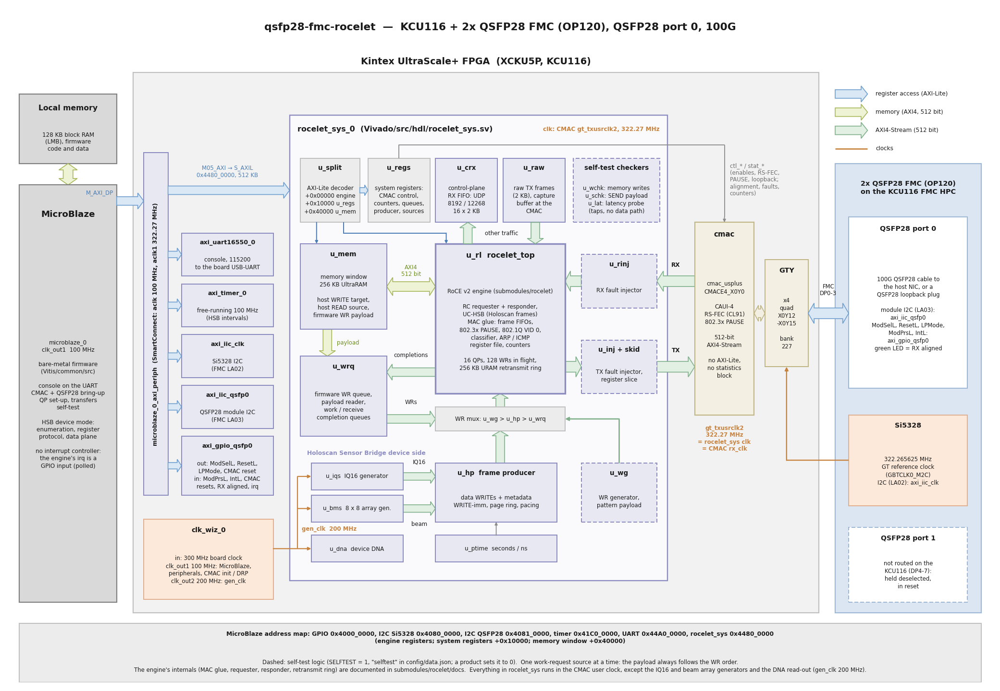

# MicroBlaze design: hardware reference

This page describes the MicroBlaze design: every target whose `config/data.json` entry has
`bdscript` = `microblaze` (today `kcu116`, 100G with the CMAC). A MicroBlaze runs the bare-metal
console on the UART; the rocelet engine, its memory window and the CMAC run in the CMAC user
clock. The block design is `Vivado/src/bd/bd_microblaze.tcl`. The logic it shares with the
[Zynq UltraScale+ design](zynqmp_hw.md) (`rocelet_sys`: the engine, the memory window, the system
registers, the self-test logic, the HSB producer and its sources) is described on
. The board specifics (FMC slot, transceivers, CMAC site, pins, board clock,
memory, resources) are in one subsection per board at the end.

## Block diagram

How to read the diagram:

* The MicroBlaze (left, 128 KB local memory, 100 MHz) reaches every block through one AXI
  SmartConnect (`microblaze_0_axi_periph`): the UART, the timer, the two I2C controllers
  (Si5328 on the FMC, QSFP28 module), the QSFP0 GPIO and, through `M05_AXI`, the 512 KB
  window of `rocelet_sys`, which the SmartConnect also moves from 100 MHz into the CMAC user
  clock. Inside `rocelet_sys`, `u_split` decodes that window into the engine registers, the
  system registers (`u_regs`) and the memory window (`u_mem`). The **blue arrows** are these
  register accesses.
* The **green arrows** are memory traffic: the engine's 512-bit AXI4 master into the 256 KB
  UltraRAM memory window (host RDMA WRITEs land there, host RDMA READs and the payload of the
  firmware's work requests come from there) and the payload reader of `u_wrq`.
* The **pale green arrows** are 512-bit AXI4-Streams: CMAC RX → `u_rinj` → engine → `u_inj` →
  CMAC TX, the engine's other-traffic port (frames that are not RoCE and not answered by the
  ARP / ICMP responder leave there, and `u_crx` keeps the HSB control frames; `u_raw` sends the
  firmware's frames into it), the IQ16 and beam array samples into the frame producer through
  its source multiplexer `u_smux`, the work requests of the three sources (`u_wg`, `u_hp`,
  `u_wrq`; one source at a time) and the completions back to `u_wrq`.
* `u_rl` is the rocelet engine as one block (MAC glue, classifier, ARP / ICMP responder,
  requester, responder, retransmit ring, registers); its internals are documented in the
  [rocelet docs](https://rocelet.ethernetfmc.com) (`submodules/rocelet/docs`).
* The dashed boxes are the optional self-test logic (`"selftest"` in `config/data.json`): the
  fault injectors `u_rinj` / `u_inj` (with the TX register slice), the WR generator `u_wg`, the
  data checkers `u_wchk` / `u_schk` and the latency probe `u_lat` (they only watch the
  streams). A product sets it to `false`.
* The bottom group is the Holoscan Sensor Bridge device side: the frame producer `u_hp` fed by
  the IQ16 generator `u_iqs` or the beam array generator `u_bms` (see
  [Beam array generator](description.md#beam-array-generator)) through `u_smux`, the timestamps
  of `u_ptime`, and the device DNA `u_dna` (the board's serial number); see .
* The orange lines and labels are the clocks: `clk_wiz_0` makes 100 MHz (MicroBlaze,
  peripherals, CMAC init / DRP clock) and 200 MHz (`gen_clk`: the IQ16 and beam array
  generators and the DNA read-out, crossed into the CMAC clock by an asynchronous FIFO and XPM
  CDC macros) from the board's system clock ([Board specifics](#board-specifics)); the Si5328 on the FMC gives the GT reference clock
  (322.265625 MHz, GBTCLK0_M2C), and the CMAC's `gt_txusrclk2` (322.27 MHz) clocks the CMAC's
  RX and TX interfaces and everything in `rocelet_sys`.
* The thin grey line is the generic MAC boundary of `rocelet_sys` (`mac_ctl`, `mac_stat`, ...),
  which the small adapter `cmac_adapt` (`mac_cmac_adapt`) maps onto the CMAC's static control
  and status (`ctl_*`: enables, RS-FEC, PAUSE, GT loopback; `stat_*`: alignment, faults, packet
  counters): the CMAC's AXI-Lite statistics block is not built (see [CMAC](#cmac)).
* The 2x QSFP28 FMC (right) uses only QSFP28 port 0 on the KCU116 (see
  [Board specifics](#board-specifics)); port 1 is not routed and is held deselected and in reset.

The diagrams in these docs are generated by `docs/source/images/gen_block_diagram.py`
(Python 3 with matplotlib); edit and run it after a change to the design.

## MicroBlaze system

| Item | Value |
|---|---|
| Processor | MicroBlaze, 128 KB local memory (LMB, code and data of the console), no caches, no interrupt controller (the engine's interrupt is a GPIO input, polled) |
| Clocks | `clk_wiz_0` from the board's system clock (the board-file clock interface named in `bd_microblaze.tcl`, [Board specifics](#board-specifics)): `clk_out1` 100 MHz (MicroBlaze, peripherals, CMAC init / DRP clock), `clk_out2` 200 MHz (`gen_clk` of `rocelet_sys`); the CMAC user clock `gt_txusrclk2` 322.27 MHz for `rocelet_sys` and the CMAC |
| Peripherals | AXI UART 16550 (console, 115200 8N1, the board's USB-UART), AXI timer (free-running 100 MHz: the HSB enumeration interval), AXI IIC x2 (Si5328, QSFP28 module), AXI GPIO (QSFP0 module lines, CMAC reset, status) |
| rocelet_sys window | 512 KB at `0x4480_0000` through the SmartConnect (`M05_AXI`), which also crosses from 100 MHz into the CMAC user clock |

## Address map (MicroBlaze)

| Address | Size | Block |
|---------|------|-------|
| 0x4000_0000 | 64 KB | QSFP0 GPIO: out [0] ModSelL [1] ResetL [2] LPMode [3] CMAC reset; in [0] ModPrsL [1] IntL [2] usr_tx_reset [3] usr_rx_reset [4] RX aligned [5] engine interrupt |
| 0x4080_0000 | 64 KB | I2C: Si5328 (GT reference clock) |
| 0x4081_0000 | 64 KB | I2C: QSFP28 module, port 0 |
| 0x41C0_0000 | 64 KB | timer (counter 0 free running at 100 MHz: the HSB enumeration interval) |
| 0x44A0_0000 | 64 KB | UART 16550 |
| 0x4480_0000 | 64 KB | rocelet engine registers (`rocelet_regs.h`) |
| 0x4481_0000 | 64 KB | system registers (`Vitis/common/src/rsys_regs.h`, generated from `rsys_pkg.sv`; +0x8000: head frame of the control-plane receive FIFO) |
| 0x4484_0000 | 256 KB | memory window (local address 0 of the engine's memory windows) |

The rocelet_sys window is in the CMAC user clock domain: it answers only while that clock
runs (GPIO bit `usr_tx_reset` low). There is no clock guard in this design (the Zynq
UltraScale+ design has one); the firmware checks the GPIO before it touches the window.

## CMAC

The UltraScale+ Integrated 100G Ethernet (CMAC) runs CAUI-4 on the four lanes of QSFP28 port 0
with RS-FEC (Clause 91), without auto-negotiation or link training. Its optional AXI4-Lite
register and statistics block is **not** built (it is larger than the RoCE engine's MAC glue):
the CMAC is configured through its static `ctl_*` inputs, which come from the system register
`C_MAC_CTL` (RX/TX enable, RS-FEC, PAUSE, GT loopback) through `rocelet_sys`'s generic MAC
boundary and the combinational adapter `mac_cmac_adapt` (`Vivado/src/hdl/mac/`; the same
boundary the [Zynq UltraScale+ design](zynqmp_hw.md#mac-boundary-rocelet_sys--mac-block)
documents), and a few fabric counters (frames, FCS and code errors, TX underflow, link drops;
RS-FEC corrections in the engine's counters) replace the statistics. The CMAC reset is a GPIO
bit, so the firmware can relink without the CMAC user clock. PAUSE frames sent by the CMAC
carry the address `TX_SA_GPP` 02:0a:35:72:6c:01 (the firmware's default MAC).

| Item | Value |
|---|---|
| IP | `cmac_usplus`, CAUI-4 (4 x 25.78125 Gb/s), RS-FEC included, AXI-Stream user interface 512 bits, TX / RX flow control (802.3x PAUSE), no AXI-Lite, no statistics counters, no auto-negotiation / link training |
| Placement | data.json `cmac_core` (`CMAC_CORE_SELECT`) and `gt_channels` (QSFP lanes 0-3, one quad: `GT_GROUP_SELECT` = lowest~highest site), passed to `bd_microblaze.tcl` by `build.tcl` (); the board's values in [Board specifics](#board-specifics) |
| Reference clock | 322.265625 MHz from the FMC's Si5328 (the pin in the target's XDC) |
| User clock | `gt_txusrclk2` 322.27 MHz, also the CMAC's `rx_clk` (so RX status is already in the engine's clock) and the `rocelet_sys` clock |
| Engine parameters | `MAC_WIDTH` 512, `CLK_KHZ` 322266, `LINK_GBPS` 100 (data.json) |
| License | the CMAC IP license is free of charge (AMD licensing site); the build shows the evaluation-license notice `[Vivado 12-1790]` until it is installed |

The CMAC's status also drives the engine's `link_up` input (rocelet v0.2):
`link_up = stat_rx_aligned & ~stat_rx_local_fault & ~stat_rx_remote_fault`, registered in the
engine clock. A local fault means the CMAC receives no valid signal, a remote fault means the
link partner reports that it does not receive ours; in either case the partner cannot answer,
so the requester's ACK timer holds as it does when alignment is lost. While `link_up` is low,
and for `LINK_GRACE` (default 2 s, console `grace`) after it rises, the requester holds its ACK
timeouts, so a cable pull or a link-partner reset does not exhaust the retry budget of a QP with
data in flight. Fault bits that toggle while the link comes up only restart the grace (and may
add to the engine's link-drop count). Because the remote fault clears only when the partner
receives the FPGA's signal, the grace starts at the partner's own link-up, which is why 2 s
is enough.

## Si5328 (GT reference clock)

The FMC's Si5328 is the CMAC's reference clock (GBTCLK0_M2C). The console programs it on
`axi_iic_clk` (I2C address 0x68) to **322.265625 MHz** at start-up (`Vitis/common/src/si5328.c`,
which also holds the 156.25 MHz plan of the Zynq UltraScale+ design), then releases the CMAC
reset and waits for alignment; the banner prints "Si5328 programmed: GT reference clock
322.265625 MHz".

## rocelet_sys in this design

`rocelet_sys` is built with the self-test logic (`"selftest": true`) and without the Zynq
UltraScale+ options (no PS DDR window, no netdev DMA channel: their inputs are tied off in
`bd_microblaze.tcl`):

* **memory window**: 256 KB of UltraRAM (`u_mem`, local address 0), host RDMA WRITE target and
  READ source, firmware work-request payload; plus the self-test pattern region (local address
  bit 40);
* **self-test logic**: WR generator, data checkers, fault injectors, latency probe
  ([Self-test logic](description.md#self-test-logic));
* **capture**: `u_raw` captures a frame at the CMAC RX or TX interface or on the engine's
  other-traffic output (console `cap`), and sends the firmware's raw frames;
* **control-plane receive FIFO** `u_crx`: the HSB register protocol and BOOTP replies for the
  firmware (the MicroBlaze has no network stack);
* **HSB device side**: the frame producer `u_hp`, its sources (IQ16, counter, beam array
  generator) through `u_smux`, `u_ptime`, `u_dna` ().

The board's DDR memory is not used. It could replace or extend the on-chip window, by
connecting the engine's AXI4 master to a MIG controller through an AXI SmartConnect (a clock
converter from the CMAC user clock to the MIG user clock) instead of `u_mem`. This is not built
in this version (the board's memory: [Board specifics](#board-specifics)).

## Boot

The console runs from the MicroBlaze's local memory, so the application is part of the
bitstream: `./build.sh standalone` combines the bitstream with the console ELF into
`Vitis/boot/<label>/rocelet_boot.bit`, and `./build.sh cfgmem` writes the configuration-flash
image `rocelet_boot.mcs` (+ `.prm`) next to it (data.json `cfgmem`, `flashsize`, `flashintf`);
`./build.sh package` zips the contents of `Vitis/boot/<label>/` into
`bootimages/qsfp28-fmc-rocelet_<label>_standalone-2025-2.zip`. Program the `.bit` over JTAG, or
write the `.mcs` to the configuration flash so that the board starts the design at power-on
().

## Resources and timing

Per board in [Board specifics](#board-specifics) and on . The console
application has to fit the MicroBlaze's 128 KB local memory; its size per build is in the same
places.

## Board specifics

### KCU116 (`kcu116`)

| Item | KCU116 |
|---|---|
| Device | XCKU5P-FFVB676-2E (Kintex UltraScale+; GTY transceivers, one CMAC: CMACE4_X0Y0) |
| FMC slot | **HPC** (VADJ 1.8 V: the FMC's LA lines are LVCMOS18) |
| QSFP28 port 0 lanes | FMC DP0-3 = GTY bank 227, quad X0Y12-X0Y15, QSFP lane i = channel X0Y(12+i): TX F7/F6, E5/E4, D7/D6, B7/B6; RX D2/D1, C4/C3, B2/B1, A4/A3; CMAC `CMACE4_X0Y0`, `GT_GROUP_SELECT` X0Y12~X0Y15 (data.json `gt_channels` `["X0Y12", "X0Y13", "X0Y14", "X0Y15"]` and `cmac_core` `CMACE4_X0Y0`, ) |
| GT reference clock | the OP120's Si5328 at 322.265625 MHz on GBTCLK0_M2C, pin **K7** (bank 227) |
| FMC I/O | Si5328 I2C (LA02) Y17 / AA17; QSFP0 module I2C (LA03) AB17 / AC17; ModSelL AA20, ResetL AB20, ModPrsL AC22, IntL AC23, LPMode Y18, LEDs AD16 / AE16 |
| QSFP28 port 1 | FMC DP4-7 are not routed on the KCU116: port 1's module lines are held (deselected, in reset), its lanes cannot be used |
| Board I/O | 300 MHz system clock (`default_sysclk1_300`) and reset, USB-UART (CP2105, second port) from the board files |
| Memory | DDR4 (soldered components, 1 GB / 32 bit, not a socket): not used by this design |
| Constraints | `Vivado/src/constraints/kcu116.xdc`; pins from the FPGA board catalog (`generate_fmc_constraints OP120 KCU116 HPC`) |
| Firmware | the `#else` (default) branch of `Vitis/common/src/hw.h`, taken by every board that is not `BOARD_ZCU106`: `F_CLK_HZ` 322265625, `HAS_FEC` 1, `PAUSE_TX_DEFAULT` 0, `PAUSE_RX_DEFAULT` 0, the QSFP0 GPIO; another MicroBlaze board adds its own `#elif defined(BOARD_<NAME>)` branch () |
| Configuration flash | `rocelet_boot.mcs` (data.json `flashsize` 128, `flashintf` SPIx4) |
| Resources and timing | 69,178 LUT (31.9 %), 99,975 FF, 98 BRAM36, 16 URAM, 1,119 DSP (61.3 %), WNS +0.023 ns / WHS +0.006 ns at the CMAC user clock (version 0.5.0, ) |
| MicroBlaze console | 130,664 of the 130,992 bytes of local memory (328 B free) |
| Measured | ConnectX-6 Dx at 100G with RS-FEC:  |
