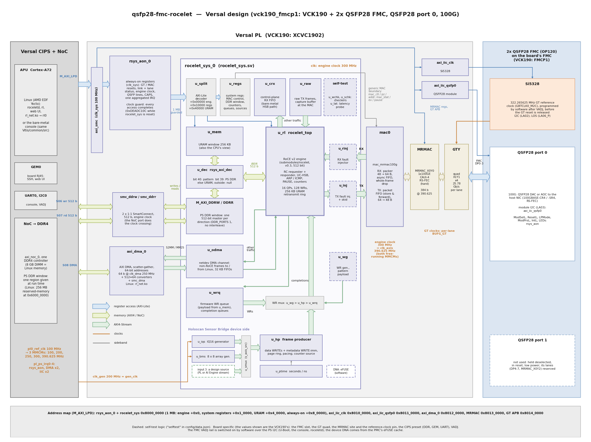

# Versal design: hardware reference

This page describes the Versal design: every target whose `config/data.json` entry has
`bdscript` = `versal` (today `vck190_fmcp1`). It is the contract between the hardware and its
software, the bare-metal console (`Vitis/common/src`, built for the Cortex-A72) and the Linux
stack (): register offsets and bit positions here are authoritative. The RTL
is `Vivado/src/hdl/rsys_aon.sv` (always-on block), `rocelet_sys.sv` and `rsys_pkg.sv` (system
registers), `Vivado/src/hdl/mac/mac_mrmac100g.v` (the MRMAC adapter),
`Vivado/src/bd/bd_versal.tcl` (block design, NoC ports, address map, interrupts).

The Versal design shares its system shell with the [Zynq UltraScale+ design](zynqmp_hw.md): the
same register map, always-on block, clock guard, PS DDR window and netdev DMA channel, so the
console, `roceletd`, `rl`, the web UI and `rl_net.ko` are the same programs. It differs where a
Versal device offers more: a **hard 100G MAC with RS-FEC** next to the transceivers, the
**NoC** in front of the DDR memory, and fabric clocks fast enough to give the engine a clock of
its own. Everything up to [Board specifics](#board-specifics) applies to any Versal board with
an FMC that carries the 2x QSFP28 FMC and an MRMAC next to the FMC's transceivers; the board
specifics are in one subsection per board at the end ().

## Overview

The control plane runs on the Cortex-A72 of the CIPS (Linux or a bare-metal console); the
rocelet engine and everything that must keep line rate live in the PL. The MAC is the Versal
**Integrated 100G Multirate Ethernet MAC (MRMAC)**, a hard block configured as one 100GBASE-R
port (CAUI-4, four 25.78125 Gb/s lanes) with **RS-FEC (Clause 91, RS(528,514))** built in. A
small adapter, `mac_mrmac100g`, connects it to the same generic MAC boundary as the CMAC and the
omac MACs of the other targets.

How to read the diagram (colours as in the [MicroBlaze design](microblaze_hw.md#block-diagram)):

* **Control (blue).** The A72 reaches the PL through `M_AXI_LPD` and one SmartConnect at
  `clk_sys` (100 MHz): the always-on block `rsys_aon_0`, which forwards the 1 MB `rocelet_sys`
  window through its [clock guard](zynqmp_hw.md#clock-guard), the two AXI IIC controllers (the
  FMC's Si5328 and the QSFP28 module), the AXI DMA's registers, the MRMAC's own registers and
  the GT quad's APB (DRP) port.
* **Memory (green).** The engine's 512-bit AXI4 master goes through the local-address decoder
  `u_dec` to the 256 KB URAM window or, through **one 512-bit NoC port per direction** (writes
  on `S06`, reads on `S07`), to the PS DDR window in the DDR4 memory; the AXI DMA of the netdev
  channel has a NoC port of its own (`S08`).
* **Streams (pale green).** MAC RX → RX fault injector → engine → TX fault injector → MAC TX,
  with the clock crossing and the 384 ↔ 512-bit conversion inside `mac0`; the engine's
  other-traffic port feeds the control-plane FIFO `u_crx`, the raw TX buffer `u_raw` and the
  netdev DMA channel `u_odma` (Linux `rl0`); the work requests of `u_wg`, `u_hp` and `u_wrq`;
  the HSB producer's sources through `u_smux`, whose input 3 is the
  [streaming source boundary](#streaming-source-boundary).
* **Clocks (orange).** All fabric clocks come from MMCMs on the CIPS `pl0_ref_clk` and run
  whatever the link does; the table below.
* Dashed boxes: the optional self-test logic (`"selftest"` in data.json). The device DNA is
  read by software on Versal (no DNA port in the PL; ).

| Clock | Frequency | Domain |
|---|---|---|
| `clk_sys` | 100 MHz (`clk_wizard_0`) | AXI-Lite control plane, always-on block + guard, AXI IIC, MRMAC `s_axi`, GT APB, AXI DMA registers |
| `clk_gen` | 200 MHz (`clk_wizard_0`) | rocelet_sys `gen_clk`: IQ16 and beam-array generators |
| `clk_dma` | 250 MHz (`clk_wizard_0`) | netdev AXI DMA, its width converters and its NoC port |
| `clk_eng` | **300 MHz** (`eng_clk_wiz`; data.json `clk_khz`) | the **engine clock**: rocelet_sys (engine, URAM window, self-test logic, HSB producer), the PS DDR window's NoC ports, the engine side of the MAC adapter. **Free-running**: it does not stop on a link loss or a GT reset |
| `clk_axis` | 390.625 MHz (`axis_clk_wiz`) | the MRMAC's AXI-Stream client clock (`tx_axi_clk` = `rx_axi_clk`) and the MAC side of the adapter; free-running |
| GT clocks | 644.53 MHz / 322.27 MHz, per lane (BUFG_GT) | the MRMAC's core and serdes clocks from the GTY quad, inside the hard MAC |

The engine needs at least 300 MHz at 100G: the MRMAC delivers a 65-byte frame in two 48-byte
beats, which the adapter packs into two 64-byte beats, so a stream of minimum-size frames at
100G becomes 281 million beats per second at the engine; 300 MHz takes them without loss, and
RoCE traffic down to a path MTU of 256 needs fewer clocks than that.

## Address map (M_AXI_LPD)

| Address | Size | Block |
|---|---|---|
| `0x8000_0000` | 1 MB | `rsys_aon_0`: rocelet_sys window (guarded) + always-on registers |
| `0x8000_0000` | 64 KB | ↳ rocelet engine registers (rocelet `docs/registers.md`, `sw/rocelet_regs.h`) |
| `0x8001_0000` | 64 KB | ↳ system registers (`rsys_regs.h`, generated from `rsys_pkg.sv`) |
| `0x8004_0000` | 256 KB | ↳ URAM memory window, CPU view (32-bit accesses) |
| `0x8008_0000` | 256 B | ↳ always-on registers ([Zynq UltraScale+ page](zynqmp_hw.md#always-on-registers-0x8008_0000-pl_clk0), differences [below](#always-on-block-differences)) |
| `0x8010_0000` | 64 KB | `axi_iic_clk`: Si5328 on the FMC (I2C address 0x68) |
| `0x8011_0000` | 64 KB | `axi_iic_qsfp0`: QSFP28 port 0 module (0x50 / 0x51) |
| `0x8012_0000` | 64 KB | `axi_dma_0`: AXI DMA (scatter-gather) of the netdev channel |
| `0x8013_0000` | 64 KB | `mrmac_0`: the MRMAC's registers (AXI-Lite, `clk_sys`; port 0 page, PG314 register map) |
| `0x8014_0000` | 64 KB | `axi_apb_bridge_0`: the GT quad's APB3 (DRP) port, for transceiver diagnostics; the design's software does not use it |

Up to `0x8012_0000` the map is the Zynq UltraScale+ design's, byte for byte: the CIPS
`M_AXI_LPD` window starts at `0x8000_0000` as the ZynqMP's `M_AXI_HPM0_LPD` does, so the
register headers, the console sources and the Linux software carry over unchanged. The MRMAC
and the GT APB port are new.

## Always-on block, clock guard

The always-on block and its clock guard are the [Zynq UltraScale+ design's](zynqmp_hw.md#clock-guard)
RTL, with the guarded window in the **engine clock** instead of the MAC clock. Because the
engine clock is free-running, the guard poisons an access (`0xDEADC10C`) only while
rocelet_sys is held in reset (`CTRL.SYS_RST`) or after an MMCM loses lock; a link loss or a GT
reset does not close it. The always-on block still holds the GT and MAC resets, the link
status, the QSFP module lines, the identification registers and the one aggregated interrupt.

### Always-on block differences

| Register | Versal design |
|---|---|
| `TARGET` (0x0C) | the first four characters of the label, upper case: `0x56434B31` ("VCK1") |
| `CAPS` (0x10) | `0x07044064`: link 100 Gb/s, MAC width 512 bits, **MAC type 4 = MRMAC**, QSFP port 0, PS DDR window, netdev DMA channel, clock guard |
| `MAC_KHZ` (0x14) | the measured **engine clock** (300000), not a MAC user clock |
| `CTRL` (0x20) | as on the ZCU106: [0] `GT_RST` holds the GT quad in reset (the MRMAC's `gt_reset_all_in`, all four lanes), [1] `MAC_RST` holds the MRMAC core and serdes and the adapter, [2] `SYS_RST` holds rocelet_sys. Reset value `0x0000_0203` |
| `STATUS` (0x24) | as on the ZCU106; [0] `MAC_ALIVE` = the engine clock runs, [1] `GT_PG` = the quad's power good, [2] / [3] GT TX / RX reset done on every lane, [5] `LINK` = MRMAC RX aligned, no local or remote fault |
| `LANE_STAT` (0x60) | **MRMAC layout**: [3:0] RS-FEC lane lock per physical lane (QSFP lane 0-3) [5:4] RS-FEC lane mapping [6] RS-FEC aligned [27:8] PCS lane block lock, virtual lanes 0-19 [31] 1 (four-lane MAC) |
| `LANE_BIP0-3`, `SKEW_FAIL` (0x64-0x74) | 0 (the MRMAC keeps these counters in its own registers) |
| `RX_OVF` (0x78) | received frames dropped or cut in the adapter's receive FIFO ([below](#receive)) |

## Interrupts

The CIPS has one interrupt pin per PL interrupt (`pl_ps_irq0` ... `pl_ps_irq15`) instead of the
ZynqMP's `pl_ps_irq0[7:0]` bus; the design uses the ZCU106's order:

| CIPS pin | Source | Linux DT `interrupts` |
|---|---|---|
| `pl_ps_irq0` | `rsys_aon_0/irq` (aggregated, level high) | `<0 84 4>` |
| `pl_ps_irq1` | `axi_dma_0/mm2s_introut` | `<0 85 4>` |
| `pl_ps_irq2` | `axi_dma_0/s2mm_introut` | `<0 86 4>` |
| `pl_ps_irq3` | `axi_iic_clk/iic2intc_irpt` | `<0 87 4>` |
| `pl_ps_irq4` | `axi_iic_qsfp0/iic2intc_irpt` | `<0 88 4>` |

`pl_ps_irq0` ... `pl_ps_irq15` are GIC SPI 84 ... 99, level high. The Linux device tree takes
the numbers from the hardware description (the SDT flow generates the values above); the
board's device-tree fixups state only the always-on block's interrupt. The always-on block's
interrupt sources (`IRQ_*` bits) are those of the
[Zynq UltraScale+ design](zynqmp_hw.md#interrupt-sources-irq_-bits).

## Bring-up sequence (software)

1. Power-up: `CTRL` = `0x203`: GT and MAC in reset. rocelet_sys runs on the engine clock and
   is accessible at once.
2. Switch the FMC's **VADJ** rail on (the VCK190 leaves it off; [Board specifics](#vck190-vck190_fmcp1)).
   Without VADJ the Si5328, its I2C bus and the QSFP28 module lines on the FMC's LA pins are dead.
3. Program the FMC's Si5328 to **322.265625 MHz** on `axi_iic_clk` (address 0x68; the plan
   `SI5328_OUT_322M266` in `Vitis/common/src/si5328.c`: N1_HS 8, NC1_LS = NC2_LS 2, N2_HS 11,
   N2_LS 31250, free-run from the 114.285 MHz crystal, the plan of the KCU116 target); wait
   for the ICAL to finish (~20 ms).
4. Release the GT: `CTRL` = `0x201` (MAC still in reset); wait for `STATUS.GT_TX_READY`.
5. With the MAC in reset, configure the MRMAC through its registers ([below](#mrmac-configuration)),
   then release the MAC: `CTRL` = `0x200`, and enable its transmitter and receiver.
6. Configure the engine and the system registers as on the ZCU106 (`C_MAC_CTL`,
   `C_MAC_ADDR_*`, engine `MAC`, `IP4`, **`TICK_DIV` 300**); `CTRL.PAUSE_RX_LEVEL` stays 0:
   the MRMAC reports a received PAUSE frame as a pulse with its quanta, as the CMAC does, and the
   engine times it (`PAUSE_QCLK` keeps its reset value for `CLK_KHZ` 300000, `LINK_GBPS` 100).
7. Wait for `STATUS.LINK` (the console and `roceletd` pulse the MAC reset once a second until a
   partner appears). A change of the GT loopback mode needs a GT reset (`CTRL.GT_RST` pulse,
   then step 5 again); the consoles do this when the loopback mode changes.

The host NIC port must be **forced to 100 Gb/s, auto-negotiation off, with RS-FEC**, the same
as for the KCU116 target ().

## MAC: the MRMAC and its adapter

### MRMAC configuration

The MRMAC (`qsfp_port0/mrmac_0`, site data.json `mrmac_core`) is built as port 0 of one
1x100GE block: **MAC+PCS+FEC** with the RS-FEC slice for 100G (IEEE 802.3, RS(528,514)), the
"independent" non-segmented **384-bit** AXI-Stream client at 390.625 MHz, and the TX and RX
flow-control ports (802.3x PAUSE) brought out. Its transceivers are the four channels of one
GTY quad (`gt_quad_base`, data.json `gt_quad`) at 25.78125 Gb/s per lane, with the line-rate
settings of AMD's VCK190 Ethernet reference design; QSFP lane *n* = FMC DP*n* = channel *n* of
the quad.

The MRMAC's operating mode is set through its registers, not by IP parameters. The console's
MRMAC backend (`Vitis/common/src/mac.c`, the same code in `roceletd`) writes, with the port in
reset:

| Register (port 0 page, offset) | Value |
|---|---|
| `MODE_REG` (0x008) | data rate 100G, serdes width "100G wide", AXI-Stream mode "100G independent 384-bit", statistics latched by `TICK_REG` |
| `FEC_CONFIGURATION_REG1` (0x0D0) | `0x1008` = RS(528,514) Clause 91 (`fec 1`, the default), `0x0` = no FEC (`fec 0`) |
| `CONFIGURATION_RX_MTU` (0x014) | maximum frame length 9600 bytes with the FCS (as the other MACs of the design) |
| PAUSE registers (0x05C-0x0C4) | transmit quanta and refresh interval (`pause quanta` / `refresh`, defaults 0x100 / 0x80), the PAUSE frame's source address (the port's MAC address), destination 01:80:C2:00:00:01 and type 0x8808, and the receive recognition of PAUSE frames (enabled by PAUSE RX, on after boot; `pause rx 0` turns it off) |
| `CONFIGURATION_TX_REG1` (0x00C) / `CONFIGURATION_RX_REG1` (0x010) | after the reset release: enable, FCS insertion (TX) / FCS check and removal (RX), 12-byte inter-frame gap, preamble and SFD checks |
| `TICK_REG` (0x02C) | 1: latch the statistics |

The console's `st` prints the MRMAC's receive state in one line: the block lock of the 20 PCS
virtual lanes, the RS-FEC lane lock per physical lane, RS-FEC alignment and lane mapping, the
MRMAC's live RX and FEC status registers and the adapter's receive-overflow count.

### The adapter `mac_mrmac100g`

The MRMAC's client interface carries a frame in 48-byte beats (six 64-bit lanes with a byte
mask each) at 390.625 MHz, and its receive side **cannot be stopped**: there is no `tready`, so
every beat must be taken. The engine works on 64-byte beats in its own clock. The adapter
(`Vivado/src/hdl/mac/mac_mrmac100g.v`, MIT, XPM primitives only) joins the two and owns every
clock crossing between `clk_axis`, the engine clock and `clk_sys`:

#### Receive

* A **packer** (`mrmac_rx_packer.v`) takes one MRMAC beat every clock, unconditionally, and
  emits 64-byte beats with a bad-frame flag (the MRMAC's FCS / PCS error on the last beat).
* An **asynchronous FIFO** (512 entries of 512 bits) crosses into the engine clock. The engine's
  receive side has no back-pressure either, and at 300 MHz the engine reads faster than the
  packer can write, so the FIFO does not fill in operation.
* **Whole-frame drop accounting**: should the FIFO ever lack room, the adapter never hands the
  engine a partial frame as a good one. A frame whose first beat finds fewer than two free
  entries is dropped whole; a frame that already started and reaches the last free entry is
  cut there and marked bad (the engine drops it). Each lost frame counts once in the always-on
  `RX_OVF` register.

#### Transmit

* A **packet FIFO** (512 entries of 512 bits = 32 KB, store and forward) passes a frame on only
  once its last beat is in, so the MRMAC never sees a gap inside a frame (which would be a
  transmit underflow).
* A **64 → 48-byte downsizer** and a skid buffer feed the MRMAC's six lanes at 390.625 MHz.
* Frames shorter than 60 bytes (without FCS) are padded with zeros; the engine's per-frame
  error flag (`tuser`) is passed to the MRMAC's error flag on the frame's last beat.
* While the MAC is held in reset the adapter swallows the engine's frames whole, so the engine
  never stalls and no fragment is sent after the reset.

#### Control and status

The generic MAC boundary of `rocelet_sys` ([Zynq UltraScale+ page](zynqmp_hw.md#mac-boundary-rocelet_sys--mac-block))
maps onto the MRMAC as follows; status levels are synchronised with two-flip-flop
synchronisers, counter events with toggle synchronisers:

| Boundary signal | MRMAC |
|---|---|
| `mac_ctl[0]` / `[1]` / `[5]` (RX enable, TX enable, FEC) | MRMAC registers, written by the firmware |
| `mac_ctl[2]` / `[3]` / `[4]` (send RFI / LFI / idle) | `ctl_tx_send_rfi_in` / `ctl_tx_send_lfi_in` / `ctl_tx_send_idle_in` |
| `mac_ctl[6]` (receive PAUSE) | `ctl_rx_pause_enable[8]`, `ctl_rx_pause_ack[8]` |
| `mac_ctl[7]` (send PAUSE), `mac_ctl[16]` (the engine's PAUSE request) | `ctl_tx_pause_enable[8]`, `ctl_tx_pause_req[8]` |
| `mac_ctl[10:8]` (GT loopback) | the GT quad's `chN_loopback` for all four channels, applied with a GT reset |
| `mac_stat` | the CMAC's layout: RX aligned, RX status, faults, hi BER, misaligned, RS-FEC hi SER and aligned, link up = aligned and no local or remote fault |
| `mac_ev` | RX frames, RX bad FCS, RX bad code, TX frames, TX bad FCS, TX underflow, RS-FEC corrected / uncorrectable codewords, PAUSE received / sent |
| `mac_pause` | the received PAUSE request level, one pulse per received PAUSE frame and its quanta |

The MRMAC exposes no total-frames statistic port: the RX frame count is the number of frames
the adapter delivers to the engine.

The adapter is simulated with a self-checking testbench against a model of the MRMAC client
interface (`Vivado/src/hdl/tb/run_xsim_mrmac.sh`): random frames of 60-9000 bytes in both
directions at line rate, receive idle cycles and error flags, transmit back-pressure, a MAC
reset during traffic, and the overflow accounting with an engine clock deliberately too slow.

### RS-FEC

RS-FEC is on after boot (`HAS_FEC` 1; `fec 1`). It is part of 100GBASE-CR4 and -SR4, a
ConnectX-6 Dx with its FEC setting `Auto` settles on it, and it gives margin on long or lossy
cables: at 25.78 Gb/s per lane a passive DAC leaves much less eye opening than at 10.3 Gb/s
(40G), so **keep RS-FEC on with passive copper**, and watch the `st` counters of corrected and
uncorrectable codewords: corrected codewords are normal on a DAC, uncorrectable ones are not.
`fec 0` switches the MRMAC to no FEC (a port reset applies it); the host port must then be set
to `encoding off` as well. `fec 1` and the host back at `Auto` return to RS-FEC.

Measured against a ConnectX-6 Dx over a 3 m passive DAC: the link comes up with RS-FEC on the
first attempt (the host's `Auto` settles on RS(528,514)); during a 60 s host WRITE at
96.6 Gb/s (723.8 GB) the FPGA counted **0 corrected and 0 uncorrectable codewords** and 0 bad
FCS, the host 3 corrected bits (raw BER about 2E-13) and 0 errors after FEC. The run-time switch
works in both directions: `fec 0` with the host at `encoding off` brings the link up without
FEC in about 2.5 s (host WRITE 97.94 Gb/s, 0 CRC and 0 symbol errors on the host), `fec 1` with
the host at `Auto` brings RS-FEC back in about 2.5 s. The codeword counters accumulate across GT
resets and loopback changes, which count codewords while the link re-forms; read them on a
steady link.

### GT loopback and the self-test

The MRMAC has no loopback of its own; the design uses the GTY transceivers' **near-end PMA
loopback** (the quad's `chN_loopback` inputs, all four channels), selected by `C_MAC_CTL[10:8]`
and applied with a GT reset. The built-in self-test `t pma` / `rl t pma` uses it: no cable,
plug or host needed (). A cable to a NIC may stay connected:
the NIC sees one short link drop per GT reset and its link is back within a few seconds.

The GTY near-end **PCS** loopback does not hold the MRMAC's 100G link (link drops, local fault,
uncorrectable codewords), so on this target `loop pcs` and `t pcs` select the near-end PMA
loopback, as on the ZCU106; the console prints a note when it does.

Results in the PMA loopback: `t pma` **SELFTEST PASS 19/19**, `t full pma` **23/23**; the
throughput tests through the engine's own responder reach 95.70 Gb/s (WRITE, 4 KB, one QP) and
97.89 Gb/s payload (WRITE, 64 KB, four QPs; 100.00 Gb/s on the line with the ACKs); a 1024-byte
WRITE takes 433 ns from the engine's transmit to its receive side through the MRMAC, RS-FEC and
the loopback. With PAUSE RX off (`pause rx 0`) the PAUSE frames the engine sends come back
unheard, and the line-rate WRITE test at PMTU 1024 recovers a few losses by go-back-N (the test
passes); with PAUSE RX on (the default) it is lossless.

### PAUSE (802.3x)

The consoles (bare metal and `roceletd`) start with **PAUSE TX on** and, unlike the Zynq
UltraScale+ design, **PAUSE RX on** (`PAUSE_TX_DEFAULT` 1, `PAUSE_RX_DEFAULT` 1): the engine asks for PAUSE when its
receive FIFO passes the XOFF level, and the MRMAC sends PAUSE frames (quanta 0x100, refresh
0x80) while the request stands, so that a host that honours PAUSE (the ConnectX-6 Dx does by
default) slows down instead of losing frames when the memory behind the engine is slower than
the link, and the FPGA honours the host's PAUSE frames: at 90-95 Gb/s an HSB stream overruns the
host unless the host can hold the board back (). `pause tx 0`
and `pause rx 0` turn them off ([Zynq UltraScale+ page](zynqmp_hw.md#pause-8023x)).

Measured against the ConnectX-6 Dx (its link pause on, the default):

* **PAUSE TX**: the host counted every PAUSE frame the FPGA sent (92,400) and honoured them. A
  host RDMA WRITE into the [PS DDR window](#bandwidth-of-the-ps-ddr-window), whose memory path is
  slower than the link, ran at **79.4 Gb/s lossless** with PAUSE TX on, against 47.5 Gb/s with
  `pause tx 0` (the engine's receive FIFO overflowed; go-back-N recovered the losses).
* **PAUSE RX** (`pause rx 1`): verified in the GT PMA loopback, where the engine received and
  honoured each of its own PAUSE frames (287 sent, 287 received, 287 honoured) during a
  line-rate WRITE at PMTU 1024, with no loss. Over the cable, on the Linux image: an HSB stream
  into GPU memory requested at 95 Gb/s, above the test host's NIC-to-GPU limit, ran lossless at
  81.6 Gb/s with PAUSE RX on (the default); the ConnectX-6 Dx sent about 55,500 PAUSE frames per run
  and the MRMAC honoured every one ().

## Memory windows: URAM and PS DDR over the NoC

The engine's local-address decoder, the URAM window, the PS DDR window registers
(`C_DDR_BASE_LO/HI`, `C_DDR_SIZE`), the null target and the rules for memory windows over PS
DDR (`MR_LADDR` = `0x80_0000_0000` + offset) are those of the
[Zynq UltraScale+ design](zynqmp_hw.md#memory-windows-uram-and-ps-ddr). What changes is the path
to the memory:

| Item | Versal design |
|---|---|
| Memory | the DDR4 memory of the board, through one DDR memory controller of the NoC; it is also Linux's memory |
| Writes (`M_AXI_DDRW`, 512 bits, engine clock) | a 1:1 SmartConnect → NoC port **`S06`** → DDR controller port `MC_2`; NoC quality-of-service request 12500 MB/s write |
| Reads (`M_AXI_DDRR`, 512 bits, engine clock) | a 1:1 SmartConnect → NoC port **`S07`** → DDR controller port `MC_3`; request 12500 MB/s read |
| `DDR_PORTS` | 1: one port per direction, no interleaver (`rsys_axi_ilv` is not built); the NoC does the clock and width crossing |
| Reach | the engine's DDR masters have 40-bit addresses and see the DDR's low region (the first 2 GB at PA 0) only; the region must lie there |
| Coherency | none, as on the ZynqMP: software owns the cache maintenance (Linux maps the region uncached through UIO; the bare-metal console flushes and invalidates its buffer) |

Each NoC port has **one destination** (one DDR controller port): the first-generation NoC keeps
a port's writes strictly in order, and a port spread over two memory controllers loses most of
its bandwidth. 12500 MB/s is the 100G payload rate of one direction.

### Bandwidth of the PS DDR window

One direction at 100G (a host RDMA WRITE into the window, or a host RDMA READ of it) needs about
12.2 GB/s of payload. Measured on the VCK190 (PMTU 4096, a 1 MB buffer of the bare-metal
console, PAUSE TX on), the window carries **about 79 Gb/s in each direction**: host WRITE
79.4 Gb/s, lossless and every beat checked (`ddr check`), host READ 79.2 Gb/s. A host WRITE is
held to that rate by the FPGA's PAUSE frames; without them (`pause tx 0`) the engine's receive
FIFO overflows and the transfer drops to 47.5 Gb/s with go-back-N recoveries, so keep PAUSE TX
on when the host writes into the PS DDR window. Traffic into and out of the URAM window and
FPGA-to-host streams into host memory do not use this path (91.8-97.5 Gb/s,
).

With the Linux image's 256 MB region at `0x6000_0000` the same ports carried more: host WRITE
97.85 Gb/s with every beat checked, host READ 88.94 Gb/s (). The
difference to the bare-metal buffer is not characterised further.

**Both directions at once** need about 24.5 GB/s, which is the order of the whole DDR4
interface's peak (DDR4-3200, 64 bits: 25.6 GB/s for reads and writes together) while Linux uses
the same memory, so **full-duplex 100G traffic into and out of the PS DDR window does not reach
line rate in both directions**; the rate with both directions at once is not characterised.
This is a property of the memory path, not of the engine. A design that needs
full-duplex 100G into external memory can give the PS DDR window a memory of its own, such as
the VCK190's LPDDR4, which Linux does not use (a NoC path and a region outside Linux's memory:
a future option of this design).

## Netdev DMA channel

The netdev DMA channel (`rsys_odma` + AXI DMA, frames to and from Linux's `rl0`) is the
[Zynq UltraScale+ design's](zynqmp_hw.md#netdev-dma-channel), with three differences:

* the AXI DMA uses **64-bit addresses** (`c_addr_width` 64; device tree `xlnx,addrwidth`
  0x40): Linux's memory on the VCK190 reaches above 40 bits (6 GB at `0x500_0000_0000`), and
  the network stack's buffers can be anywhere in it;
* its masters (descriptors, MM2S, S2MM) go through one SmartConnect to their own NoC port
  (`S08`, to DDR controller port `MC_1`, 1600 MB/s each way requested), in `clk_dma` (250 MHz);
* its interrupts are `pl_ps_irq1` (MM2S) and `pl_ps_irq2` (S2MM), and its registers are at
  `0x8012_0000` as on the ZCU106.

## Streaming source boundary

The HSB frame producer's source multiplexer `u_smux` and its input 3 are the
[Zynq UltraScale+ design's](zynqmp_hw.md#streaming-source-boundary-hsb-producer). On a Versal
device input 3 is where a design's own data source joins the RoCE path: a PL processing chain
or an AI Engine stream (through the PL), with an asynchronous FIFO from its clock into the
engine clock and whole-frame drops on overflow for a source that cannot stop.

## Device serial number

The Versal PL has no device-DNA port, so `rocelet_sys` is built without its DNA reader
(`DNA_EN` 0) and software reads the device's 128-bit DNA from the PMC's eFUSE cache: the
bare-metal console directly, `roceletd` through Linux's `xilinx-secure-config` nvmem device or,
where that read is not supported (as on the 2025.2 image), read-only through `/dev/mem`.
The HSB serial number is folded from it ().

## Board specifics

One subsection per board: what the generic description above leaves to the board. Resources,
timing and measured rates per board are on .

### VCK190 (`vck190_fmcp1`)

| Item | VCK190 |
|---|---|
| Device | XCVC1902-2MSEVSVA2197 (Versal AI Core; GTY transceivers, MRMAC hard blocks) |
| FMC slot | **FMCP1**; FMCP2 is not used |
| VADJ | **1.5 V**, the FMC's LA lines are LVCMOS15. The VCK190 leaves VADJ_FMC **off** after power-up: it is switched on over the PS I2C (LPD I2C0, `0xFF02_0000`: TCA9548 switch at 0x74, channel 0; IR38164 regulator at 0x1E, 1.5 V profile, output enable written last) by U-Boot before Linux starts (`Yocto/bsp/vck190_fmcp1/meta-user/recipes-bsp/u-boot/files/vck190-vadj-bootcmd.cfg`), and again, idempotently, by the bare-metal console and by `roceletd` at start-up (`Vitis/common/src/vadj.c`), so every boot path works |
| QSFP28 port 0 lanes | FMCP1 DP0-3 = **GTY_QUAD_X1Y1** (bank 201), channel *n* = QSFP lane *n* = DP*n*: TX AB7, AA9, Y7, W9 / RX AB2, AA4, Y2, W4 (P pins); straight order, no P/N swaps |
| MAC | **MRMAC_X0Y0** (the MRMAC next to quad X1Y1) |
| GT placement in data.json | `gt_quad` `GTY_QUAD_X1Y1`, `mrmac_core` `MRMAC_X0Y0`, `gt_refclk_hz` 322265625 () |
| GT reference clock | the OP120's Si5328 at **322.265625 MHz** on GBTCLK0_M2C → `REFCLK0` of quad X1Y1, pins **M15 / M14** (`vck190_fmcp1.xdc`) |
| FMC I/O | Si5328 I2C (LA02) AW24 / AY25, Si5328 LOS (LA06_P) BC20; QSFP0 module I2C (LA03) AV22 / AW21; ModSelL AU21, ResetL AV21, ModPrsL BG21, IntL BF22, LPMode BF23, LEDs BC25 / BD25 |
| QSFP28 port 1 | FMCP1 DP4-7 = GTY_QUAD_X1Y2 (bank 202, GBTCLK1 K15 / K14), next to MRMAC_X0Y2: reserved for a second 100G port; its module lines are held (deselected, in reset, low power, LEDs off) |
| Constraints | `vck190_fmcp1.xdc` + `vck190_fmcp1_impl.xdc` (the fabric clocks and the GT clocks as asynchronous groups, the rocelet_sys and clock-guard crossings); pins from the FPGA board catalog (`generate_fmc_constraints OP120 VCK190 FMCP1`) |
| CIPS | Cortex-A72, PS UART0 (console), GEM0 + GEM1 (GEM0 = the RJ45 next to the USB connectors; the third RJ45 belongs to the system controller), SD1, QSPI, LPD I2C0 + I2C1; the NoC with one DDR4 controller on the 8 GB DIMM: Linux memory 2 GB at PA `0x0000_0000` + 6 GB at `0x500_0000_0000` |
| Always-on | `TARGET` `0x56434B31` ("VCK1"); `CAPS` `0x07044064` |
| Firmware | `BOARD_VCK190` in `Vitis/common/src/hw.h`: `MAC_MRMAC`, `F_CLK_HZ` 300000000 (the engine clock), `HAS_FEC` 1, `PAUSE_TX_DEFAULT` 1, `PAUSE_RX_DEFAULT` 1, `HAS_VADJ`, `HAS_PLAT_DNA`; MRMAC registers at `0x8013_0000` |
| Linux | `Yocto/bsp/vck190_fmcp1/` (defaults in ) |
| Resources and timing | 88,574 LUT (9.8 %), 119,805 FF, 103 BRAM36, 16 URAM, 1,115 DSP (56.7 %), WNS +0.043 ns / WHS +0.012 ns, engine clock 300 MHz (build of 2026-11-06; ) |
| Measured | ConnectX-6 Dx at 100000 with FEC `Auto` (RS) over a 3 m DAC: link up with RS-FEC in 2.0-6.7 s (PCS lanes 0-19 and RS-FEC lanes 0-3 locked, aligned), `t pma` 19/19, host WRITE / READ / SEND 97.5 / 96.3 / 91.8 Gb/s and FPGA WRITE with immediate 93.5 Gb/s into host memory (PMTU 4096), PS DDR window 79.4 / 79.2 Gb/s (host WRITE / READ) lossless with PAUSE TX, 0 uncorrectable codewords () |
