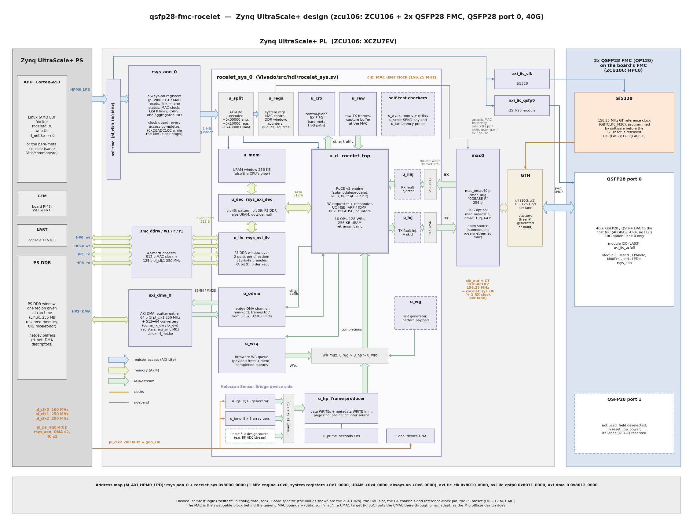

# Zynq UltraScale+ design: hardware reference

This page describes the Zynq UltraScale+ design: every target whose `config/data.json` entry has
`bdscript` = `zynqmp` (today `zcu106`). It is the contract between the hardware and its
software, the bare-metal console (`Vitis/common/src`, built for the Cortex-A53) and the Linux
stack ([](zynqmp_linux.md)): register offsets and bit positions here are authoritative. The RTL
is `Vivado/src/hdl/rsys_aon.sv` (always-on block), `rocelet_sys.sv` and `rsys_pkg.sv` (system
registers), `Vivado/src/bd/bd_zynqmp.tcl` (block design, address map, interrupts).

Everything up to [Board specifics](#board-specifics) applies to any Zynq UltraScale+ MPSoC or
RFSoC board with an FMC that carries the 2x QSFP28 FMC; the board specifics (FMC slot,
transceiver channels and pins, VADJ, PS DDR map, resources and timing) are in one subsection per
board at the end. A new board adds such a subsection ([](porting.md)).

## Overview

The design is PS-centric: the Zynq UltraScale+ PS owns the control plane (bare-metal console or
Linux), the rocelet engine and everything that must keep line rate live in the PL. The MAC is a
swappable block behind a generic MAC boundary, selected per target by data.json `mac`:
`omac_40g` (40GBASE-R4, four lanes), `omac_10g` (10GBASE-R, one lane) or, on a device with a
100G hard MAC, the CMAC (see [CMAC](#cmac-rfsoc-targets)).



How to read the diagram (colours as in the [MicroBlaze design](microblaze_hw.md#block-diagram)):

* **Control (blue).** The A53 reaches the PL through `M_AXI_HPM0_LPD` and one SmartConnect at
  `pl_clk0`: the always-on block `rsys_aon_0`, which forwards the 1 MB `rocelet_sys` window
  through its [clock guard](#clock-guard), the two AXI IIC controllers (the FMC's Si5328 and the
  QSFP28 module) and the AXI DMA's registers.
* **Memory (green).** The engine's 512-bit AXI4 master goes through the local-address decoder
  `u_dec` to the 256 KB URAM window or, through the interleave `u_ilv` and four SmartConnects,
  to the PS DDR window on **HP0 + HPC0 (writes)** and **HP1 + HP3 (reads)**; the AXI DMA of the
  netdev channel uses **HP2**.
* **Streams (pale green).** MAC RX → rocelet's width converter → RX fault injector → engine →
  TX fault injector → width converter → MAC TX; the engine's other-traffic port feeds the
  control-plane FIFO `u_crx`, the raw TX buffer `u_raw` and the netdev DMA channel `u_odma`
  (Linux `rl0`); the work requests of `u_wg`, `u_hp` and `u_wrq`; the HSB producer's sources
  through `u_smux`, whose input 3 is the [streaming source boundary](#streaming-source-boundary-hsb-producer).
* **Clocks (orange).** The MAC clock (the GT TX user clock) clocks all of `rocelet_sys`; the
  PS clocks are in the table below.
* Dashed boxes: the optional self-test logic (`"selftest"` in data.json).

| Clock | Frequency | Domain |
|---|---|---|
| `pl_clk0` | 100 MHz (99.99 actual) | AXI-Lite control plane, always-on block + guard, AXI IIC, GT free-running clock |
| `pl_clk1` | 250 MHz | PS DDR side: the PS DDR window's SmartConnects (master side), AXI DMA, its width converters, the DMA FIFOs' PS side |
| `pl_clk2` | 200 MHz | rocelet_sys `gen_clk`: IQ16 and beam-array generators, device DNA |
| MAC clock | 156.25 MHz with omac (GT TXUSRCLK2, from the FMC's Si5328) | MAC user side, rocelet_sys (engine, URAM window, PS DDR interleave, self-test logic). **Stops** while the GT is in reset or without a reference clock |
| GT RX clocks | 156.25 MHz recovered, one per lane (1 with omac_10g, 4 with omac_40g) | the omac receive PCS (and with omac_40g the receive MAC) only, crossed inside omac |

## Address map (M_AXI_HPM0_LPD)

| Address | Size | Block |
|---|---|---|
| `0x8000_0000` | 1 MB | `rsys_aon_0`: rocelet_sys window (guarded) + always-on registers |
| `0x8000_0000` | 64 KB | ↳ rocelet engine registers (rocelet `docs/registers.md`, `sw/rocelet_regs.h`) |
| `0x8001_0000` | 64 KB | ↳ system registers (`rsys_regs.h`, generated from `rsys_pkg.sv`; same layout as the MicroBlaze design) |
| `0x8004_0000` | 256 KB | ↳ URAM memory window, CPU view (32-bit accesses) |
| `0x8008_0000` | 256 B | ↳ **always-on registers** (below) |
| `0x8010_0000` | 64 KB | `axi_iic_clk`: Si5328 on the FMC (I2C address 0x68) |
| `0x8011_0000` | 64 KB | `axi_iic_qsfp0`: QSFP28 port 0 module (0x50 / 0x51) |
| `0x8012_0000` | 64 KB | `axi_dma_0`: AXI DMA (scatter-gather) of the netdev channel |

The rocelet_sys layout inside the 1 MB window is the MicroBlaze design's (engine `+0x0`, system
`+0x1_0000`, memory `+0x4_0000`), so the console sources and the register headers are shared.
The address map is the same on every Zynq UltraScale+ board.

## Clock guard

The rocelet_sys window lives in the MAC clock. Every access to `0x8000_0000-0x8007_FFFF` goes
through the guard in `rsys_aon` (pl_clk0), which **always completes the access with OKAY**:

| Condition | Read returns | Write |
|---|---|---|
| MAC clock alive (heartbeat seen within 256 pl_clk0 cycles), no orphan, `CTRL.SYS_RST` = 0 | the register value | performed |
| MAC clock stopped, or `CTRL.SYS_RST` = 1, or an orphan is pending | `0xDEADC10C` at once (`POISON_RD` + 1) | dropped (`DROP_WR` + 1) |
| forwarded, but no answer within `GUARD_TMO` pl_clk0 cycles (default 4096 = 41 µs) | `0xDEADC10C` (`GUARD_TO` + 1) | lost; the access stays "orphaned" (`STATUS.ORPHAN`) until the MAC side completes it |

So a CPU can never hang on, or take an SError from, the MAC clock domain. Software rules:
check `STATUS.MAC_ALIVE` (or treat `0xDEADC10C` as "not available") before trusting a value; a
counter that legitimately reads `0xDEADC10C` is possible but extremely unlikely, confirm with
`POISON_RD`. Interrupt bit 5 reports every poisoned or dropped access.
The forwarded path costs about 25 pl_clk0 cycles per access (two toggle synchronisers).

## Always-on registers (`0x8008_0000`, pl_clk0)

| Offset | Name | Access | Description |
|---|---|---|---|
| 0x00 | `ID` | RO | `0x52414F4E` ("RAON") |
| 0x04 | `VERSION` | RO | `0x00010000` (1.0) |
| 0x08 | `BUILD_ID` | RO | build time, Unix seconds (set when the block design is made) |
| 0x0C | `TARGET` | RO | target id, 4 ASCII characters made from the target label (`zcu` → `Z`, first four characters, upper case; see [Board specifics](#board-specifics)) |
| 0x10 | `CAPS` | RO | [7:0] link Gb/s (10 / 40) [15:8] MAC AXI-Stream width / 8 (8 = 64 bits, 32 = 256 bits) [19:16] MAC type (1 CMAC, 2 omac_10g, 3 omac_40g, 4 MRMAC on the [Versal design](versal_hw.md)) [23:20] QSFP port (0) [24] PS DDR window [25] netdev DMA channel [26] clock guard. omac_40g on port 0 with both options: `0x07032028`; omac_10g: `0x0702080A`. Software reads the MAC type and the link speed here (one console binary serves every MAC) |
| 0x14 | `MAC_KHZ` | RO | measured MAC clock, kHz (over 1 ms; 0 = stopped). 156250 with omac_10g and omac_40g |
| 0x18 | `PL_KHZ` | RO | 100000 (the pl_clk0 the block was built for) |
| 0x1C | `TIME_US` | RO | free-running microseconds (pl_clk0), wraps after 71 min |
| 0x20 | `CTRL` | RW | [0] `GT_RST` hold the GT in reset (gtwizard reset_all) [1] `MAC_RST` hold the MAC in reset [2] `SYS_RST` hold rocelet_sys in reset (soft reset; the guard then poisons) [8] QSFP `ModSelL` [9] QSFP `ResetL` [10] QSFP `LPMode`. **Reset value `0x0000_0203`**: GT and MAC held in reset (the reference clock is not running until software programs the Si5328), module selected, out of reset, high power |
| 0x24 | `STATUS` | RO | [0] `MAC_ALIVE` MAC clock running [1] `GT_PG` GT power good [2] `GT_TX_READY` [3] `GT_RX_READY` [4] `LOCK` block lock / lanes aligned [5] `LINK` link up (`mac_stat[12]`, the engine's `link_up`) [6] `HI_BER` [7] `LF` local fault [8] `RF` remote fault [12] `MODPRSL` QSFP `ModPrsL` (0 = module present) [13] `INTL` QSFP `IntL` (0 = interrupt) [14] `LOS` Si5328 LOS alarm (OP120 LA06_P) [16] `ORPHAN` guard access pending [17] `SYS_RST`. The firmware's names are `AON_ST_<name>` in `Vitis/common/src/hw.h`, shortened for some bits (`AON_ST_ALIVE`, `AON_ST_GTPG`, `AON_ST_TXRDY`, `AON_ST_RXRDY`, `AON_ST_HIBER`) |
| 0x28 | `LINK_EV` | RO | [15:0] link-up events [31:16] link-down events (since reset) |
| 0x2C | `MAC_STAT` | RO | the generic MAC status bundle `mac_stat[15:0]`, synchronised (layout under "MAC boundary") |
| 0x30 | `IRQ_STATUS` | R/W1C | latched interrupt sources (below); write 1 to clear |
| 0x34 | `IRQ_ENABLE` | RW | mask; the interrupt output is `\|(IRQ_STATUS & IRQ_ENABLE)` (reset 0) |
| 0x38 | `IRQ_RAW` | RO | the sources' current levels |
| 0x3C | `SYS_EVT` | RO | rocelet_sys event levels `evt[7:0]` (synchronised) |
| 0x40 | `POISON_RD` | RW | reads answered with poison while the guard was closed (write: clear) |
| 0x44 | `DROP_WR` | RW | writes dropped while the guard was closed (write: clear) |
| 0x48 | `GUARD_TO` | RW | forwarded accesses that timed out (write: clear) |
| 0x4C | `GUARD_TMO` | RW | forwarding time-out in pl_clk0 cycles (minimum 64, reset 4096) |
| 0x50 | `SCRATCH` | RW | scratch register |
| 0x60 | `LANE_STAT` | RO / W | **four-lane MAC only** (0 with omac_10g): omac_40g lane status, synchronised from the MAC clock. [3:0] block lock per physical lane (bit p = QSFP lane p) [7:4] alignment-marker lock per physical lane [15:8] PCS lane number found on QSFP lane p at [8+2p +: 2] (latched at alignment; the partner's lane order) [22:16] lane skew of the last alignment, 66-bit blocks (6.4 ns each) [31] 1 = four-lane MAC. **Write (any value): clear the lane counters 0x64-0x78** |
| 0x64-0x70 | `LANE_BIP0`-`3` | RO | **omac_40g**: BIP3 errors per physical lane (QSFP lane 0-3), one per alignment marker (every 16384 blocks = 105 µs per lane) whose BIP3 did not match: the lane's bit-error indicator |
| 0x74 | `SKEW_FAIL` | RO | **omac_40g**: alignment attempts that failed (the four markers more than 32 blocks = 204.8 ns apart) |
| 0x78 | `RX_OVF` | RO | **omac_40g**: received frames cut (`tuser` = 1) or dropped because the receive clock-crossing banks were full (omac_40g `ev_rx_overflow`; only back-to-back frames of (length w/o FCS) mod 32 = 1..7 at full rate can cause it) |

### Interrupt sources (`IRQ_*` bits)

| Bit | Source | Latching |
|---|---|---|
| 0 | link change (`STATUS.LINK` rose or fell) | edge (both) |
| 1 | rocelet engine `irq` (a QP error latched, `CTRL.IRQ_EN`) | level |
| 2 | control-plane RX FIFO not empty (`rsys_crx`, bare-metal HSB path) | level |
| 3 | work completion queued (`rsys_wrq` WC queue) | level |
| 4 | receive completion queued (RC queue: SEND, WRITE with immediate) | level |
| 5 | guard: an access was poisoned, dropped or timed out | edge |
| 6 | QSFP `IntL` asserted | level |
| 7 | QSFP module plugged / unplugged (`ModPrsL` change) | edge (both) |
| 8 | Si5328 LOS alarm change | edge (both) |

Level sources re-latch while the condition stays true, so clear them after serving the
condition; edge sources latch once per change.

### QSFP28 port 0 LEDs

The always-on block drives the two LEDs of QSFP28 port 0 on the FMC from its status, without
software: **green** = link up (`STATUS.LINK`), **red** = a module is present (`ModPrsL` = 0)
and the link is down; both off = no module. Port 1's LEDs are held off. The LED pins are in
the board's [Board specifics](#board-specifics).

## Interrupts (`pl_ps_irq0`)

| pl_ps_irq0 bit | Source | GIC SPI | Linux DT `interrupts` |
|---|---|---|---|
| 0 | `rsys_aon_0/irq` (aggregated, level high) | 121 | `<0 89 4>` |
| 1 | `axi_dma_0/mm2s_introut` | 122 | `<0 90 4>` |
| 2 | `axi_dma_0/s2mm_introut` | 123 | `<0 91 4>` |
| 3 | `axi_iic_clk/iic2intc_irpt` | 124 | `<0 92 4>` |
| 4 | `axi_iic_qsfp0/iic2intc_irpt` | 125 | `<0 93 4>` |

The SPI numbers are those of the Zynq UltraScale+ PS (`pl_ps_irq0[n]` = SPI 121 + n), the same
on every board.

## Bring-up sequence (software)

1. Power-up: `CTRL` = `0x203`: GT and MAC in reset, the MAC clock is stopped, rocelet_sys reads
   poison.
2. Program the FMC's Si5328 to **156.25 MHz** on `axi_iic_clk` (address 0x68; the register plan
   is `SI5328_OUT_156M25` in `Vitis/common/src/si5328.c`: N1_HS 9, NC1_LS = NC2_LS 4, N2_HS 10,
   N2_LS 37500, free-run from the 114.285 MHz crystal); wait for the ICAL to finish (~20 ms).
3. Release the GT: `CTRL` = `0x201` (MAC still in reset); wait for `STATUS.GT_TX_READY` and
   `STATUS.MAC_ALIVE` (`MAC_KHZ` ≈ 156250).
4. Release the MAC: `CTRL` = `0x200`. rocelet_sys is now accessible; its own reset ran when the
   MAC clock started.
5. Configure: system register `C_MAC_CTL` (rx/tx enable, loopback), `C_MAC_ADDR_*`, the engine
   (`MAC`, `IP4`, `TICK_DIV` 156, **`CTRL.PAUSE_RX_LEVEL` = 1** because omac reports a received
   PAUSE as a level, `PAUSE_QCLK` 512 at 40G, 2048 at 10G = its reset value); the consoles also
   turn **PAUSE TX on** where the board's default says so (`C_MAC_CTL[7]` + engine
   `CTRL.PAUSE_TX_EN`, section "PAUSE").
6. Wait for `STATUS.LINK` (omac block lock and no fault; the omac RX watchdog restarts the GT RX
   datapath until a partner appears). A relink is a `MAC_RST` pulse; a GT reset is needed only
   after the reference clock changed.

The host NIC port must be **forced to the MAC's rate (40 Gb/s with omac_40g, 10 Gb/s with
omac_10g), auto-negotiation off, FEC off** (ConnectX-6 Dx: `ethtool -s <if> speed
40000|10000 duplex full autoneg off`, `ethtool --set-fec <if> encoding off`), MTU ≥ 4200 for
RoCE PMTU 4096. At 40G the engine's `PAUSE_QCLK` is 512 (one PAUSE quantum = 512 bit times =
12.8 ns = 2 MAC clocks, x 256); the console computes it from `CAPS` (`eng.c`).

## MAC boundary (rocelet_sys ↔ MAC block)

rocelet_sys talks to the MAC only through these ports (one clock: the MAC user clock); a small
per-MAC module maps them onto the MAC (`Vivado/src/hdl/mac/`: `mac_omac40g` with `MAC_WIDTH`
256, plus the 40G lane status `mac_lane[31:0]` / `mac_lev[5:0]` into the always-on block;
`mac_omac10g` with `MAC_WIDTH` 64; `mac_cmac_adapt` for a CMAC, as in the
[MicroBlaze design](microblaze_hw.md#cmac)).

| Port | Dir (rocelet_sys) | Bits |
|---|---|---|
| `rx_*` / `tx_*` | in / out | AXI-Stream at `MAC_WIDTH` (256 with omac_40g, 64 with omac_10g, 512 with a CMAC); RX without `tready`, FCS stripped, `tuser` = bad frame; TX without gaps inside a frame, the MAC pads + adds the FCS |
| `mac_ctl[31:0]` | out | [0] RX enable [1] TX enable [2] send RFI [3] send LFI (omac `ctl_tx_fault`) [4] send idle [5] FEC (CMAC RS-FEC) [6] receive PAUSE [7] send PAUSE [10:8] GT loopback (0 off, 1 near-end PCS, 2 near-end PMA; omac: any non-zero = its PMA loopback) [16] the engine's PAUSE request level (rocelet `mac_pause_req`). From system register `C_MAC_CTL` |
| `mac_pz[31:0]` | out | [15:0] quanta of the PAUSE frames sent [31:16] refresh interval (`C_MAC_PZ`) |
| `mac_addr[47:0]` | out | station address (PAUSE source; byte 0 on the wire = [7:0]); `C_MAC_ADDR_LO/HI` |
| `mac_stat[15:0]` | in | [0] RX aligned / block lock [1] RX status (omac: link up) [2] local fault [3] remote fault [4] received local fault [5] internal local fault [6] hi BER [7] misaligned [8] FEC hi SER [9] FEC lanes aligned [10] RX in reset [11] TX in reset [12] **link up** (rocelet `link_up`) [13] TX PAUSE active. Read back in `S_MAC_STAT` and `AON MAC_STAT` |
| `mac_ev[15:0]` | in | increments per clock: [2:0] RX frames [5:3] RX bad FCS [8:6] RX bad code (omac: errored blocks) [9] TX frames [10] TX bad FCS (omac: aborted) [11] TX underflow [12] FEC corrected [13] FEC uncorrectable [14] PAUSE received [15] PAUSE sent |
| `mac_pause[17:0]` | in | [17] received PAUSE in force, level (omac `stat_rx_pause_req` → rocelet `mac_pause_hold`) [16] received PAUSE pulse (CMAC `stat_rx_pause_valid[8]`) [15:0] its quanta |

Through a MAC narrower than 512 bits rocelet_sys uses rocelet's own width converters
(`rocelet_rx_upsize`, `rocelet_tx_downsize`) at its MAC ports, and the engine itself is built
with `MAC_WIDTH` 512: the self-test injectors, the capture buffer, the frame classifier and the
latency probe keep working on 64-byte beats. The engine's `CAPS` register therefore reads
MAC width 512; the MAC's width is in `S_SYS_CFG[31:24]` and in the always-on `CAPS`.

## System registers added in 0.5.0 (`0x8001_0000`, MAC clock)

| Register | Index / offset | Description |
|---|---|---|
| `C_MAC_ADDR_LO` | cfg 3 (`0x00C`) | MAC station address bytes 0-3 (reset 02:0a:35:72) |
| `C_MAC_ADDR_HI` | cfg 4 (`0x010`) | [15:0] bytes 4-5 (reset 6c:01) |
| `C_DDR_BASE_LO` | cfg 5 (`0x014`) | PS DDR window: physical base of the region, bits [31:12] (4 KB aligned; [11:0] ignored) |
| `C_DDR_BASE_HI` | cfg 6 (`0x018`) | [7:0] physical base bits [39:32] |
| `C_DDR_SIZE` | cfg 7 (`0x01C`) | region size in bytes, multiple of 4 KB ([11:0] ignored). **Reset 0 = window closed** |
| `C_ODMA_CTRL` | cfg 83 (`0x14C`) | [0] netdev DMA channel RX enable (other-traffic frames to the PS) |
| `S_SYS_CFG` | sv 1 (`0x404`) | adds [3] PS DDR window [4] netdev DMA channel [23:16] link Gb/s [31:24] MAC width / 8 |
| `S_MAC_STAT` | sv 3 (`0x40C`) | the generic `mac_stat` (adds [12] link up [13] TX PAUSE active) |
| `E_ODMA_RX` | cnt 48 (`0x8C0`) | netdev channel: frames queued for the PS |
| `E_ODMA_DROP` | cnt 49 (`0x8C4`) | netdev channel: frames dropped (RX disabled, FIFO full, longer than 10240 bytes) |
| `E_ODMA_TX` | cnt 50 (`0x8C8`) | netdev channel: frames from the PS sent |
| `E_DDR_WR_BURSTS` | cnt 51 (`0x8CC`) | PS DDR window: write bursts |
| `E_DDR_RD_BURSTS` | cnt 52 (`0x8D0`) | PS DDR window: read bursts |
| `E_DDR_OOR` | cnt 53 (`0x8D4`) | PS DDR window: bursts outside the region (null target) |

## Memory windows: URAM and PS DDR

The engine's 512-bit AXI4 master (responder WRITE/SEND data, READ responses, REREAD payload)
is decoded by `rsys_axi_dec` on the **local address** that a memory window (`MR_LADDR`) or a work
request gives:

| Local address | Target |
|---|---|
| bit 40 = 1 | self-test pattern region (reads = pattern(address), writes are checked and discarded) |
| bit 39 = 0 (and bit 40 = 0) | URAM window, 256 KB, wraps (as in the MicroBlaze design: `MR_LADDR` 0 = start of URAM) |
| bit 39 = 1 (and bit 40 = 0), offset = bits [38:0] < `C_DDR_SIZE` | **PS DDR**, physical address = `C_DDR_BASE` + offset |
| bit 39 = 1, offset ≥ `C_DDR_SIZE` | **null target**: writes accepted and discarded (OKAY), reads return zeros (OKAY), `E_DDR_OOR` counts the bursts |

The PS DDR window is **one region of PS DDR given at run time**: base (`C_DDR_BASE_LO/HI`, 4 KB
aligned, 40-bit physical) and size (`C_DDR_SIZE`, bytes, multiple of 4 KB, up to 4 GB - 4 KB).
On Linux it is a `reserved-memory` carve-out (`no-map`, mapped to user space through UIO,
[](zynqmp_linux.md)); its base and size are set per board in the board's device tree (the
defaults per board: [](zynqmp_linux.md#per-board-defaults)); bare-metal software can use any
buffer (the console uses a 1 MB buffer). A memory window that targets PS DDR uses `MR_LADDR` =
`0x80_0000_0000` + offset into the region. Whatever the memory windows say, no remote request
reaches PS memory outside the region: those bursts go to the null target. After reset the size
is 0 (window closed). Example (region at PA `0x6000_0000`, 256 MB): `C_DDR_BASE_LO` =
`0x6000_0000`, `C_DDR_BASE_HI` = 0, `C_DDR_SIZE` = `0x1000_0000`; then an MR with `MR_LADDR` =
`0x80_0000_0000`, `MR_LEN` ≤ 256 MB maps VA → PA `0x6000_0000` + (VA − `MR_VA`). Bursts never
cross 4 KB and the size is a multiple of 4 KB, so the region check of a burst's first address
covers the burst. The region must lie in the board's PS DDR (its address ranges are in the
board's subsection).

The decoder changes the target of a direction only when that direction has nothing outstanding
(AXI ordering per ID across two slaves). The engine's read buffer is 512 beats per source in this
design (`MEM_RD_BUF`, DDR latency).

### Two HP ports per direction (`DDR_PORTS` 2)

One 128-bit S_AXI_HP port at `pl_clk1` 250 MHz carries 32 Gb/s raw, less than the 40G payload
rate (measured on one port per direction: host WRITE into PS DDR 26-32 Gb/s, READ 31.6). So the
PS DDR window uses **two ports per direction, address-interleaved** (data.json `ddr_ports` 2 →
rocelet_sys `DDR_PORTS` 2; `rsys_axi_ilv` between the decoder and the four masters):

| Master (rocelet_sys) | PS port | PS DDR controller port | Carries |
|---|---|---|---|
| `M_AXI_DDRW` | `S_AXI_HP0_FPD` | port 3 (with DisplayPort, unused) | writes, physical address bit 9 = 0 |
| `M_AXI_DDRW1` | `S_AXI_HPC0_FPD`, used non-coherently (`AxCACHE` 0011, through the CCI) | ports 1-2 (CCI) | writes, bit 9 = 1 |
| `M_AXI_DDRR` | `S_AXI_HP1_FPD` | port 4 (with HP2 = the netdev DMA) | reads, bit 9 = 0 |
| `M_AXI_DDRR1` | `S_AXI_HP3_FPD` | port 5 | reads, bit 9 = 1 |

* **Granule 512 bytes** (`ILV_BIT` 9): physical address bits [8:0] address inside a granule,
  bit 9 selects the port, so consecutive 512-byte granules alternate between the two ports of a
  direction and every sequential transfer is split half / half. A burst that crosses a granule
  boundary is cut there (a 4 KB burst = 8 sub-bursts of 8 beats, 4 per port); the first keeps its
  own start address (it may start inside a beat), the others start at granule boundaries.
* **Ordering**: one AXI ID (0) on every port, so each port answers in order; the B responses
  (one per original burst, the worst BRESP of its sub-bursts, the original ID) and the read data
  (RLAST on the original burst's last beat, the original ID) are put back into request order by
  small order FIFOs. The same address always goes to the same port, so two writes to one address
  stay in order.
* **Buffering**: 32 beats (2 KB) per port for W and for R (LUTRAM): the engine's W stream is in
  order, so while it feeds one port the other drains its FIFO; the read merge drains one port
  while the other fills. Up to 64 sub-bursts (32 KB) in flight per direction.
* **Capacity**: 2 x 32 = 64 Gb/s raw per direction (simulated: 0.80 of 1 beat per MAC clock =
  64 Gb/s at 156.25 MHz with each port modelled at 128 bits / 250 MHz, `tb_axi_ilv`), above the
  40G line rate in both directions; URAM is not affected.
* The physical address map seen by software is unchanged: one region, `C_DDR_BASE` + offset; the
  interleave is invisible except in the order the PS sees the bursts.
* `DDR_PORTS` 1 (data.json `ddr_ports` 1 or absent): one port per direction, writes on HP0,
  reads on HP1 (enough for 10G; at 40G it caps the PS DDR window at about 32 Gb/s).

The HP ports and their DDR controller ports are those of the Zynq UltraScale+ PS, the same on
every MPSoC and RFSoC device.

**Cache coherency.** The HP ports are not coherent, HPC0 is used non-coherently, and the engine
issues `AxCACHE` = 0011: software owns the cache maintenance. A buffer the host writes into
(RDMA WRITE / SEND) must be invalidated before the CPU reads it (after the completion); a buffer
the host reads (RDMA READ) or the FPGA sends from must be cleaned (flushed) after the CPU wrote
it and before the transfer. Linux: allocate from a `reserved-memory` carve-out (`no-map`) mapped
uncached through UIO, or with `dma_alloc_noncoherent()` / pinned pages + `dma_sync_*` in a
driver; bare-metal: `Xil_DCacheInvalidateRange` / `Xil_DCacheFlushRange`. The SMMU must stay in
bypass for the PL masters (default: no `iommus` property) so that `MR_LADDR` is a physical
address.

## PAUSE (802.3x)

The link to the host is point to point, so the Zynq UltraScale+ consoles (bare metal and
`roceletd`) start with **PAUSE TX on**: the engine asks for PAUSE when its receive FIFO passes
the XOFF level (128 beats; XON 64), and the MAC sends PAUSE frames (quanta 0x100, refresh 0x80)
while the request stands. A host that honours PAUSE (the ConnectX-6 Dx does with its default
`ethtool -A ... rx on`) then slows down instead of losing frames when the memory behind the
engine is slower than the link. `pause tx 0` turns it off (`pause` without arguments shows the
state). **PAUSE RX** (the FPGA honouring the host's PAUSE: omac `stat_rx_pause_req` → rocelet
`mac_pause_hold` → `CTRL.PAUSE_RX_EN`) stays off by default, as in the MicroBlaze design:
`pause rx 1` (on by default on the VCK190: [](versal_hw.md#pause-8023x)). The defaults are set per board in `Vitis/common/src/hw.h` (`PAUSE_TX_DEFAULT`, `PAUSE_RX_DEFAULT`).

## Netdev DMA channel

Frames the engine does not consume (not RoCE UDP 4791, not answered by the built-in ARP/ICMP
responder) leave the engine on its other-traffic port. In this design they go to:

* the control-plane RX FIFO `rsys_crx` (bare-metal console, HSB register protocol; enable
  `C_CRX_CTRL[0]`), and
* the **netdev DMA channel** `rsys_odma` (enable `C_ODMA_CTRL[0]`): an admission check at each
  frame start (enabled and room for a whole 10240-byte frame, else the frame is dropped and
  `E_ODMA_DROP` counts it), a 32 KB packet FIFO into `pl_clk1`, a 512→64-bit width converter and
  the AXI DMA's **S2MM** channel. The engine is never back-pressured.

Frames from the PS: AXI DMA **MM2S** → 64→512-bit converter → 32 KB packet FIFO → the engine's
other-traffic input, arbitrated frame by frame with the firmware's raw TX buffer.

| Item | Value |
|---|---|
| DMA | AMD AXI DMA v7.1 (PG021), **scatter-gather mode**, no status/control stream (`c_sg_include_stscntrl_strm` 0), 40-bit addresses (`c_addr_width` 40), 64-bit memory-mapped and stream data width, data realignment engine on both channels (buffers at any byte address), buffer length field 16 bits (`c_sg_length_width` 16: up to 65535 bytes per descriptor), MM2S / S2MM burst 64 beats. Registers at `0x8012_0000` (MM2S at +0x00, S2MM at +0x30, PG021 register map); descriptor fetch, MM2S and S2MM masters → `S_AXI_HP2_FPD` (non-coherent: descriptors and buffers need cache maintenance, or uncached / `dma_alloc_coherent` memory for the descriptor rings) |
| Descriptors | PG021 scatter-gather descriptors (64-byte aligned, 13 words: NXTDESC, NXTDESC_MSB, BUFFER_ADDRESS, BUFFER_ADDRESS_MSB, reserved x2, CONTROL, STATUS, APP0-4). CONTROL[25:0]: buffer length; [27] TXEOF, [26] TXSOF (MM2S). STATUS[25:0]: bytes transferred; [27] RXSOF, [26] RXEOF (S2MM), [31] Cmplt, [30] DMADecErr, [29] DMASlvErr, [28] DMAIntErr. **APP0-4 are not used** (no status stream) |
| RX (S2MM) frame | one Ethernet frame per stream packet (`tlast` on its last byte), from the destination MAC to the last payload byte, **no FCS**, no preamble, no length header, no side-band (`tuser` is not carried). The frame length = the S2MM descriptor's STATUS transferred bytes (sum over the descriptors from RXSOF to RXEOF if a frame spans several buffers; give every RX descriptor ≥ 10240 bytes to get one descriptor per frame) |
| RX contents | good frames only (bad FCS / PCS errors / runts are dropped in the MAC and the engine); never RoCE v2 (UDP 4791, terminated by the engine); ARP and ICMP only with `CTRL.ARP_INT` = 0; frames up to 10240 bytes (longer ones are cut at 10240 and end with `tlast`: drop frames with STATUS length 10240 if jumbo frames are not used). Frames arriving while `C_ODMA_CTRL[0]` = 0, while the 32 KB FIFO cannot hold a whole 10240-byte frame, or while S2MM has no descriptor (the FIFO fills) are dropped whole and counted in `E_ODMA_DROP`; the engine is never stalled |
| TX (MM2S) frame | one Ethernet frame per packet (TXSOF on its first descriptor, TXEOF on its last), destination MAC first, **no FCS** (the MAC appends it), frames shorter than 60 bytes are padded by the MAC; at most 16383 bytes (the engine's other-traffic FIFO); the frame is sent only once its last byte is in the 32 KB packet FIFO (store-and-forward, frame-atomic with the console's raw TX buffer) |
| Interrupts | MM2S `pl_ps_irq0[1]` (GIC SPI 122, DT `<0 90 4>`), S2MM `pl_ps_irq0[2]` (SPI 123, DT `<0 91 4>`); IOC / delay / error interrupts per PG021 (DMACR) |
| Counters | `E_ODMA_RX` (frames queued for S2MM), `E_ODMA_DROP`, `E_ODMA_TX` (frames from MM2S sent) |
| Linux netdev (rl0) setup | engine `CTRL.OTHER_RX_EN` = 1, `CTRL.ARP_INT` = 0 (Linux answers ARP / ICMP), `C_ODMA_CTRL` = 1, `C_CRX_CTRL` = 0 (or 1 to keep the bare-metal HSB path too); the port's IP address belongs to Linux (`rl0`) and must equal the engine's `IP4` and `MAC` (the engine answers RoCE for that address; roceletd keeps them equal). rl0's default address and MAC per board: [](zynqmp_linux.md#per-board-defaults). The bare-metal console keeps its own defaults (192.168.20.2, 02:0a:35:72:6c:01) |
| Throughput | 64 bits at 250 MHz = 16 Gb/s per direction through the DMA, enough for a 10G netdev (and for control traffic at 40G) |

## Streaming source boundary (HSB producer)

The HSB frame producer (`rsys_hsb_prod`) takes its samples from one show-ahead AXI-Stream,
`s_axis_src` (64-byte beats, `tready` = consume, `tuser[63:0]` = side-band of the beat, copied
from a frame's first beat into the metadata record for source 2), selected by `rsys_src_mux`
from the source the producer latched at run start (`C_HP_CTRL[2:1]`):

| `src_sel` | Source |
|---|---|
| 0 | IQ16 test signal (`rsys_iq_src`, gen_clk) |
| 1 | counter pattern (inside the producer) |
| 2 | beam-array generator (`rsys_beam_src`, side-band {scene_id, scene_frame}) |
| 3 | reserved: a design-specific source, e.g. an RFSoC RF-ADC stream (today mapped to 0) |

An RFSoC design adds its source as input 3 of `rsys_src_mux` with an asynchronous FIFO from the
RF data converter's fabric clock (a free-running ADC must drop whole frames on overflow instead
of stalling).

## MAC blocks

### omac_40g (40GBASE-R4, four lanes)

data.json `mac` = `omac_40g`, `mac_width` 256, `link_gbps` 40, `clk_khz` 156250.

| Item | omac_40g |
|---|---|
| MAC block | `mac_omac40g`: omac_40g (40GBASE-R4, IEEE 802.3 cl. 81/82: four PCS lanes, alignment markers every 16384 blocks, BIP3, deskew up to 32 blocks, reorder by marker) + `omac_gt_usp_gth_x4` (gtwizard `omac_gth_40g` from `gen_gt.tcl omac_gen_gth_x4`, 64B/66B async gearbox, 10.3125 Gb/s per lane), opsero-ethernet-mac submodule |
| Lanes | QSFP lane l = omac_40g lane l = FMC DP l of QSFP28 port 0; the GT channel of each lane, the master channel (QSFP lane 0: its TX user clock is the MAC clock) and the reference clock are board specific: data.json `gt_channels` / `gt_refclk` ([](porting.md#gt-placement-in-datajson), values in [Board specifics](#board-specifics)), from which build.tcl also derives the lane map `CH_OF_LANE` of `mac_omac40g` |
| MAC ↔ rocelet_sys | 256-bit AXI-Streams at 156.25 MHz (40.0 Gb/s), rocelet's 256↔512 converters at rocelet_sys's MAC ports, the engine at 512 bits (2x the line rate) |
| Clocks | five: the TX user clock (MAC / rocelet_sys clock) + one recovered RX user clock per lane; omac_40g's receive PCS + MAC run on lane 0's clock; every pair is bounded by `set_max_delay -datapath_only 6.4` in the implementation-only `<target>_impl.xdc` (written pair by pair: XDC has no `foreach`) |
| `S_SYS_CFG` | [23:16] 40, [31:24] 32 (256 bits); engine `CAPS` reads MAC width 512 (engine built at 512), `CLK_KHZ` 156250 |
| Lane status | always-on `LANE_STAT`, `LANE_BIP0-3`, `SKEW_FAIL`, `RX_OVF` (0x60-0x78); the console prints them with `st` and after every link attempt, and clears the counters at link-up |

**Bring-up order** (what the console's lane line shows when the link does not come up):
1. `LANE_STAT[3:0]` block lock per lane = 1111. A lane without block lock has no signal or no
   64B/66B stream (wrong line rate or reference clock). Block lock does not prove the bit
   order or the polarity: a wrong `BIT_REVERSE` or a P/N swap still locks (the lock check only
   needs the two header bits to differ) and shows up as marker lock or BIP errors failing in
   the next steps (a board with a P/N swap needs the polarity input of that channel in
   `mac_omac40g`).
2. `LANE_STAT[7:4]` marker lock = 1111: the lane carries a 40GBASE-R lane (markers every 16384
   blocks). Block lock without marker lock = the partner sends 10GBASE-R (host not at 40G).
3. `STATUS.LOCK` (all lanes aligned) and `LANE_STAT[15:8]`: the PCS lane on each QSFP lane (any
   order is legal; the receiver reorders), `[22:16]` the skew. `SKEW_FAIL` counting = skew
   above 32 blocks.
4. `STATUS.LINK` (no local / remote fault), then `LANE_BIPn` per lane = signal integrity on
   the running link (0 expected on a good DAC).

Known limit of the 256-bit one-frame-per-beat interface (omac_40g docs): back-to-back frames
whose length without FCS is 1..7 bytes past a multiple of 32 cannot run at the full 40.0 Gb/s
(TX up to 7 % slower, RX cut / dropped after ~280 such frames in a row: `RX_OVF`); RoCE traffic
(ACKs, PMTU 1024-4096 data) is not affected.

### omac_10g (10GBASE-R, one lane)

A target whose data.json entry lists `mac_options` can be built with the open-source 10GBASE-R
MAC on QSFP lane 0 instead (a manifest option: no prebuilt image is published for it):

```
python3 config/update.py --mac <label>=omac_10g   # data.json: mac, link_gbps 10, mac_width 64, linkspeed 10
./build.sh all --target <label>
python3 config/update.py --mac <label>=omac_40g   # back to the 40G MAC
```

| Item | omac_10g |
|---|---|
| MAC block | `mac_omac10g`: omac_10g (10GBASE-R) + `omac_gt_usp_gth` (gtwizard `omac_gth_10g`, one channel: the board's QSFP lane 0, the first entry of data.json `gt_channels`) |
| MAC ↔ rocelet_sys | 64-bit AXI-Streams at 156.25 MHz, rocelet's 64↔512 converters |
| Constraints | `<target>_omac_10g.xdc` + `<target>_omac_10g_impl.xdc` (build.tcl takes `<target>_<mac>.xdc` when it exists) |
| Always-on | `CAPS` `0x0702080A`; the 40G lane registers read 0 |
| Host | forced 10000, auto-negotiation off, FEC off |
| Software | the same console / roceletd binaries (MAC and rate from `CAPS`); Yocto takes `LINE_RATE` from data.json |

### CMAC (RFSoC targets)

On a Zynq UltraScale+ device with the integrated 100G Ethernet hard block (the RFSoC devices of
the ZCU111, ZCU208 and ZCU216, and some larger MPSoC devices with GTY transceivers; not the
XCZU7EV of the ZCU106 nor the XCZU9EG of the ZCU102), the CMAC sits behind the same MAC
boundary: `cmac_usplus` (CAUI-4, RS-FEC, AXI-Stream user interface at 322.265625 MHz, 512 bits,
no AXI-Lite) with `mac_cmac_adapt` as the `mac0` block, exactly as in the
[MicroBlaze design](microblaze_hw.md#cmac); the always-on block's `CAPS` then reads MAC type 1
and link 100. Everything else on this page (guard, always-on block, PS DDR window, DMA channel,
software) is unchanged, except that the PS DDR window needs more HP bandwidth for 100G (see
[](porting.md)). No CMAC target of this design is built in this release; `bd_zynqmp.tcl` stops
with an error for `mac` = `cmac` until one is added.

## Board specifics

One subsection per board: what the generic description above leaves to the board. Resources,
timing and measured rates per board are on [](resources.md).

### ZCU106 (`zcu106`)

| Item | ZCU106 |
|---|---|
| Device | XCZU7EV-FFVC1156-2-E (Zynq UltraScale+ MPSoC EV; GTH transceivers, no 100G MAC) |
| FMC slot | **HPC0** (bank VADJ 1.8 V: the FMC's LA lines are LVCMOS18); HPC1 is not used |
| MAC | `omac_40g` (the shipping configuration, `mac_options` [`omac_40g`, `omac_10g`]: the 10G option is `python3 config/update.py --mac zcu106=omac_10g`, run from the repository root) |
| QSFP28 port 0 lanes | HPC0 DP0-3 = GTH quad 226 (bank 226); QSFP lane 0 = DP0 = `GTHE4_CHANNEL_X0Y14` (TX R6/R5, RX R2/R1, **master**), lane 1 = DP1 = X0Y13 (T4/T3, U2/U1), lane 2 = DP2 = X0Y15 (N6/N5, P4/P3), lane 3 = DP3 = X0Y12 (U6/U5, V4/V3); no P/N swaps. The 10G option uses lane 0 (X0Y14) only |
| GT channel list | data.json `gt_channels` `["X0Y14", "X0Y13", "X0Y15", "X0Y12"]` (QSFP lanes 0-3; the 10G option takes the first), `gt_refclk` `clk0` ([](porting.md#gt-placement-in-datajson)); build.tcl derives the `mac_omac40g` lane map `CH_OF_LANE` 0x36 from it; the clock-pair constraints in `zcu106_impl.xdc` name the gtwizard's channel indices (ascending site order: 0 = X0Y12 ... 3 = X0Y15) |
| GT reference clock | the OP120's Si5328 (not the ZCU106's own Si5328) at 156.25 MHz on GBTCLK0_M2C → `MGTREFCLK0` of quad 226 (`gt_refclk` `clk0`), pins **V8 / V7** (`zcu106.xdc`) |
| FMC I/O | Si5328 I2C (LA02) L20 / K20, Si5328 LOS (LA06_P) H19; QSFP0 module I2C (LA03) K19 / K18; ModSelL L17, ResetL L16, ModPrsL G18, IntL F18, LPMode A13, LEDs J16 / J15 |
| QSFP28 port 1 | HPC0 DP4-7 = GTH bank 227 (GBTCLK1 T8 / T7), lanes reserved for a second engine; its module lines are held (deselected, in reset, low power, LEDs off) |
| Constraints | `zcu106.xdc` + `zcu106_impl.xdc` (40G), `zcu106_omac_10g.xdc` + `zcu106_omac_10g_impl.xdc` (10G option); pins from the FPGA board catalog (`generate_fmc_constraints OP120 ZCU106 HPC0`) |
| PS | the board preset (`apply_board_preset`): 4 GB DDR4 SODIMM, GEM3 on the board's RJ45, SD, UART0 on the CP2108; PS DDR at PA `0x0000_0000-0x7FEF_FFFF` and `0x8_0000_0000-0x8_7FFF_FFFF` |
| Always-on | `TARGET` `0x5A313036` ("Z106"); `CAPS` `0x07032028` (10G option `0x0702080A`) |
| Firmware | `BOARD_ZCU106` in `Vitis/common/src/hw.h`: `F_CLK_HZ` 156250000, `HAS_FEC` 0, `PAUSE_TX_DEFAULT` 1, `PAUSE_RX_DEFAULT` 0 |
| Linux | `Yocto/bsp/zcu106/` (defaults in [](zynqmp_linux.md#per-board-defaults)) |
| Resources and timing | 96,973 LUT (42.1 %), 87 BRAM36, 16 URAM, 1,116 DSP, WNS +0.304 ns / WHS +0.007 ns; 10G option 84,198 LUT (36.5 %), WNS +0.345 ns (builds of 2026-11-05; [](resources.md)) |
| Measured | ConnectX-6 Dx forced to 40000 / FEC off over a 3 m DAC: link up in 4.8-5.7 s (lanes in order 0-3, skew 0-1 block, 0 BIP errors), RDMA at 40G line rate into URAM and into the PS DDR window in both directions, PAUSE in both directions ([](resources.md#measured-zcu106-40g-and-10g)) |
