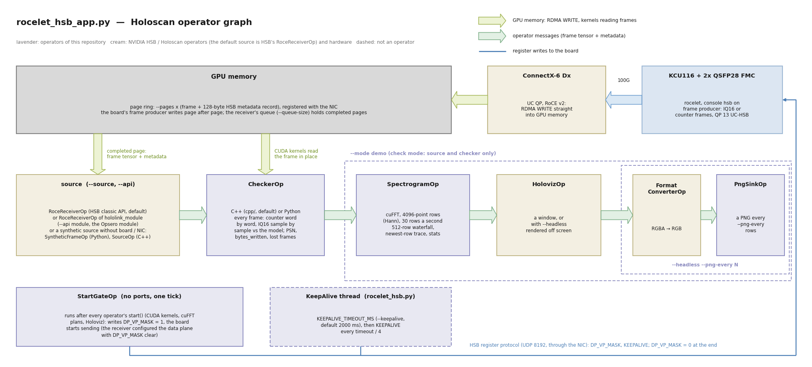

# Holoscan Sensor Bridge host example

`rocelet_hsb.py` receives frames from the qsfp28-fmc-rocelet design's Holoscan Sensor Bridge
(HSB) device mode with NVIDIA's HSB host software, version 3.0.0, through its "classic"
`hololink` Python API. It uses the Linux-UDP receiver (`LinuxReceiver`): an ordinary UDP
socket, any NIC, no RDMA and no GPU memory registration. The device side is described in
`docs/source/hsb.md`. `rocelet_hsb_app.py` (below) is the Holoscan application: RoCE receiver
into GPU memory, a checker operator (C++ in `cpp/`, or Python) and a spectrogram demo in
Holoviz. `module/` is the Opsero `hololink_module` for HSB's module API.

Status: written against the HSB 3.0.0 sources (tag `3.0.0`, commit 6f0b259) and run against
the board (KCU116 + OP120, a Lenovo P520 with a ConnectX-6 Dx, 2026-10-31): enumeration,
register access, `Hololink.reset()`, counter and IQ16 frames, MTU 4200 and 1500, and the
Holoscan application with the C++ and Python checkers, the start gate, the keepalive, the
resync handling and the module API (hardware sessions F and G, design release 0.3.0). The
measured numbers are below.

## Requirements

- The board: KCU116 + 2x QSFP28 FMC (OP120), port 0 cabled to the host's 100G port, the
  qsfp28-fmc-rocelet bitstream with console 0.3.0 or later. On the console (UART, 115200 8N1):

  ```
  rl> hsb on
  ok HSB on: BOOTP every second from 192.168.20.2, register protocol on UDP 8192, serial ...
  ```

- The host: NVIDIA's HSB container image built from the holoscan-sensor-bridge repository at
  tag 3.0.0 (`docker/build.sh`), run with `--net host` so that it sees the 100G interface,
  for example:

  ```
  docker run --rm -it --gpus all --runtime=nvidia --net host --privileged \
      -v $PWD:/work -w /work hololink-demo:3.0.0 bash
  ```

  `--privileged` (as in HSB's own `docker/demo.sh`) lets the script enlarge its socket
  receive buffer (`SO_RCVBUFFORCE`, `--rcvbuf`, default 64 MiB). The board sends each frame as
  a line-rate burst (1 MiB in about 90 us) whatever the frame rate, and the kernel's default
  limit (`net.core.rmem_max`, 208 KB) drops most of a 1 MiB frame. Without `--privileged`,
  raise the limit on the host instead (`sysctl -w net.core.rmem_max=134217728`).

- The host interface on the board's subnet (192.168.20.0/24 with the board at 192.168.20.2
  by default; the console's `ip` command or `hololink-set-ip` changes it) and an MTU of at
  least 4200 bytes on that interface.

## MTU: `use_mtu(4200)`

The HSB host sets the packet size from the enumeration metadata `mtu`, default 1500: the
host then programs `DP_PACKET_SIZE` = (1500 - 74) / 128 = 11, i.e. 1408-byte payloads. The
rocelet engine's path MTU is a power of two, so the firmware rounds down to 1024 bytes. For
4096-byte packets (4.0 times fewer packets per frame), the application calls
`hololink.DataChannel.use_mtu(metadata, 4200)` before it creates the `DataChannel`, as
`rocelet_hsb.py` does (`--mtu`), and the host interface runs an MTU of at least 4200.

## The device identity (UUID)

The board announces the Opsero UUID `98183d0f-18ee-4719-a3b4-ca69e9b94c97` (compat-id
0x2603, HSB IP version 0x2603). The HSB host accepts a UUID it does not know: the classic API
gives it a default enumeration strategy with 2 sensors, 2 data planes and 2 SIFs per sensor.
The board has one sensor and one data plane, so `rocelet_hsb.py` registers the exact shape
first:

```python
hololink.Enumerator.set_uuid_strategy(
    "98183d0f-18ee-4719-a3b4-ca69e9b94c97",
    hololink.BasicEnumerationStrategy(total_sensors=1, total_dataplanes=1, sifs_per_sensor=1))
```

The vendor field "NVDA" in the board's BOOTP packet is a protocol constant that the HSB host
requires; it does not claim that the board is an NVIDIA product. HSB's module API
(`hololink_module`) loads a device module chosen by UUID and compat-id: the Opsero module for
this board is in `module/` (see "Opsero hololink_module" below).

## Opsero registers

Besides the HSB registers, the firmware answers vendor registers at 0x7F000000 (C names in
`Vitis/common/src/hsb_regs.h`, Python names in `rocelet_hsb.py`). SOURCE and SCENE apply when
the host next enables the data plane (DP_VP_MASK 0 to 1), RATE_MBPS also while it runs (from the
next frame); all three survive an HSB reset:

| Address | Name | Access | Values |
|---|---|---|---|
| 0x7F000000 | ID | R | "OPSR" (0x4F505352) |
| 0x7F000004 | SOURCE | RW | 0 IQ16 test signal (default), 1 counter pattern, 2 beam array generator (`sw/beam/`) |
| 0x7F000008 | RATE_MBPS | RW | frame rate limit in Mb/s (frame + 128-byte metadata), 0 = none, default 1000 |
| 0x7F00000C | SCENE | RW | IQ16 scene: 1 survey (default), 2 radar, 3 tones, 4 noise |
| 0x7F000010 | FRAMES | R | frames completed since the producer last started (enable or link-pause resume) |
| 0x7F000014 | STATUS | R | [0] producer running [1] data plane enabled [2] paused for the link [3] link pause on [4] keepalive armed |
| 0x7F000020 | KEEPALIVE_TIMEOUT_MS | RW | producer watchdog: 0 = off (default); otherwise the board stops sending when no KEEPALIVE write arrived for this many ms while the data plane is enabled. One-shot (back to 0 when it fires), cleared by an HSB reset and `hsb on`; a write restarts the timer |
| 0x7F000024 | KEEPALIVE | RW | write any value: restart the timer; read: ms since it last restarted |
| 0x7F000028 | WATCHDOG_COUNT | R | watchdog stops since `hsb on` (kept across HSB resets) |
| 0x7F00002C | LINKPAUSE_COUNT | R | link pauses since `hsb on` (kept across HSB resets) |

**Keepalive.** `rocelet_hsb.py` and `rocelet_hsb_app.py` arm the watchdog (`--keepalive`,
default 2000 ms; 0 = off): after `Hololink.reset()` (which clears it) and before the data plane
starts they write KEEPALIVE_TIMEOUT_MS, and a thread writes KEEPALIVE every timeout / 4. A
killed or hung application therefore stops the board within the timeout; the next run needs no
manual step. The application's JSON summary lists STATUS, WATCHDOG_COUNT and LINKPAUSE_COUNT
before and after the run. A stock HSB application does not write the timeout and gets the
stock behaviour (the board streams until DP_VP_MASK is cleared).

**Link pause.** When the link drops while the data plane runs, the firmware pauses the
producer and resumes it about 2 s (LINK_GRACE) after the link is back. The resumed run starts
at frame number 0, the first page and IQ16 sample 0 (the PSN carries on). The checkers treat
this as a **resync** (counted, logged, a new accounting segment; no frame-number gap and no data
error; the frames lost across it are derived from the PSN step and counted as lost).

Counter pattern: 64-bit little-endian word *w* of a frame = (frame number[15:0] << 48) |
(8 *w*), so every word says where it belongs. The IQ16 signal is 16-bit I / Q pairs (4 tones,
a sawtooth chirp and noise; `rocelet_iq.py` is its bit-exact model).

## Usage

```
# what announces itself on the network (HSB's own tool works too: hololink-enumerate)
python3 rocelet_hsb.py --enumerate

# register access (HSB's hololink-read / hololink-write tools work too)
python3 rocelet_hsb.py --read 0x80                 # HSB_IP_VERSION = 0x00002603
python3 rocelet_hsb.py --write 0x1000 0x12345678   # a data-plane register, read back

# 100 frames of 1 MiB, counter pattern, checked word by word, 1 Gb/s
python3 rocelet_hsb.py --frames 100

# IQ16 frames at 2 Gb/s (size and arrival are checked, not the samples)
python3 rocelet_hsb.py --source iq --rate-mbps 2000 --frames 100
```

A run resets the board's HSB state (`Hololink.reset()`), selects the source and the rate,
configures one data plane (`DataChannel.configure_roce` with the receiver's socket port) and
prints one line, then PASS or FAIL. The Linux-UDP receiver parses every packet in software:
on the test host (Xeon Skylake-SP, ConnectX-6 Dx) 1 MiB frames were clean up to 8 Gb/s
(`--rate-mbps 8000`) and dropped packets at 16 Gb/s. The RoCE receiver (`RoceReceiverOp`, a
ConnectX NIC) is the path for higher rates: into GPU memory it was clean up to 80 Gb/s on the
same host, whose NIC-to-GPU path ends at about 81 Gb/s. Keep `--rate-mbps` below what the
host can take: above it the NIC drops packets of every kind, including the board's register
replies, and an unpaced stream (`--rate-mbps 0`, 97.6 Gb/s) into that GPU lost most packets.

The script switches the data plane off when it ends, also on Ctrl-C or SIGTERM; if it dies
without that (`kill -9`), the keepalive watchdog stops the board after `--keepalive` ms (with
`--keepalive 0`: `hsb off` on the console, a `Hololink.reset()` or `hololink-write 0x0200030C
0` stops it).

# Holoscan application: `rocelet_hsb_app.py`

A Holoscan application for the same device mode, with the frames in GPU memory:



* The source (HSB's `RoceReceiverOp` with the classic or the module API, or a synthetic
  source) emits every completed page of the GPU page ring; `CheckerOp` (C++ or Python) checks
  every frame; in demo mode `SpectrogramOp` (cuFFT) and `HolovizOp` (a window, or headless
  with PNG snapshots) follow.
* `StartGateOp` enables the board's data plane once every operator has started; the
  keepalive thread feeds the board's producer watchdog.
* The diagram is generated by `docs/source/images/gen_block_diagram.py`; the docs page
  "Holoscan Sensor Bridge device mode" explains it.

| File | What |
|---|---|
| `rocelet_hsb_app.py` | the application and its operators |
| `rocelet_hsb_kernels.cu` | CUDA kernels, compiled at start-up (CuPy / NVRTC): checkers, generators, spectrogram |
| `rocelet_iq.py` | the IQ16 test signal as a bit-exact numpy model, the four scenes, a check of a saved frame |
| `rocelet_hsb.py` | board control used by the application (`connect`, `connect_module`, `select_source`, `start_data_plane` / `stop_data_plane`, `KeepAlive`, `board_counters`) |
| `cpp/` | the C++ operators (`rocelet_hsb_ops` Python module): `CheckerOp` and the synthetic `SourceOp`; `cpp/build.sh` |
| `module/` | the Opsero `hololink_module` (module API), its build script and tests |

**Modes.** `--mode check` runs the checker only and prints a stats line every second, a JSON
summary at the end and PASS or FAIL (exit code 0 / 1). `--mode demo` adds the spectrogram:
IQ16 frames, 4096-point FFT rows (Hann window, |X|^2 summed per row, -Fs/2 on the left,
1024 columns, 0 dBFS = a full-scale complex tone), 30 rows a second, a 512-row waterfall with
a trace of the newest row and a text overlay (rate, frames, check results), in a Holoviz
window or, with `--headless`, rendered off screen and saved as PNG every `--png-every` rows.

**Sources.** `--source roce`: the board, through HSB's `RoceReceiverOp` (a UC QP on a ConnectX
NIC, frames written by the NIC straight into GPU memory, `--pages` x (frame + 128 B) of GPU
memory registered). The application resets the board's HSB state, writes the Opsero registers
(`--data iq|counter`, `--rate` in Gb/s, `--scene`), and the receiver configures the data plane
when the graph starts and unconfigures it when it stops; the application also writes
DP_VP_MASK 0 in its `finally` (Ctrl-C, SIGTERM, `--duration`, `--frames`, an exception).
`--source synthetic`: no board, no NIC: a generator writes frames into a GPU page ring laid
out as the board writes it (frame, then the 128-byte metadata record) and emits them with the
receiver's metadata; `--data file --synthetic-file F --file-frame-number N` replays a saved
frame; fault injection (`--corrupt-every`, `--drop-every`, `--psn-bad-every`, `--overrun-every`,
`--restart-every`) makes it a self-test. `--source csynthetic`: the C++ synthetic source, built
like HSB's `RoceReceiverOp` (a producer thread fills the page ring as the board and the NIC
would, an asynchronous condition wakes the operator, which only emits): with `--rate R` frames
complete on the board's timeline and HSB's receive queue (`--queue-size`) drops its oldest frame
when the application falls behind, as on hardware; `--rate 0` keeps the queue full and measures
the application's ceiling.

**Checkers.** `--checker cpp` (default when `cpp/` is built) is the C++ operator, `--checker py`
the Python one; both check the same things and report the same numbers (the self-tests give
identical counts). The C++ checker needs no Python per frame: one kernel launch and the
accounting per frame, the results copied back once a second in the background.

Build the C++ operators once, inside the container (pybind11 2.13.6 is fetched):

```
cpp/build.sh                         # -> cpp/build/rocelet_hsb_ops.cpython-312-x86_64-linux-gnu.so
```

**Host APIs.** `--api classic` (default): HSB's `hololink` API; `--api module`: HSB's module
API with the Opsero module (`--module-dir` or `HOLOLINK_MODULE_DIR`, see "Opsero
hololink_module" below).

**Start order.** Holoscan calls `start()` of every operator before the first `compute()` of any
of them, and HSB's `RoceReceiverOp.start()` configures the board, so the board used to stream
while the rest of the graph was still starting (CUDA kernel loading, cuFFT plans,
Holoviz/Vulkan): the first frame reached the checker ~0.7 s late, hundreds to thousands of
frames were recycled at start-up, and the 80 Gb/s demo start cost 881-1,269 PHY discards on the
ConnectX-6 (hardware session F). With `--start-gate on` (default) the receiver configures the
data plane with the sensor's `vp_mask` set to 0 in the enumeration metadata, so
`DataChannel.configure_roce` writes every data-plane register but leaves DP_VP_MASK clear; a
one-tick `StartGateOp`, which runs only after every `start()` has returned, sets DP_VP_MASK
bit 0 `--start-delay` seconds later (default 0). Keep it 0 at high rates: an idle GPU drops to a
low-power PCIe state within about a second (P520: P8, PCIe Gen1), and a line-rate start into it
overflows the NIC (80 Gb/s demo after a 1 s delay: ~420,000 CX-6 PHY discards, frames lost and
frames with holes in the first second; none with 0 s). Stopping writes DP_VP_MASK 0 explicitly (`unconfigure()` no longer clears it).
`--start-gate off` restores HSB's behaviour.

**Receiver scheduling.** HSB's receivers can wake the graph through an asynchronous condition
per frame (`--frame-ready async`); once the stream outruns the application the delivered rate
then decays: under the greedy scheduler always (hardware session F: 2,000 -> 160 frames/s at
40 Gb/s), under the event-based scheduler with 2 workers in most runs (the C++ board model at
80 Gb/s delivered 20-50 % of the frames in 5 of 6 runs, 99 % in one). With `--frame-ready
blocking` (default for the classic API and the C++ synthetic source) the receiver has no
condition and its `compute()` waits for the next frame (HSB's classic `RoceReceiverOp`
`use_frame_ready_condition=False`), and the greedy scheduler alternates receiver and checker:
no decay. The module API's `RoceReceiverOp` only has the asynchronous mode (event-based
scheduler, 2 workers).

**Keepalive and link pause.** See "Opsero registers" above: `--keepalive` (default 2000 ms) arms
the board's producer watchdog and refreshes it from a thread; a producer restart after a link
pause is a counted **resync**, not an error.

**What the checker checks** (one kernel launch per frame; results collected once a second):

* data: the counter pattern word by word, or the IQ16 signal sample by sample against the
  model (sample n of the run = frame number x samples per frame + offset); a mismatching
  word that equals the data of a *later* frame of the same page is counted as **overrun**
  (the board reused the page before the checker read it: more `--pages`, a lower rate),
  anything else as an **error**;
* the metadata record: PSN = the immediate's PSN, PSN advancing by packets per frame
  (ceil(frame / PMTU) + 1) x the frame-number step, bytes_written = the frame size;
* frames: frames **lost** on the network = the board's frame-number span minus the receiver's
  completion count (`received_frame_number`) over the same frames; the other frame-number gaps
  are `consumer-dropped` (completed at the receiver, recycled before the application took them);
  a frame number that falls back below `--resync-window` (4096) while the PSN does not follow
  the frame-number step is a producer restart (**resync**): a new accounting segment starts,
  the IQ16 sample count is re-anchored, and the frames lost across it (PSN step / packets per
  frame minus receiver completions) count as lost.
  HSB's own `dropped` counter is not used for this: RoceReceiver stamps it on the newly arriving
  frame when it recycles the oldest queued one, so it runs up to `--queue-size` - 1 frames ahead
  of the gaps (reported as `hsb_dropped` in the JSON summary only).

PASS = frames received, 0 errors, 0 lost, 0 PSN or bytes_written errors. A run also FAILs when the
board's producer watchdog stopped the data plane during it (WATCHDOG_COUNT moved) or when no frame
arrived in the last 3 s of a `--duration` run (frames lost at the tail leave no gap to count).
IQ16 scene 3 (tones)
repeats every 8 samples, so a stale or reused page cannot be told from the right one: check
with scene 1 (survey) or 4 (noise), whose noise differs at every sample.

**Measured on the test host** (Lenovo P520: Xeon Skylake-SP, RTX PRO 4000 Blackwell; 1 MiB frames;
80 Gb/s = 9,530 frames/s = 105 us per frame). GPU time per frame: 13 us for the counter check,
27 us for the IQ16 check (C++ checker, timed with CUDA events), 12 us for the 64 x 4096-point FFT.
With the C++ board model (`--source csynthetic`):

| Checker | 80 Gb/s board timeline: frames checked | frames/s | host us per frame (p50) | CPU cores (application) | ceiling (`--rate 0`) |
|---|---|---|---|---|---|
| C++, counter | 99.82 / 99.92 / 99.95 % (3 runs of 30 s) | 9,516-9,528 | 20 | 0.6 | 17,000-19,000 frames/s |
| C++, IQ16 scene 1 | 99.68 / 99.89 % | 9,502-9,522 | 20 | 0.6 | 15,000 frames/s |
| Python, counter | 93.9 % | 8,952 | 46 | 1.0 | 7,400 frames/s |
| Python, IQ16 | 93.2 % | 8,888 | 47 | 0.9 | 6,900 frames/s |

(blocking receiver scheduling, greedy scheduler, `--queue-size 8`; CPU from the per-thread
counters in a 3-s steady-state window, without the synthetic source's producer thread, which
stands for the board and the NIC; the ceiling rows use the event-based scheduler.) Frames the
application cannot take are dropped by the receiver and reported as `consumer-dropped`, not as
errors; `--check-every N` checks every Nth frame's data (every frame's metadata). Inside a
Holoscan operator a CuPy kernel call costs ~20 us, so the Python checker launches its kernels
through `cuLaunchKernel` (ctypes, ~6 us) and the spectrogram uses a prebuilt cuFFT plan.

**Measured with the board** (KCU116 + OP120, ConnectX-6 Dx, the same host and GPU, console
0.3.0, hardware session G; 1 MiB frames, blocking receiver scheduling, greedy scheduler, start
gate, keepalive 2000 ms):

| Run (80 Gb/s unless noted) | frames checked of the board's | frames/s | CPU cores (application) |
|---|---|---|---|
| C++ checker, counter, `--queue-size 8`, 5 min | 99.66 % (2 min: 99.36 %) | 9,502 | 0.88 |
| C++ checker, IQ16 scene 1, `--queue-size 8`, 5 min | 99.68 % | 9,503 | 0.87 |
| C++ checker, counter, `--queue-size 32` (default), 5 min | 99.87 % | 9,521 | 0.86 |
| C++ checker, IQ16 scene 1, defaults, 3 min | 99.97 % | 9,530 | 0.87 |
| Python checker, counter, 2 min | 96.4 % | 9,192 | 1.24 |
| C++ checker, `--frame-ready async --threads 2`, 1 min | 88.5 % | 8,432 | 2.0 |
| demo (checker + spectrogram + Holoviz headless), 30 s | 91-95 % | 8,400-9,000 | 1.2 |
| module API (async only), C++ checker, 30 s | 91.5 % | 8,719 | 2.0 |
| module API, 40 Gb/s, C++ / Python checker | 100 % / 99.4 % | 4,765 / 4,738 | 1.3 / 1.5 |

Every run: 0 errors, 0 lost, 0 PSN errors, 0 CX-6 PHY discards (with the start gate and
`--start-delay 0`), first frame at the checker 1 ms after the data-plane enable, 0 start-up
drops (gate off: 54 in check mode, 9,988 in the demo). Frames the application could not take
came in bursts of 60-500 (host stalls), which the deeper queue absorbs. Hardware session F
(Python checker, asynchronous scheduling, before the C++ checker and the blocking mode) took at
most ~5,200 frames/s, 54 % of the frames at 80 Gb/s.

## Running it

In NVIDIA's HSB container, from this directory. With the board (RoCE, a ConnectX NIC, the GPU):

```
docker run --rm -it --gpus all --runtime=nvidia --net host --privileged \
    -v $PWD:/work -w /work hololink-demo:3.0.0 bash

python3 rocelet_hsb_app.py --mode check --data counter --rate 10 --duration 600
python3 rocelet_hsb_app.py --mode check --data iq --scene 1 --rate 40 --duration 600
python3 rocelet_hsb_app.py --mode demo --rate 10 --headless --png-every 30 --duration 30 --outdir out
python3 rocelet_hsb_app.py --mode demo --rate 10          # Holoviz window (DISPLAY, -v /tmp/.X11-unix)
```

Module API (Opsero module built, see below), and the Python checker for comparison:

```
HOLOLINK_MODULE_DIR=module/build/lib/hololink/modules python3 rocelet_hsb_app.py --api module --rate 10 --duration 60
python3 rocelet_hsb_app.py --checker py --rate 40 --duration 60
```

Without the board (any NVIDIA GPU):

```
python3 rocelet_hsb_app.py --source csynthetic --mode check --rate 80 --duration 30    # board model, 80 Gb/s
python3 rocelet_hsb_app.py --source csynthetic --mode check --rate 0 --duration 15     # ceiling
python3 rocelet_hsb_app.py --source csynthetic --rate 0 --frames 20000 --restart-every 4999  # resync test
python3 rocelet_hsb_app.py --source synthetic --mode check --data iq --rate 0 --frames 20000
python3 rocelet_hsb_app.py --source synthetic --mode check --rate 0 --frames 10000 \
    --corrupt-every 1000 --drop-every 777 --psn-bad-every 1500 --overrun-every 1300 \
    --restart-every 4999                                                              # self-test
python3 rocelet_hsb_app.py --source synthetic --mode demo --scene 1 --rate 10 --headless --duration 20
```

With injected faults the verdict compares what was detected with what was injected.

Holoviz needs Vulkan from the NVIDIA driver inside the container
(`NVIDIA_DRIVER_CAPABILITIES=all` or `graphics,display,...`; HSB's `docker/demo.sh` sets it).
On a host with a headless (compute-only) driver the Vulkan library is missing: unpack the
`libnvidia-gl-<branch>` package of exactly the host driver version somewhere, mount it into
the container and point the loader at it, for example:

```
-v <dir>:/opt/nvgl:ro --device /dev/nvidia-modeset \
-e VK_ICD_FILENAMES=<an nvidia_icd.json whose library_path is /opt/nvgl/usr/lib/x86_64-linux-gnu/libGLX_nvidia.so.0> \
-e __EGL_VENDOR_LIBRARY_FILENAMES=/opt/nvgl/usr/share/glvnd/egl_vendor.d/10_nvidia.json \
-e LD_LIBRARY_PATH=/opt/nvgl/usr/lib/x86_64-linux-gnu:/usr/local/cuda/lib64
```

`--viz none` runs the spectrogram without Holoviz.

## The IQ16 model

`rocelet_iq.py` reproduces the board's IQ16 samples exactly (the integer arithmetic of the
RTL generator `iq16_gen`, the scenes as the firmware programs them). Check a
frame saved from the board (frame bytes only) by its frame number:

```
python3 rocelet_iq.py --check frame.bin --frame-number 600 --scene 1
```

A 1 MiB IQ16 frame saved on the test host (frame number 600, scene 1, 1 Gb/s) matched the
model in all 262,144 samples.

# Opsero hololink_module (`module/`)

HSB 3.0.0 has two host APIs. The "classic" `hololink` API (used by `rocelet_hsb.py` and by
default by `rocelet_hsb_app.py`) works with any UUID once the application declares the board's
shape (`set_uuid_strategy`). The module API (`hololink_module`, frozen V1 interfaces) instead
loads a device module chosen by the announcement: `hololink_<uuid>_<compat-id>.so` (falling
back to `hololink_<uuid>.so`) from `$HOLOLINK_MODULE_DIR`, or from
`<site-packages>/lib/hololink/modules` in NVIDIA's container. Without a module for the UUID the
enumeration metadata reaches the application unenriched and no device services (control plane,
data channels, receivers) are available.

`module/` builds the Opsero module for this board,
**`hololink_98183d0f-18ee-4719-a3b4-ca69e9b94c97_2603.so`**: NVIDIA's canonical HSB-IP publisher
(`module_core::HsbIpPublisher`) with one sensor on data plane 0 and one SIF (vp_mask 1, SIF
0x01000000, VP 0x1000, HIF 0x02000300), no I2C, clock synthesiser or MIPI D-PHY
(`update_board_metadata` stamps nothing). The source is MIT; NVIDIA's headers and module_core
sources (Apache-2.0) are used from a holoscan-sensor-bridge checkout, not copied.

Build it inside the HSB container, pointing at the holoscan-sensor-bridge checkout (tag
3.0.0) the container was built from:

```
docker run --rm -it --gpus all --runtime=nvidia -v $PWD:/work -v <hsb checkout>:/hsb:ro \
    -w /work hololink-demo:3.0.0 bash
sw/hsb/module/build.sh /hsb sw/hsb/module/build
export HOLOLINK_MODULE_DIR=$PWD/sw/hsb/module/build/lib/hololink/modules
```

(or copy the `.so` into `/usr/local/lib/python3.12/dist-packages/lib/hololink/modules` of an
image you build on top of NVIDIA's). Tests without the board (bridge network; the emulator
part needs root in the container for its raw sockets):

```
python3 sw/hsb/module/test_module.py --module-dir $HOLOLINK_MODULE_DIR
```

They check that an announcement with the board's UUID and compat-id loads the module and comes
back enriched, that sensor 1 and data plane 1 are refused and another UUID gets no module, and,
with NVIDIA's HSB emulator announcing the board's identity on the container's loopback: the
module API finds it, reads HSB_IP_VERSION through the module's control plane, receives counter
frames through the module's Linux data channel, and the deferred data-plane start (below) works.

**Using the module API.** `rocelet_hsb_app.py --api module` runs the Holoscan application on
it (Python: `hololink_module.Adapter`, `HololinkInterfaceV1`, `hololink_module.operators.
RoceReceiverOp`); `--module-dir` or `HOLOLINK_MODULE_DIR` selects the module. The module API's
`RoceReceiverOp` picks the RDMA device from the board's IP address (no `--ibv-name`) and does not
pass the receiver's completion count to the frame metadata, so the checker reports frame-number
gaps (lost + consumer-dropped together) instead of separate counts. It also passes the board's
16-bit frame number as is and no `imm_data`: the checkers extend the frame number themselves (a
forward step of less than 32,768 across 0 is a wrap, anything else a producer restart). A C++ application does the
same:

```cpp
auto& adapter = hololink::module::Adapter::get_adapter();       // loads the Opsero module
auto metadata = adapter.wait_for_channel("192.168.20.2", std::chrono::seconds(10));
adapter.use_mtu(metadata, 4200);                                // 4096-byte packets
auto hololink = hololink::module::HololinkInterfaceV1::get_service(metadata);
hololink->start();
hololink->reset();
// Opsero registers: counter pattern, 10 Gb/s, keepalive watchdog 2000 ms (then refresh 0x7F000024)
hololink->write_uint32({ 0x7F000004, 0x7F000008, 0x7F000020 }, { 1, 10000, 2000 });
// in compose(): hololink::module::operators::RoceReceiverOp with
//   Arg("enumeration_metadata", metadata), Arg("frame_context", ctx), Arg("frame_size", 1 << 20),
//   Arg("pages", 64u), Arg("queue_size", 8u)  -> your operators (frames in GPU memory)
```

Link the application against `hololink::module` (the HSB installation's CMake package
`Hololink`); see HSB's `examples/module_*_player.cpp` for complete programs.
